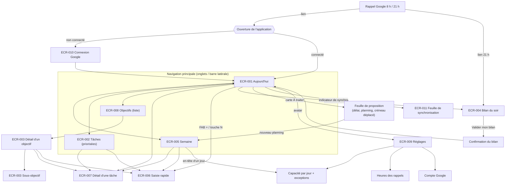
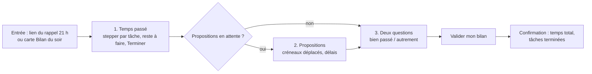
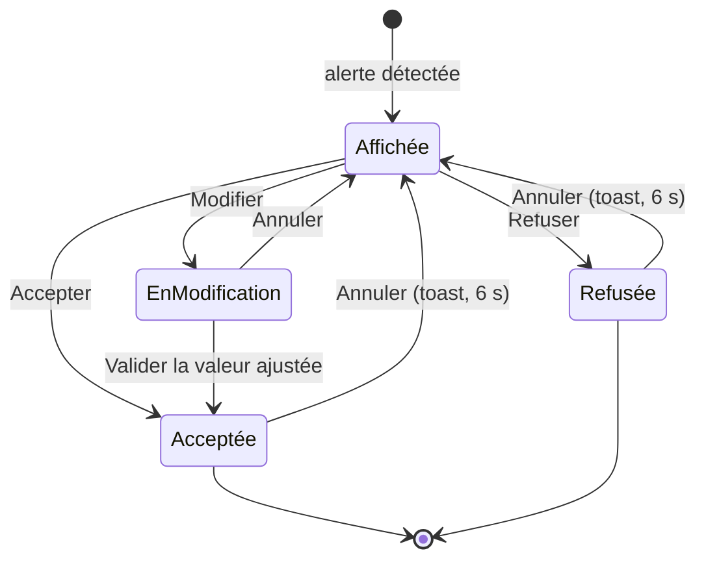
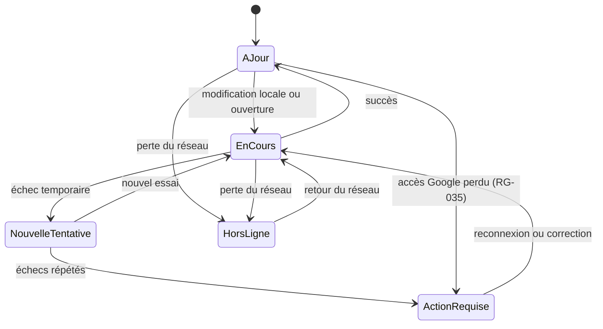

# Parcours utilisateurs

> **Version 0.1, 2026-10-20 (Steeve).** Socle UX initial, hors cycle de lot. Entrées : cahier des charges v0.3, backlog v0.3 (US-001 à US-036), DAT v0.1 (brouillon). Les écrans cités (`ECR-xxx`) sont inventoriés dans le [guide d'ergonomie, §13](guide-ergonomie.md#13-inventaire-des-écrans). Les choix qui dépendent d'une question ouverte portent la mention **(sous réserve de Q-…)**.

## 1. Persona

### Le commanditaire : « Camille », pilote de ses propres objectifs
*(prénom fictif, utilisé pour rendre les parcours lisibles ; le persona est l'utilisateur unique de l'application, RG-018)*

| | |
|---|---|
| **Situation** | Travailleur autonome sur ses propres objectifs. Organise seul ses journées. |
| **Appareils** | Smartphone (usage **prioritaire**, souvent en mobilité, parfois sans réseau) ; PC pour les séances de préparation plus longues. |
| **Outils actuels** | Google Calendar, au quotidien. |
| **Ce qu'il veut** | Savoir chaque matin quoi faire ; vérifier que ses délais tiennent ; mesurer son temps réel et son rythme ; ajuster ses objectifs en conséquence ; garder la maîtrise de ses données (espace personnel). |
| **Ce qui le freine** | Les saisies fastidieuses ; les outils qui décident à sa place ; les alertes qui culpabilisent sans proposer de solution ; devoir ressaisir sur un appareil ce qu'il a fait sur l'autre. |
| **Rythme** | 8 h : rappel du matin (tâches du jour + fun fact). Journée de travail. 21 h : rappel du soir (temps passé, reste à faire, deux questions de bilan). Le week-end, préparation de la semaine. |
| **Indicateur de réussite pour lui** | Moins de 2 minutes par jour passées à « gérer l'outil » (saisie du soir comprise), des délais crédibles, une vélocité qui se stabilise. |

**Conséquences de conception** (rappel du guide d'ergonomie) : ouverture sur Aujourd'hui ; saisie du temps par stepper de 30 min ; propositions toujours explicables et refusables ; fonctionnement identique hors ligne ; synchronisation visible mais discrète.

---

## 2. Parcours clés

Les étapes indiquent l'écran, l'action et le nombre de gestes visé. « Geste » = un appui, un balayage ou une touche.

### P-01 — Journée type, du matin au soir

| # | Moment | Ce que fait Camille | Écran | Ce que fait l'application | Gestes |
|---|---|---|---|---|---|
| 1 | 8 h 00 | Reçoit le rappel du matin dans Google Agenda : 4 tâches du jour, une alerte de délai, un fun fact. | Rappel Google | Rappel préparé à l'avance (RG-012), alerte incluse (RG-007), fun fact (US-035). | 0 |
| 2 | 8 h 05 | Ouvre l'application sur son smartphone. | ECR-001 Aujourd'hui | Affiche immédiatement les données de l'appareil, puis synchronise (indicateur discret). Une tâche porte « Reportée d'hier » (RG-032). | 1 |
| 3 | 8 h 06 | Voit la carte « Délai difficile à tenir » : accepte le nouveau délai proposé. | ECR-001, carte « À traiter » | Applique, toast « Annuler ». | 1 |
| 4 | 8 h 07 | Constate que la jauge affiche « +30 min au-delà de votre capacité ». Balaye une tâche vers la gauche et choisit « Demain ». | ECR-001 → feuille « Planifier le… » | Jauge à jour ; créneau Google déplacé (RG-034). | 2 |
| 5 | 10 h 30 | Une idée lui vient : FAB « + », tape l'intitulé, puces « Vendredi » et « 1 h », Entrée. | Saisie rapide | Tâche ajoutée, planifiée aujourd'hui (contexte), horaire suggéré à venir. | 4 + frappe |
| 6 | 12 h 00 | Termine une tâche : appui sur la case ronde. | ECR-001 | Tâche barrée, puis rangée dans « Terminées » ; toast « Annuler ». | 1 |
| 7 | 15 h 00 | Dans le métro, sans réseau, termine une autre tâche. | ECR-001 | Indicateur « Hors ligne · 1 en attente », aucune fonction bloquée (RG-021). | 1 |
| 8 | 21 h 00 | Reçoit le rappel du soir, avec le lien vers le bilan. | Rappel Google | (Q-DEM001-40) | 1 |
| 9 | 21 h 01 | Fait son bilan : voir P-04. | ECR-004 | — | ≈ 10 |

**Points de vigilance** : la carte « À traiter » ne doit pas masquer la liste du jour (2 cartes maximum) ; l'état hors ligne ne doit pas inquiéter (pas de bandeau).

### P-02 — Créer un objectif et ses tâches

| # | Ce que fait Camille | Écran | Ce que fait l'application | Gestes |
|---|---|---|---|---|
| 1 | Onglet Objectifs, bouton principal « Nouvel objectif ». | ECR-008 → feuille de création | Champs : intitulé, délai (facultatif, RG-002), importance (RG-030, échelle sous réserve de Q-DEM001-35.3), objectif parent (facultatif, US-023). | 2 |
| 2 | Saisit « Publier le guide pratique », délai 15 déc., importance haute. « Créer ». | Feuille | Ouvre directement le détail du nouvel objectif. | 4 + frappe |
| 3 | Arrive sur l'objectif vide : « À décliner en tâches » (sous réserve de Q-DEM001-26.3). | ECR-003 | Action principale : « Ajouter une tâche ». | 0 |
| 4 | Ajoute 5 tâches à la suite : la saisie rapide reste ouverte entre deux ajouts, objectif pré-rempli. | Saisie rapide | Chaque tâche apparaît dans la liste de l'objectif. | ≈ 4 par tâche |
| 5 | Une tâche a un délai (20 déc.) postérieur à celui de l'objectif. | ECR-003 | Accepte, et affiche l'alerte « Après le délai de l'objectif "Publier le guide pratique" » (RG-024). | 0 |
| 6 | Ajoute un sous-objectif « Relecture » et y rattache 2 tâches. | ECR-003 → section Sous-objectifs | Le sous-objectif apparaît avec sa progression (US-023 ; profondeur : Q-DEM001-24). | ≈ 6 |
| 7 | Décompose une tâche en 3 sous-tâches depuis son détail. | ECR-007 | La ligne de la tâche affiche « 0/3 » (US-024). | ≈ 3 par sous-tâche |
| 8 | Rattache une tâche existante à un second objectif. | ECR-007, champ Objectifs | Puces d'objectifs ; la tâche apparaît dans les deux objectifs (RG-001). | 3 |

### P-03 — Planifier la semaine

| # | Ce que fait Camille | Écran | Ce que fait l'application | Gestes |
|---|---|---|---|---|
| 1 | Dimanche soir, sur PC, ouvre Semaine. | ECR-005 | Affiche les 7 prochains jours (sous réserve de Q-DEM001-36.2) avec la jauge de chaque jour, la capacité réduite par les événements de l'agenda (US-019) et la colonne « À planifier ». | 1 |
| 2 | Voit la carte « Planning proposé : 11 tâches placées ». | ECR-005 | Les tâches proposées sont marquées « Proposé » (bordure pointillée) dans les jours (US-027). | 0 |
| 3 | Déplace 2 tâches d'un jour à l'autre (glisser-déposer ou `Alt` + `→`). | ECR-005 | Jauges recalculées ; dépassement signalé sans blocage (RG-011). | 2 |
| 4 | Change la capacité du mercredi (rendez-vous médical) : exception datée. | ECR-005 → en-tête du jour → feuille Capacité | Libellé « Exception » sur le jour (US-005). | 3 |
| 5 | « Valider le planning ». | ECR-005 | Tâches planifiées ; horaires suggérés calculés ; créneaux créés dans l'agenda principal (US-020). Indicateur « Synchronisation… » puis « À jour ». | 1 |
| 6 | Le lendemain, sur smartphone, retrouve le même planning. | ECR-001 | Données synchronisées (RG-017). | 0 |

Variante smartphone : les 7 jours sont empilés verticalement ; le déplacement se fait par la feuille « Planifier le… » (2 gestes) au lieu du glisser-déposer.

### P-04 — Saisie du soir et bilan

| # | Ce que fait Camille | Écran | Ce que fait l'application | Gestes |
|---|---|---|---|---|
| 1 | Ouvre le bilan depuis le lien du rappel de 21 h ou depuis la carte « Bilan du soir » d'Aujourd'hui. | ECR-004 | Liste les tâches planifiées aujourd'hui et celles qui ont reçu du temps passé aujourd'hui (RG-013). | 1 |
| 2 | **Étape 1 : Temps passé.** Pour chaque tâche, ajuste le stepper (pas de 30 min). Le reste à faire calculé s'affiche dessous (RG-009). | ECR-004 | Pré-remplit le temps déjà saisi dans la journée ; « — » si rien. Temps total du jour en en-tête. | 1 à 3 par tâche |
| 3 | Coche « Terminée » pour une tâche finie. | ECR-004 | La tâche est terminée (RG-026). | 1 |
| 4 | Corrige le reste à faire d'une tâche (appui sur la valeur, stepper). | ECR-004 | Le reste corrigé est conservé (sous réserve de Q-DEM001-31.1). Si l'estimation est dépassée : alerte « Estimation dépassée » (RG-009). | 2 |
| 5 | **Étape 2 : Propositions** (s'il y en a). Voit « Créneau déplacé : Rédiger l'introduction, mardi → jeudi ». Accepte. | ECR-004 | Replanification appliquée après validation uniquement (RG-037). | 1 |
| 6 | **Étape 3 : Deux questions.** « Ce qui s'est bien passé aujourd'hui », « Ce que j'aurais aimé faire autrement ». Saisit deux phrases (ou passe : réponses facultatives sous réserve de Q-DEM002-2). | ECR-004 | Réponses enregistrées (US-033 ; conservation et relecture : Q-DEM002-3, US-034). | frappe |
| 7 | « Valider mon bilan ». | ECR-004 | Enregistre ; écran de confirmation sobre : temps total du jour, tâches terminées, « À demain ». Les tâches non terminées planifiées aujourd'hui seront reportées (RG-032). | 1 |

Le bilan est une seule page défilante, découpée en 3 sections numérotées, et non un assistant à plusieurs écrans : Camille voit d'emblée la longueur du bilan et peut sauter une section.

### P-05 — Traiter une alerte de délai non tenable

| # | Ce que fait Camille | Écran | Ce que fait l'application | Gestes |
|---|---|---|---|---|
| 1 | Lit dans le rappel du matin : « Attention : "Publier le guide pratique" ne tiendra pas le 15 déc. à votre rythme actuel. » | Rappel Google | Alerte reprise dans le rappel (RG-007). | 0 |
| 2 | Ouvre l'application : carte critique « Délai difficile à tenir » en tête de « À traiter ». | ECR-001 | Pourquoi : « À votre rythme moyen (9 h/sem.), il faut encore 3 semaines ; il en reste 2. » Comparatif : 15 déc. → 22 déc. (valeur de vélocité et travail restant : sous réserve de Q-DEM001-30). | 1 |
| 3a | **Accepter** : le délai devient 22 déc. | ECR-001 | Toast « Délai modifié · Annuler ». La carte disparaît. | 1 |
| 3b | **Modifier** : sélecteur de date pré-rempli au 22 déc. ; choisit le 20 déc. | Feuille date | Si le 20 déc. reste non tenable, l'application le dit dans la feuille avant validation (« Encore difficile à tenir »), sans bloquer. | 2 à 3 |
| 3c | **Autre proposition** : « Voir le nouveau planning » (proposition de nouveau planning, US-011). | ECR-005 | Tâches déplacées marquées « Proposé » ; « Valider le planning ». | 2 |
| 3d | **Refuser** | ECR-001 | Carte fermée, icône d'alerte conservée sur l'objectif et ses tâches. Réapparition : sous réserve de Q-ERG-07. | 1 |

### P-06 — Créneau déplacé dans Google Calendar

| # | Ce que fait Camille | Écran | Ce que fait l'application | Gestes |
|---|---|---|---|---|
| 1 | Dans Google Agenda, déplace le créneau « Rédiger l'introduction » de mardi 10 h à jeudi 14 h. | Google Agenda | — | — |
| 2 | Ouvre l'application plus tard. | ECR-001 | Le déplacement est détecté à l'ouverture ou à la synchronisation suivante, pas en temps réel (DAT v0.1, F2). Carte d'attention « Créneau déplacé dans votre agenda » : « Vous avez déplacé "Rédiger l'introduction" de mardi à jeudi. Une replanification vous sera proposée ce soir. » (RG-037). Point sur l'onglet Aujourd'hui. | 1 |
| 3 | (Option, sous réserve de Q-ERG-05) « Traiter maintenant ». | Feuille de proposition | Même proposition qu'au soir. | 1 |
| 4 | Le soir, dans le bilan, étape « Propositions » : « Planifier "Rédiger l'introduction" jeudi 23 » (jour proposé : sous réserve de Q-DEM001-33.2). | ECR-004 | Accepter / Modifier / Refuser. | 1 |
| 5a | **Accepter** : la tâche passe au jeudi. | ECR-004 | Jauge de jeudi recalculée ; dépassement signalé le cas échéant. | 1 |
| 5b | **Modifier** : choisit vendredi. | Feuille « Planifier le… » | Le créneau Google est déplacé au vendredi, à l'horaire suggéré. | 2 |
| 5c | **Refuser** : la tâche reste au mardi. | ECR-004 | Comportement du créneau Google en cas de refus : **à préciser** (Q-ERG-11). | 1 |

Cas particuliers dépendant de Q-DEM001-33 : créneau déplacé dans la même journée (33.3), créneau supprimé (33.4).

---

## 3. Enchaînement des écrans

### 3.1 Vue d'ensemble

### 3.2 Bilan du soir (ECR-004)

### 3.3 Proposition (modèle commun)

### 3.4 Synchronisation (indicateur)

---

## 4. Points ouverts propres aux parcours

| Id | Parcours | Point | Renvoi |
|---|---|---|---|
| PO-01 | P-06 | Si Camille refuse la replanification après un déplacement de créneau, que devient le créneau dans Google : remis au jour planifié dans l'application, ou laissé tel quel (incohérence entre l'agenda et l'application) ? | Q-ERG-11 du guide d'ergonomie (à rattacher à Q-DEM001-33) |
| PO-02 | P-04 | Bilan non fait le soir : proposé le lendemain ? | Q-ERG-04 |
| PO-03 | P-01 | Ordre des tâches dans Aujourd'hui. | Q-ERG-06 |
| PO-04 | P-03 | Validation du planning proposé en bloc ou tâche par tâche. | Q-ERG-10 |

## 5. Historique
| Version | Date | Auteur | Modification |
|---|---|---|---|
| 0.1 | 2026-10-20 | Steeve | Création : persona, parcours P-01 à P-06, diagrammes d'enchaînement. |
