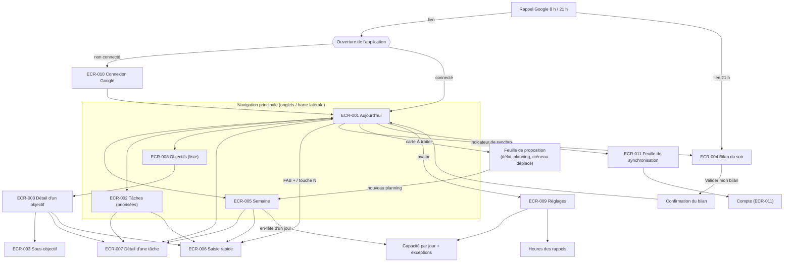
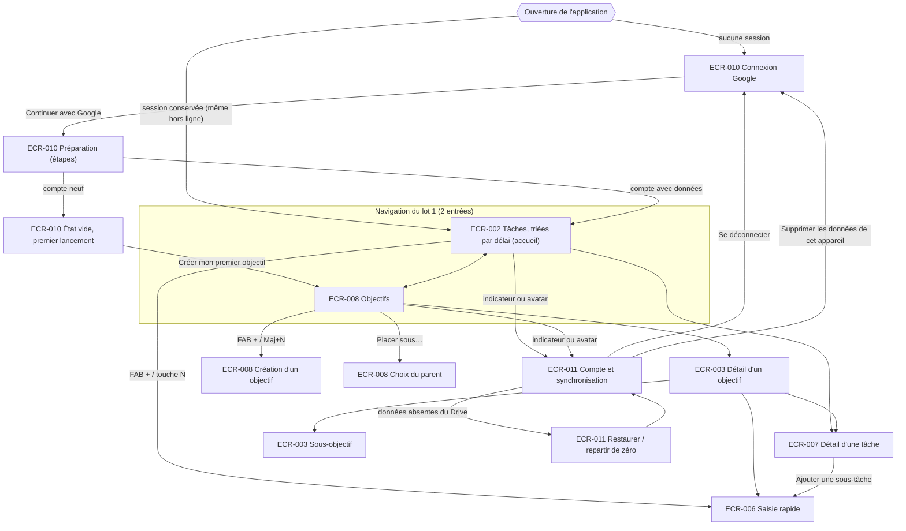
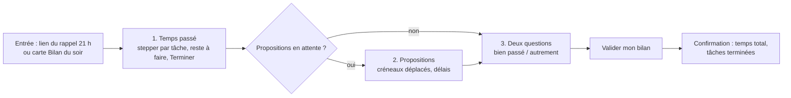
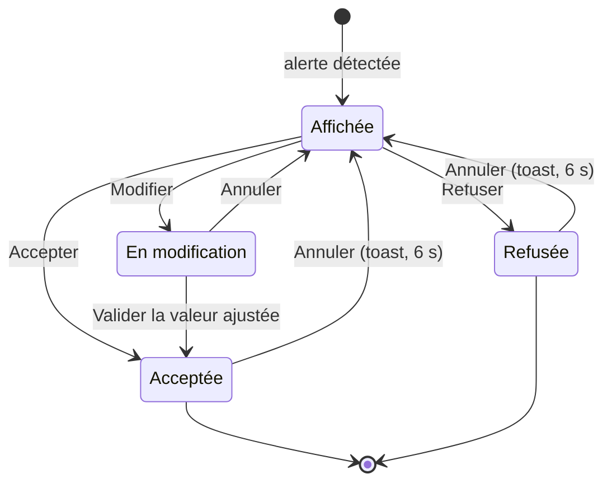
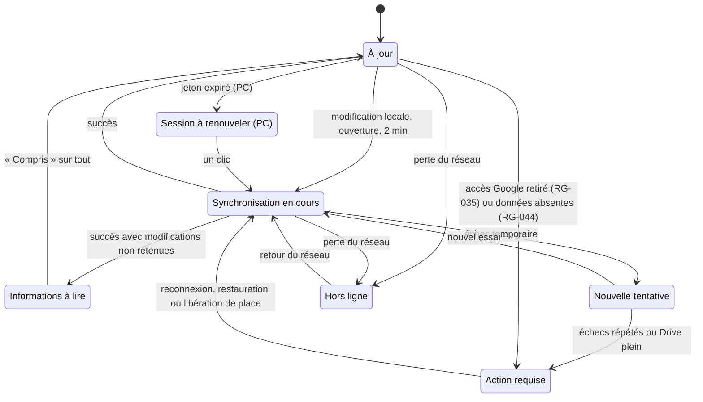
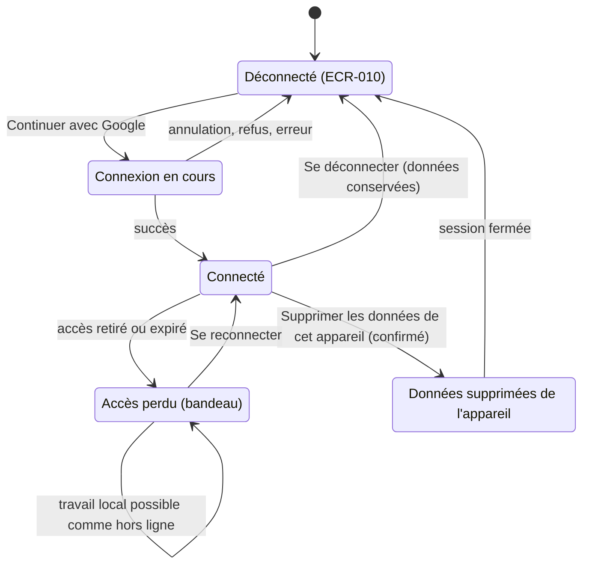
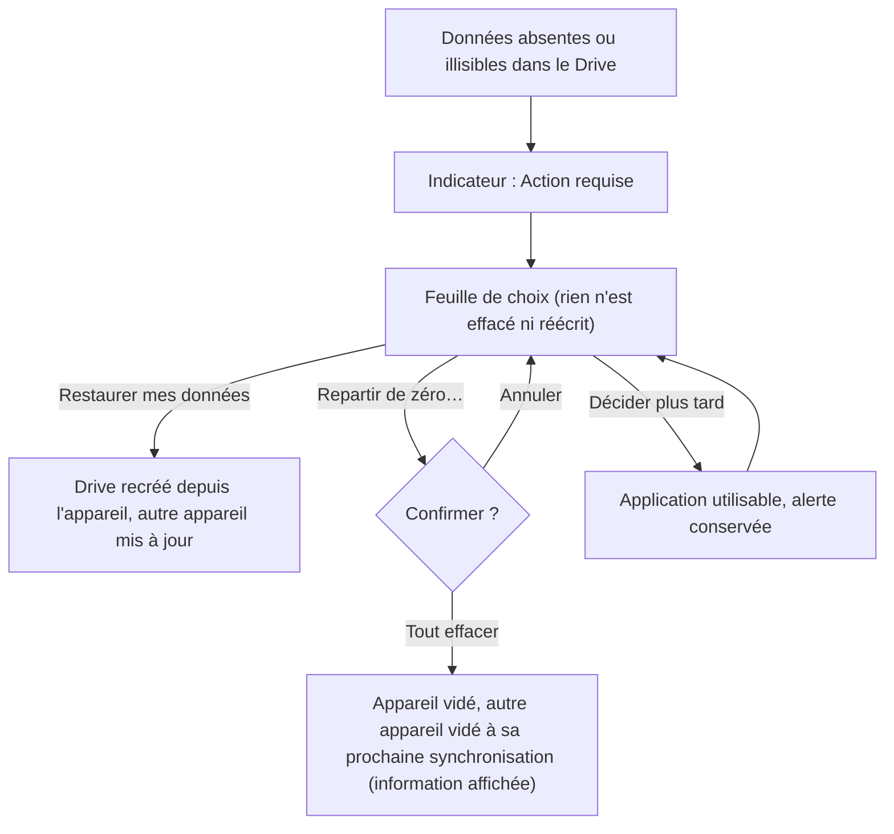

# Parcours utilisateurs

> **Version 0.2.1, 2026-10-21 (Steeve).** Mise à jour de l'étape E4 de LOT-001. La v0.1 (2026-10-20) était le socle UX initial, hors cycle de lot. Entrées de la v0.2 : LOT-001 et ses 10 US, cahier des charges v0.5, DAT v0.4, décisions DEC-001 à DEC-016, réponses Q-ERG-02 à 11. Les écrans cités (`ECR-xxx`) sont inventoriés dans le [guide d'ergonomie, §13](guide-ergonomie.md#13-inventaire-des-écrans). Les choix qui dépendent d'une question ouverte portent la mention **(sous réserve de Q-…)**.
>
> **Lecture par lot.** P-01, P-03, P-04, P-05 et P-06 sont des parcours **cibles** (lots « Planification », « Rappels », « Suivi du temps », « Pilotage »). Le **lot 1** livre P-02 (adapté), P-07 à P-13 (nouveaux) et les étapes hors ligne de P-01. Chaque parcours indique ce qui change en v0.2.

## 1. Persona

### Le commanditaire : « Camille », pilote de ses propres objectifs
*(prénom fictif, utilisé pour rendre les parcours lisibles ; le persona est l'utilisateur unique de l'application, RG-018)*

| | |
|---|---|
| **Situation** | Travailleur autonome sur ses propres objectifs. Organise seul ses journées. |
| **Appareils** | Smartphone (usage **prioritaire**, souvent en mobilité, parfois sans réseau) ; PC pour les séances de préparation plus longues. |
| **Outils actuels** | Google Calendar, au quotidien. |
| **Ce qu'il veut** | Savoir chaque matin quoi faire ; vérifier que ses délais tiennent ; mesurer son temps réel et son rythme ; ajuster ses objectifs en conséquence ; garder la maîtrise de ses données (espace personnel). |
| **Ce qui le freine** | Les saisies fastidieuses ; les outils qui décident à sa place ; les alertes qui culpabilisent sans proposer de solution ; devoir ressaisir sur un appareil ce qu'il a fait sur l'autre. |
| **Rythme** | 8 h : rappel du matin (tâches du jour + fun fact). Journée de travail. 21 h : rappel du soir (temps passé, reste à faire, deux questions de bilan). Le week-end, préparation de la semaine. |
| **Indicateur de réussite pour lui** | Moins de 2 minutes par jour passées à « gérer l'outil » (saisie du soir comprise), des délais crédibles, une vélocité qui se stabilise. |

**Conséquences de conception** (rappel du guide d'ergonomie ; **v0.2** : au lot 1, ouverture sur Tâches faute de planification, Q-ERG-12) : ouverture sur Aujourd'hui ; saisie du temps par stepper de 30 min ; propositions toujours explicables et refusables ; fonctionnement identique hors ligne ; synchronisation visible mais discrète.

---

## 2. Parcours clés

Les étapes indiquent l'écran, l'action et le nombre de gestes visé. « Geste » = un appui, un balayage ou une touche.

### P-01 — Journée type, du matin au soir *(parcours cible ; au lot 1 : étapes 5, 6 et 7 sur l'écran Tâches)*

| # | Moment | Ce que fait Camille | Écran | Ce que fait l'application | Gestes |
|---|---|---|---|---|---|
| 1 | 8 h 00 | Reçoit le rappel du matin dans Google Agenda : 4 tâches du jour, une alerte de délai, un fun fact. | Rappel Google | Rappel préparé à l'avance (RG-012), alerte incluse (RG-007), fun fact (US-035). | 0 |
| 2 | 8 h 05 | Ouvre l'application sur son smartphone. | ECR-001 Aujourd'hui | Affiche immédiatement les données de l'appareil, puis synchronise (indicateur discret). **(v0.2)** La liste du jour suit l'ordre de priorité (RG-051) et non celui des horaires. Une tâche porte « Reportée d'hier » (RG-032). | 1 |
| 3 | 8 h 06 | Voit la carte « Délai difficile à tenir » : accepte le nouveau délai proposé. | ECR-001, carte « À traiter » | Applique, toast « Annuler ». | 1 |
| 4 | 8 h 07 | Constate que la jauge affiche « +30 min au-delà de votre capacité ». Balaye une tâche vers la gauche et choisit « Demain ». | ECR-001 → feuille « Planifier le… » | Jauge à jour ; créneau Google déplacé (RG-034). | 2 |
| 5 | 10 h 30 | Une idée lui vient : FAB « + », tape l'intitulé, puces « Vendredi » et « 1 h », Entrée. | Saisie rapide | Tâche ajoutée, planifiée aujourd'hui (contexte), horaire suggéré à venir. | 4 + frappe |
| 6 | 12 h 00 | Termine une tâche : appui sur la case ronde. | ECR-001 | Tâche barrée, puis rangée dans « Terminées » ; toast « Annuler ». | 1 |
| 7 | 15 h 00 | Dans le métro, sans réseau, termine une autre tâche. | ECR-001 | Indicateur « Hors ligne · 1 en attente », aucune fonction bloquée (RG-021). | 1 |
| 8 | 21 h 00 | Reçoit le rappel du soir, avec le lien vers le bilan. | Rappel Google | (Q-DEM001-40) | 1 |
| 9 | 21 h 01 | Fait son bilan : voir P-04. | ECR-004 | — | ≈ 10 |

**Points de vigilance** : la carte « À traiter » ne doit pas masquer la liste du jour (2 cartes maximum) ; l'état hors ligne ne doit pas inquiéter (pas de bandeau). **(v0.2)** Le fun fact du matin reste masquable (RG-040) ; le bilan du soir est accessible dès 17 h (RG-039).

### P-02 — Créer un objectif et ses tâches *(lot 1, adapté en v0.2)*

| # | Ce que fait Camille | Écran | Ce que fait l'application | Gestes |
|---|---|---|---|---|
| 1 | Onglet Objectifs, bouton principal « Nouvel objectif ». | ECR-008 → feuille de création | Champs : intitulé (obligatoire), description (facultative), délai (facultatif, « Sans délai » par défaut, RG-002), objectif parent (facultatif, US-023). **(v0.2)** L'importance (RG-030) n'est pas demandée au lot 1 (US-030). | 2 |
| 2 | Saisit « Publier le guide pratique », délai 15 déc. « Créer ». | Feuille | Ouvre directement le détail du nouvel objectif. | 4 + frappe |
| 3 | Arrive sur l'objectif vide : « À décliner en tâches » (US-001 CA-8). | ECR-003 | Action principale : « Ajouter une tâche ». | 0 |
| 4 | Ajoute 5 tâches à la suite : la saisie rapide reste ouverte entre deux ajouts, objectif pré-rempli. **(v0.2)** Délai et estimation sont toujours choisis explicitement (Q-ERG-03). | Saisie rapide | Chaque tâche apparaît dans la liste de l'objectif. | ≈ 4 par tâche |
| 5 | Une tâche a un délai (20 déc.) postérieur à celui de l'objectif. | ECR-003 | Accepte, et affiche l'alerte « Après le délai de l'objectif "Publier le guide pratique" » (RG-024). | 0 |
| 6 | Ajoute un sous-objectif « Relecture » et y rattache 2 tâches. | ECR-003 → section Sous-objectifs | Le sous-objectif apparaît avec sa progression (US-023, un seul niveau). Sur un sous-objectif, « Ajouter un sous-objectif » n'est pas proposé. | ≈ 6 |
| 7 | Décompose une tâche en 3 sous-tâches depuis son détail. | ECR-007 | La ligne de la tâche affiche « 0/3 » (US-024). Pour la première, l'estimation de la tâche sera remplacée par la somme : le message le dit avant l'enregistrement. | ≈ 3 par sous-tâche |
| 8 | Rattache une tâche existante à un second objectif. | ECR-007, champ Objectifs | Puces d'objectifs ; la tâche apparaît dans les deux objectifs (RG-001). | 3 |

### P-03 — Planifier la semaine

| # | Ce que fait Camille | Écran | Ce que fait l'application | Gestes |
|---|---|---|---|---|
| 1 | Dimanche soir, sur PC, ouvre Semaine. | ECR-005 | Affiche les 7 prochains jours (sous réserve de Q-DEM001-36.2) avec la jauge de chaque jour, la capacité réduite par les événements de l'agenda (US-019) et la colonne « À planifier ». | 1 |
| 2 | Voit la carte « Planning proposé : 11 tâches placées ». | ECR-005 | Les tâches proposées sont marquées « Proposé » (bordure pointillée) dans les jours (US-027). | 0 |
| 3 | Déplace 2 tâches d'un jour à l'autre (glisser-déposer ou `Alt` + `→`). | ECR-005 | Jauges recalculées ; dépassement signalé sans blocage (RG-011). **(v0.2, Q-ERG-08)** Un jour postérieur au délai de la tâche est possible, avec une alerte. | 2 |
| 4 | Change la capacité du mercredi (rendez-vous médical) : exception datée. | ECR-005 → en-tête du jour → feuille Capacité | Libellé « Exception » sur le jour (US-005). | 3 |
| 5 | **(v0.2, Q-ERG-10)** Valide le planning **tâche par tâche** (et non en bloc). *ECR-005 est à aligner au lot « Planification ».* | ECR-005 | Tâches validées une à une ; horaires suggérés calculés ; créneaux créés dans l'agenda principal (US-020). Indicateur « Synchronisation… » puis « À jour ». | 1 par tâche |
| 6 | Le lendemain, sur smartphone, retrouve le même planning. | ECR-001 | Données synchronisées (RG-017). | 0 |

Variante smartphone : les 7 jours sont empilés verticalement ; le déplacement se fait par la feuille « Planifier le… » (2 gestes) au lieu du glisser-déposer.

### P-04 — Saisie du soir et bilan

| # | Ce que fait Camille | Écran | Ce que fait l'application | Gestes |
|---|---|---|---|---|
| 1 | Ouvre le bilan depuis le lien du rappel de 21 h ou depuis la carte « Bilan du soir » d'Aujourd'hui. **(v0.2, Q-ERG-04)** Il est accessible avant 21 h, et le lendemain pour la veille non faite (RG-039). | ECR-004 | Liste les tâches planifiées aujourd'hui et celles qui ont reçu du temps passé aujourd'hui (RG-013). | 1 |
| 2 | **Étape 1 : Temps passé.** Pour chaque tâche, ajuste le stepper (pas de 30 min). Le reste à faire calculé s'affiche dessous (RG-009). | ECR-004 | Pré-remplit le temps déjà saisi dans la journée ; « — » si rien. Temps total du jour en en-tête. | 1 à 3 par tâche |
| 3 | Coche « Terminée » pour une tâche finie. | ECR-004 | La tâche est terminée (RG-026). | 1 |
| 4 | Corrige le reste à faire d'une tâche (appui sur la valeur, stepper). | ECR-004 | Le reste corrigé est conservé (sous réserve de Q-DEM001-31.1). Si l'estimation est dépassée : alerte « Estimation dépassée » (RG-009). | 2 |
| 5 | **Étape 2 : Propositions** (s'il y en a). Voit « Créneau déplacé : Rédiger l'introduction, mardi → jeudi ». Accepte. | ECR-004 | Replanification appliquée après validation uniquement (RG-037). | 1 |
| 6 | **Étape 3 : Deux questions.** « Ce qui s'est bien passé aujourd'hui », « Ce que j'aurais aimé faire autrement ». Saisit deux phrases (ou passe : réponses facultatives sous réserve de Q-DEM002-2). | ECR-004 | Réponses enregistrées (US-033 ; conservation et relecture : Q-DEM002-3, US-034). | frappe |
| 7 | « Valider mon bilan ». | ECR-004 | Enregistre ; écran de confirmation sobre : temps total du jour, tâches terminées, « À demain ». Les tâches non terminées planifiées aujourd'hui seront reportées (RG-032). | 1 |

Le bilan est une seule page défilante, découpée en 3 sections numérotées, et non un assistant à plusieurs écrans : Camille voit d'emblée la longueur du bilan et peut sauter une section.

### P-05 — Traiter une alerte de délai non tenable

| # | Ce que fait Camille | Écran | Ce que fait l'application | Gestes |
|---|---|---|---|---|
| 1 | Lit dans le rappel du matin : « Attention : "Publier le guide pratique" ne tiendra pas le 15 déc. à votre rythme actuel. » | Rappel Google | Alerte reprise dans le rappel (RG-007). | 0 |
| 2 | Ouvre l'application : carte critique « Délai difficile à tenir » en tête de « À traiter ». | ECR-001 | Pourquoi : « À votre rythme moyen (9 h/sem.), il faut encore 3 semaines ; il en reste 2. » Comparatif : 15 déc. → 22 déc. (valeur de vélocité et travail restant : sous réserve de Q-DEM001-30). | 1 |
| 3a | **Accepter** : le délai devient 22 déc. | ECR-001 | Toast « Délai modifié · Annuler ». La carte disparaît. | 1 |
| 3b | **Modifier** : sélecteur de date pré-rempli au 22 déc. ; choisit le 20 déc. | Feuille date | Si le 20 déc. reste non tenable, l'application le dit dans la feuille avant validation (« Encore difficile à tenir »), sans bloquer. | 2 à 3 |
| 3c | **Autre proposition** : « Voir le nouveau planning » (proposition de nouveau planning, US-011). | ECR-005 | Tâches déplacées marquées « Proposé » ; « Valider le planning ». | 2 |
| 3d | **Refuser** | ECR-001 | Carte fermée, icône d'alerte conservée sur l'objectif et ses tâches. **(v0.2, RG-052)** Refuser ne traite pas l'alerte : la carte est réaffichée chaque jour tant que le délai ne tient pas. | 1 |

### P-06 — Créneau déplacé dans Google Calendar

| # | Ce que fait Camille | Écran | Ce que fait l'application | Gestes |
|---|---|---|---|---|
| 1 | Dans Google Agenda, déplace le créneau « Rédiger l'introduction » de mardi 10 h à jeudi 14 h. | Google Agenda | — | — |
| 2 | Ouvre l'application plus tard. | ECR-001 | Le déplacement est détecté à l'ouverture ou à la synchronisation suivante, pas en temps réel (DAT, F2 ; hors du délai d'une heure, DEC-014). Carte d'attention « Créneau déplacé dans votre agenda » avec **« Traiter maintenant »** en action principale (RG-037). Point sur l'onglet Aujourd'hui. | 1 |
| 3 | **(v0.2, Q-ERG-05 « oui »)** « Traiter maintenant » : la proposition s'ouvre en feuille, sans attendre le soir. | ECR-001 (cadre E) | Accepter / Modifier / Refuser, avec la conséquence du refus écrite sous les boutons. | 1 |
| 4 | S'il ne l'a pas traitée, le soir, dans le bilan, étape « Propositions » : « Planifier "Rédiger l'introduction" jeudi 23 » (jour proposé : sous réserve de Q-DEM001-33.2). Puis chaque jour tant qu'elle n'est pas traitée (RG-052). | ECR-004 | Accepter / Modifier / Refuser. | 1 |
| 5a | **Accepter** : la tâche passe au jeudi. | ECR-004 | Jauge de jeudi recalculée ; dépassement signalé le cas échéant. | 1 |
| 5b | **Modifier** : choisit vendredi. | Feuille « Planifier le… » | Le créneau Google est déplacé au vendredi, à l'horaire suggéré. | 2 |
| 5c | **Refuser** | ECR-001 (E) / ECR-004 | **(v0.2, Q-ERG-11 a)** Le créneau est **supprimé de l'agenda Google** et la tâche est **déplanifiée**. Toast : « Créneau supprimé de votre agenda · Tâche non planifiée · Annuler ». L'alerte est traitée. | 1 |

Cas particuliers dépendant de Q-DEM001-33 : créneau déplacé dans la même journée (33.3), créneau supprimé dans l'agenda (33.4).

### P-07 — Première connexion *(lot 1, nouveau)*
Écrans : ECR-010, puis ECR-002 ou ECR-010 C. US-022, US-017.

| # | Ce que fait Camille | Écran | Ce que fait l'application | Gestes |
|---|---|---|---|---|
| 1 | Ouvre l'application (Google Play en test interne sur le smartphone, adresse web sur le PC). | ECR-010 A | Seule l'invitation à se connecter est affichée : un bouton, et ce que l'application demande à Google (identité, dossier « Done Juan », rien d'autre). Aucune donnée, aucune autre fonction (CA-1). | 0 |
| 2 | Appuie sur « Continuer avec Google ». | ECR-010 A | Ouvre la connexion Google. | 1 |
| 3 | Choisit son compte et accepte les accès. | Écran Google (hors maquette) | **Aucun avertissement « application non validée »** au lot 1 (ENF-08). | 1 à 2 |
| 4 | Attend quelques secondes. | ECR-010 B | Étapes : compte identifié, dossier trouvé ou créé dans le Drive, récupération des données. Annulation possible. Moins de 10 s sur 4G. | 0 |
| 5a | **Compte neuf** : arrive sur l'état vide. | ECR-010 C | « Créer mon premier objectif » (principal) ou « Ajouter une tâche sans objectif ». | 1 |
| 5b | **Compte avec données (nouvel appareil)** : retrouve ses objectifs et ses tâches. | ECR-002 | Les données du Drive s'affichent ; l'indicateur passe à « À jour ». | 0 |

Variantes : connexion annulée ou autorisation refusée → ECR-010 D (rien n'est créé) ; pas de réseau → ECR-010 E (« Réessayer ») ; Drive indisponible pour ce compte → ECR-010 F (« Choisir un autre compte »). Gestes pour un compte neuf : 3 à 4.

### P-08 — Se déconnecter, se reconnecter, changer de compte *(lot 1, nouveau)*
Écrans : ECR-011, ECR-010. US-022 (CA-6, CA-9), RG-043, DEC-016.

| # | Ce que fait Camille | Écran | Ce que fait l'application | Gestes |
|---|---|---|---|---|
| 1 | Appuie sur l'avatar (ou sur l'indicateur de synchronisation). | ECR-011 A | Ouvre la feuille « Compte et synchronisation ». | 1 |
| 2 | Appuie sur « Se déconnecter ». | ECR-011 | S'il y a des modifications en attente : dialogue « Se déconnecter ? » avec leur nombre et la promesse de leur enregistrement à la prochaine connexion (F1). Sinon, déconnexion immédiate. | 1 (+ 1) |
| 3 | Revient à l'écran de connexion. | ECR-010 G | « Vous êtes déconnecté. Vos données sont conservées sur cet appareil. » Aucune donnée affichée. | 0 |
| 4a | **Même compte** : se reconnecte. | ECR-010 A → ECR-002 | Retrouve toutes ses données ; les modifications en attente sont envoyées au Drive. Sans réseau : la reconnexion est impossible et le dit (ECR-010 E). | 2 à 3 |
| 4b | **Un autre compte B** se connecte sur le même appareil (par exemple appareil prêté). | ECR-010 → ECR-002 | B arrive sur **son propre espace**. Aucun indice de l'existence des données de A (RG-018, DEC-016). | 2 à 3 |
| 4c | A se reconnecte plus tard sur cet appareil. | ECR-010 → ECR-002 | Retrouve toutes ses données et ses modifications en attente, qui sont envoyées. | 2 à 3 |

### P-09 — Travailler hors ligne, retrouver ses données, lire les modifications non retenues *(lot 1, nouveau)*
Écrans : ECR-002, ECR-007, ECR-008, ECR-011. US-017, US-018, US-031 (smartphone et PC).

| # | Ce que fait Camille | Écran | Ce que fait l'application | Gestes |
|---|---|---|---|---|
| 1 | Perd le réseau (métro, avion). | Écran courant | Libellé « Hors ligne » à la place de l'icône, un toast unique : « Hors ligne. Vos modifications sont enregistrées sur l'appareil et seront envoyées au retour du réseau. » Rien n'est désactivé. | 0 |
| 2 | Crée une tâche, en termine une autre, modifie un délai. | ECR-002, ECR-007 | Tout fonctionne comme en ligne. Les lignes modifiées portent le point « en attente d'envoi ». Le libellé passe à « Hors ligne · 3 en attente ». | 3 à 8 |
| 3 | (Option) Ouvre la feuille pour vérifier. | ECR-011 B | Liste lisible des 3 modifications ; « Synchroniser maintenant » est désactivé, avec son explication. | 1 |
| 4 | Retrouve le réseau. | Écran courant | « Synchronisation… » puis « À jour ». **Pas de toast** si tout s'est bien passé. Les modifications de l'autre appareil sont intégrées. | 0 |
| 5 | Une de ses saisies a été écartée par une modification plus récente de l'autre appareil. | Écran courant | Point accent sur l'indicateur et toast « 1 modification n'a pas été retenue · Voir ». | 0 |
| 6 | Appuie sur « Voir ». | ECR-011 C | Élément, information, **valeur non retenue**, valeur conservée. Même traitement pour une suppression qui l'emporte (RG-047) et un déplacement annulé (RG-048). | 1 |
| 7 | Appuie sur « Compris ». | ECR-011 C | La ligne disparaît ; le point s'éteint quand tout est lu. | 1 |

Sur PC, le parcours est identique (DEC-013). Les points propres au PC sont dans P-10.

### P-10 — PC : reprendre la synchronisation après l'expiration de la session Google *(lot 1, nouveau)*
Écrans : ECR-011 H et I. US-031 (CA-5), US-017 (CA-3, F14).

| # | Ce que fait Camille | Écran | Ce que fait l'application | Gestes |
|---|---|---|---|---|
| 1 | Ouvre l'application sur son PC (installée ou dans le navigateur). | ECR-002 | Affiche immédiatement les données du PC. | 1 |
| 2 | Constate l'indicateur en accent « Reprendre la synchronisation » en pied de la barre latérale. | ECR-002 | Aucune interruption, aucun bandeau. Il peut continuer à travailler : tout est conservé sur le PC. | 0 |
| 3 | Clique sur « Reprendre la synchronisation ». | ECR-011 H | Ouvre la fenêtre de session Google si nécessaire, puis « Synchronisation… » : les modifications en attente sont envoyées, celles de l'autre appareil intégrées. | **1** |
| 4 | Deux onglets ouverts. | ECR-011 I | Un seul synchronise. L'autre l'indique dans la feuille seulement. | 0 |

Si le **navigateur** a effacé les données du site, les modifications non envoyées sont perdues (limite de la plateforme) ; elles ne le sont pas dans les autres cas. Cet avertissement figure dans le guide utilisateur.

### P-11 — Les données ont disparu du Drive : restaurer ou repartir de zéro *(lot 1, nouveau)*
Écrans : ECR-011 E. US-017 (CA-9), RG-044.

| # | Ce que fait Camille | Écran | Ce que fait l'application | Gestes |
|---|---|---|---|---|
| 1 | A supprimé par erreur le dossier « Done Juan » dans Google Drive. | Google Drive | — | — |
| 2 | Ouvre l'application. | ECR-011 E | « Action requise » dans l'indicateur et feuille de choix : « Vos données ne sont plus dans votre Google Drive. Cet appareil en garde une copie : 12 objectifs, 47 tâches… » **Rien n'est effacé ni réécrit.** | 0 |
| 3a | **Restaurer mes données** (action principale). | ECR-011 E | Les données sont recréées dans le Drive à partir de l'appareil, puis retrouvées sur l'autre appareil. Toast de confirmation. | 1 |
| 3b | **Repartir de zéro…** | ECR-011 E → confirmation | Dialogue « Effacer toutes vos données sur vos deux appareils ? » avec le nombre de modifications non enregistrées perdues. Après confirmation, l'appareil est vidé. | 2 |
| 3c | **Décider plus tard.** | ECR-011 E | L'application reste utilisable ; l'alerte reste affichée. | 1 |
| 4 | (Choix 3b) Sur l'**autre appareil**, à la prochaine synchronisation. | ECR-011 G | Les données y sont effacées sans reposer la question. Carte d'information : « Vous avez choisi de repartir de zéro sur votre PC. 2 modifications faites ici avant ce choix n'ont pas été conservées. » | 0 |

À ne pas confondre avec « Supprimer les données de cet appareil » (P-12).

### P-12 — Supprimer les données de cet appareil *(lot 1, nouveau)*
Écrans : ECR-011 A, F2, F3. US-022 (CA-10), RG-055, DEC-015.

| # | Ce que fait Camille | Écran | Ce que fait l'application | Gestes |
|---|---|---|---|---|
| 1 | Prête ou cède son téléphone. Appuie sur l'avatar. | ECR-011 A | Ouvre la feuille. L'action n'existe que connecté. | 1 |
| 2 | Appuie sur « Supprimer les données de cet appareil » (texte rouge, isolée). | ECR-011 F2 | Dialogue : les données de l'appareil seront retirées, le Drive et l'autre appareil ne sont pas touchés, vous serez déconnecté. « Annuler » est focalisé. | 1 |
| 3 | Confirme. | ECR-011 F2 | « Enregistrement de vos modifications dans votre Drive… » : le dépôt est tenté d'abord. | 1 |
| 4a | Le dépôt réussit. | ECR-010 | Données retirées, session fermée, retour à la connexion. | 0 |
| 4b | **Le dépôt est impossible** (pas de réseau). | ECR-011 F3 | « 3 modifications seraient perdues. » Il confirme explicitement (« Supprimer quand même ») ou annule : rien n'est alors supprimé. | 1 |
| 5 | Plus tard, se reconnecte avec le même compte. | ECR-010 → ECR-002 | Les données sont rechargées depuis le Drive comme sur un nouvel appareil (réseau nécessaire, P-07 5b). | 2 à 3 |

Les données d'un autre compte conservées sur l'appareil (P-08 4b) ne sont pas touchées et restent invisibles.

### P-13 — Décomposer, terminer et abandonner une tâche *(lot 1, nouveau)*
Écrans : ECR-007, ECR-002, ECR-003. US-024, US-003, US-025, US-002.

| # | Ce que fait Camille | Écran | Ce que fait l'application | Gestes |
|---|---|---|---|---|
| 1 | Ouvre une tâche (appui sur la ligne). | ECR-007 A | Détail : délai, estimation, objectifs, sous-tâches. | 1 |
| 2 | « Ajouter une sous-tâche ». | ECR-007 I | Saisie rapide sans valeur par défaut. La première sous-tâche annonce : « L'estimation de la tâche (3 h) sera remplacée par la somme de ses sous-tâches ». | 4 + frappe |
| 3 | Termine les sous-tâches une à une (case ronde). | ECR-007 A | Compteur « 1/3 » ; l'estimation de la tâche reste la somme des sous-tâches non abandonnées. | 1 chacune |
| 4 | Tente de terminer la tâche alors qu'il reste des sous-tâches. | ECR-007 A | Action principale indisponible, avec la phrase « Il reste 2 sous-tâches à terminer ou abandonner ». | 1 |
| 5 | Termine ou abandonne les dernières, puis termine la tâche. | ECR-007 A | « Terminer la tâche » devient disponible. La tâche reste « à faire » tant qu'il ne la termine pas (US-003 CA-2). Les objectifs concernés sont recalculés. | 1 |
| 6 | (Autre issue) Menu « … » → « Abandonner la tâche… ». | ECR-007 C, D | Confirmation avec le nombre de sous-tâches abandonnées avec elle ; elle passe dans le filtre « Abandonnées ». | 3 |
| 7 | Change d'avis : filtre Abandonnées → la tâche → « Reprendre la tâche ». | ECR-002, ECR-007 F | La tâche et les sous-tâches abandonnées avec elle reviennent « à faire ». | 3 |
| 8 | **Après une synchronisation**, trouve une tâche terminée dont une sous-tâche est à faire (rouverte sur l'autre appareil). | ECR-007 H | Carte d'incohérence, sans correction automatique ; trois issues au choix (rouvrir la tâche, terminer ou abandonner la sous-tâche). | 1 |

---

## 3. Enchaînement des écrans

### 3.1 Vue d'ensemble (cible, tous lots)



### 3.1 bis Navigation du lot 1 (v0.2)



### 3.2 Bilan du soir (ECR-004)



### 3.3 Proposition (modèle commun)



### 3.4 Synchronisation (indicateur), v0.2



### 3.5 Session et compte (v0.2)



Un autre compte B qui se connecte depuis « Déconnecté » arrive dans son propre espace ; l'espace de A est conservé à part et invisible (DEC-016).

### 3.6 Données absentes du Drive (RG-044)



### 3.7 Cycle de vie d'une tâche (v0.2)

```mermaid
stateDiagram-v2
    state "À faire" as AF
    state "Terminée" as T
    state "Abandonnée" as AB
    [*] --> AF : création
    AF --> T : Terminer (refusé s'il reste des sous-tâches à faire)
    T --> AF : Rouvrir
    AF --> AB : Abandonner (confirmation ; sous-tâches à faire abandonnées avec elle)
    AB --> AF : Reprendre (reprend les sous-tâches abandonnées avec elle)
    AF --> [*] : Supprimer (confirmation, définitif)
    T --> [*] : Supprimer
    AB --> [*] : Supprimer
```

Incohérence après synchronisation (RG-049) : une tâche parente « Terminée » ou « Abandonnée » avec une sous-tâche « À faire » reste dans cet état, signalée, jusqu'à ce que l'utilisateur la résolve.

---

## 4. Points ouverts propres aux parcours

| Id | Parcours | Point | Renvoi |
|---|---|---|---|
| ~~PO-01~~ | P-06 | **Résolu (v0.2)** : le refus supprime le créneau de l'agenda et déplanifie la tâche. | Q-ERG-11 a |
| ~~PO-02~~ | P-04 | **Résolu (v0.2)** : bilan accessible avant 21 h et le lendemain. | Q-ERG-04 |
| ~~PO-03~~ | P-01 | **Résolu (v0.2)** : tri par priorité. | Q-ERG-06, RG-051 |
| ~~PO-04~~ | P-03 | **Résolu (v0.2)** : validation tâche par tâche. | Q-ERG-10 |
| PO-05 | P-02, P-07 | Écran d'accueil et navigation du lot 1 (Tâches, deux entrées). | Q-ERG-12 |
| PO-06 | P-13 | Confirmation d'abandon : toujours, ou seulement avec des sous-tâches. | Q-ERG-13 |
| PO-07 | P-09 | Durée de conservation des modifications non retenues. | Q-ERG-14 |
| PO-08 | P-07 | Nom de l'application (écran de connexion, consentement Google, dossier du Drive). | Q-ERG-15 |
| PO-09 | P-03 | ECR-004 et ECR-005 (v0.1) à aligner sur Q-ERG-08 à 10 au lot « Planification ». | Q-ERG-08, 09, 10 |

## 5. Historique
| Version | Date | Auteur | Modification |
|---|---|---|---|
| 0.1 | 2026-10-20 | Steeve | Création : persona, parcours P-01 à P-06, diagrammes d'enchaînement. |
| 0.2 | 2026-10-21 | Steeve | E4 de LOT-001. Parcours cibles P-01, P-03 à P-06 mis à jour des réponses Q-ERG-04 à 11. P-02 adapté au lot 1. Nouveaux parcours P-07 (première connexion), P-08 (déconnexion et changement de compte), P-09 (hors ligne et modifications non retenues), P-10 (reprise de session sur PC), P-11 (restaurer ou repartir de zéro), P-12 (supprimer les données de l'appareil), P-13 (sous-tâches, fin, abandon). Diagrammes 3.1 bis, 3.4 (v0.2), 3.5, 3.6, 3.7. Points ouverts PO-01 à 04 résolus, PO-05 à 09 ajoutés. |
| 0.2.1 | 2026-10-21 | Steeve | Nom « Done Juan » (DEC-017) : application et dossier Drive (V-13), validation E6 de LOT-001 (DEC-018). |
