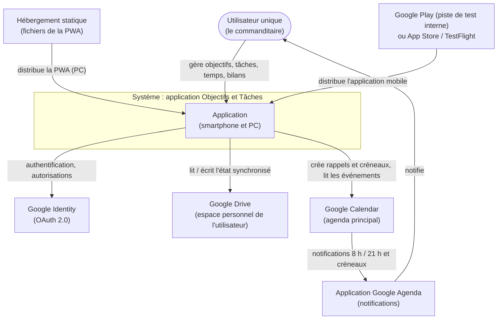
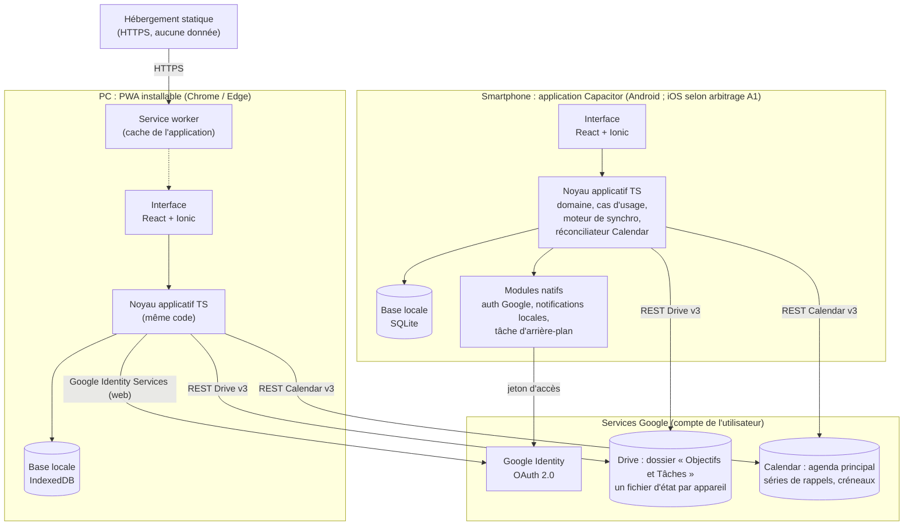
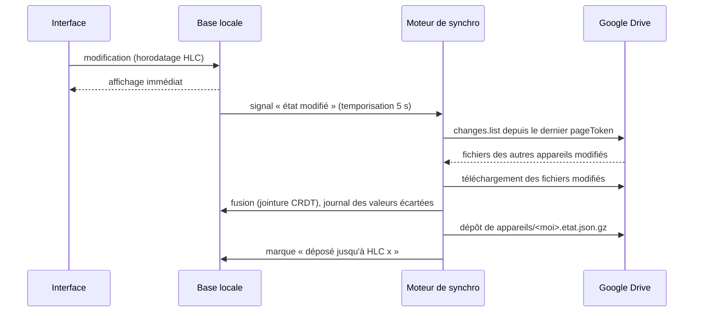
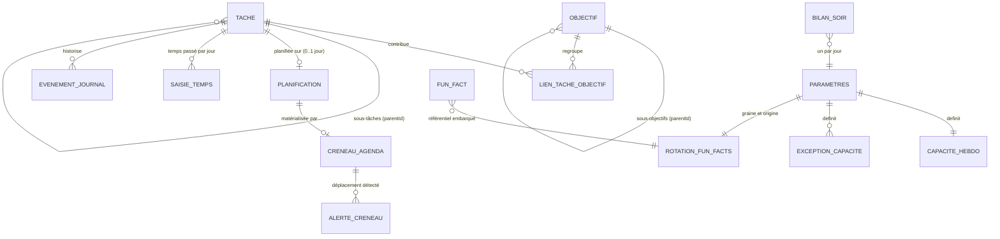

# Dossier d'architecture technique (DAT)

> **Version 0.4 (brouillon), 2026-10-21.** Auteur : Starck, architecte logiciel.
> Socle d'architecture initial, préparé hors cycle de lot, à la demande du commanditaire.
> Toutes les décisions sont au statut **Proposé**. Elles passeront au statut « Accepté » à la clôture (E17) du lot qui les met en œuvre.

## Historique

| Version | Date | Auteur | Origine | Nature de la modification |
|---|---|---|---|---|
| 0.1 | 2026-10-20 | Starck | DEM-001, DEM-002, cahier des charges v0.2 et v0.3, LOT-001 (proposé), réponses Q-DEM001-1 à 20 et compléments du commanditaire | Création. Architecture *local-first* sans serveur applicatif. Base de code TypeScript unique (PWA pour le PC, Capacitor pour le smartphone). Synchronisation par Google Drive (état fusionnable par appareil). Intégration Google Calendar par réconciliation déclarative. ADR-001 à ADR-011 proposés. Avis sur LOT-001 dans `avis-dependances-lot1.md`. Décisions DS-01 à DS-20 et réponses aux points de testabilité d'Anthony (§11). |
| 0.2 | 2026-10-20 | Starck | **DEC-011** (commanditaire) : « le fuseau horaire est celui de l'appareil, on enregistre en base les éléments en utc » | ADR-011 révisé : la journée est celle du fuseau de l'appareil (RG-008 maintenue), les instants sont stockés en UTC ; l'option « fuseau de l'agenda » est écartée. Introduction d'un fuseau technique unique pour l'agenda (`Parametres.fuseauAgenda`, valeur selon Q-DEM001-37). Mise à jour de §4.4.1, §6.1, §6.4, §8 (F3 réécrit, ajout de P-T1), §10 (PO-5), §11 (DS-08, DS-11, DS-18, DS-19, PT-02, PT-06, PT-07, PT-08) et ADR-006. |
| 0.3 | 2026-10-20 | Starck | **DEC-012** (commanditaire), qui remplace DEC-011 : « je change d'avis, reste sur un agenda qui est aligné sur le fuseau horaire Français métropolitain » | ADR-011 révisé : fuseau de référence **fixe Europe/Paris** (constante) pour la journée, les rappels et les créneaux ; instants en UTC. Suppression du paramètre de fuseau de l'agenda et de l'enregistrement du fuseau de l'appareil. §8.1 : A-F1, A-F2, A-F4 et A-F5 sans objet ; A-F3 et P-T1 reformulés ; nouveau point A-F6 (affichage en voyage). Ajout de PT-16 (changements d'heure du 25/10/2026 et du 28/03/2027). Mise à jour d'ADR-006, d'ADR-008 et de l'avis sur le lot 1. |
| 0.4 | 2026-10-21 | Starck | E3 de LOT-001 ; RG-043 (réponse « non » à Q-22.3 : données conservées sur l'appareil à la déconnexion) ; cahier des charges v0.4 (RG-043 à RG-054) | Alignement sur RG-043, DEC-013 à DEC-016 : plus aucun effacement à la déconnexion ; action distincte de suppression des données (DEC-015) ; PC hors ligne dès le lot 1 (DEC-013, US-031) ; base locale **cloisonnée par compte** (§4.1.4, §4.1.5, §7.1, DS-07, ADR-004). Ajouts issus de l'analyse d'impact : empreinte SHA-256 des fichiers Drive et `generation` du manifeste (RG-044) ; registre « cycle de vie » unique (état et dates) ; conséquences des suppressions dérivées à la lecture (RG-046, RG-047) ; réparation des hiérarchies (RG-048) ; incohérences dérivées (RG-049) ; chargement non bloquant de Google Identity Services. Nouveaux risques R11 à R14. Test technique préalable R1/R2 : `test-technique-R1-R2.md`. |

## Sommaire
1. Contexte et exigences structurantes
2. Vue d'ensemble (C4 niveaux 1 et 2)
3. Choix technologiques
4. Intégration Google (OAuth, Drive, Calendar)
5. Traitements planifiés sans serveur
6. Modèle de données de haut niveau
7. Sécurité, données personnelles, observabilité, déploiement, environnements
8. Exigences fonctionnelles techniquement sensibles (signalements à Pepper)
9. Arbitrages commanditaire
10. Risques et points ouverts
11. Décisions pour la spécification technique (DS-01 à DS-20) et points de testabilité
12. Index des ADR

---

## 1. Contexte et exigences structurantes

### 1.1 Contexte
Application personnelle de gestion d'objectifs et de tâches, avec un **utilisateur unique** (RG-018). Elle fonctionne sur un **smartphone**, usage prioritaire, et sur un **PC** dès la première version (RG-017, ENF-01). Elle est **inutilisable sans compte Google** (RG-019). Les données sont conservées dans l'**espace de stockage personnel** de l'utilisateur, a priori son Google Drive (RG-020, Q-DEM001-3 b). Conserver les données ailleurs est **exclu** (CdC §4.3). L'agenda Google **principal** reçoit :
- les rappels de 8 h et de 21 h (RG-012 à RG-014) ;
- les créneaux des tâches planifiées (RG-034).

L'application lit aussi cet agenda, pour deux usages :
- calculer la capacité disponible (RG-033) ;
- détecter les créneaux déplacés (RG-037).

### 1.2 Exigences structurantes

| Id | Exigence | Source | Conséquence d'architecture |
|---|---|---|---|
| EX-01 | Smartphone et PC dès la v1 ; smartphone prioritaire | RG-017, ENF-01 | Base de code unique, interface mobile d'abord et adaptative (ADR-001) |
| EX-02 | Données dans l'espace personnel de l'utilisateur, aucune donnée chez l'éditeur | RG-020, CdC §4.3 | Pas de base de données côté serveur. Google Drive sert de support de synchronisation (ADR-002, ADR-003). |
| EX-03 | Modification visible sur l'autre appareil en moins d'une heure | RG-017, ENF-02 (interprétation : Q-DEM001-21) | Envoi immédiat après chaque modification. Interrogation périodique au premier plan, synchronisation à l'ouverture (§4.3). |
| EX-04 | Hors ligne d'abord sur smartphone, en consultation et en saisie | RG-021, ENF-04 | Base locale faisant foi pour l'interface ; synchronisation asynchrone (ADR-003, ADR-010) |
| EX-05 | En cas de conflit, la modification la plus récente l'emporte, sans perte silencieuse | RG-036, ENF-06, Q-DEM001-23 | Fusion par champ, horodatée par horloge hybride (HLC) ; journal des valeurs écartées (ADR-003, ADR-011) |
| EX-06 | Rappels quotidiens à 8 h et 21 h, même si aucun appareil n'est allumé | RG-012, RG-013 | Rappels portés par Google Calendar (séries récurrentes), contenu précalculé (ADR-006, ADR-007) |
| EX-07 | Créneaux dans l'agenda principal ; déplacement détecté, puis notification et proposition le soir | RG-034, RG-037 | Synchronisation incrémentale de l'agenda (*sync token*), identifiants d'événements déterministes (ADR-006) |
| EX-08 | Perte de l'accès Google : événements conservés, aucune perte de données | RG-035, ENF-06 | Aucune suppression d'événement à la déconnexion. La perte d'accès est traitée comme une coupure de réseau (§4.1.5). |
| EX-09 | Accès minimal au compte Google | ENF-05 | Scopes non sensibles quand c'est possible, autorisation incrémentale par fonctionnalité (ADR-004, ADR-005) |
| EX-10 | Fun fact du matin : chacun affiché aussi souvent que les autres | DEM-002 | Permutation déterministe par cycle de 100 jours (ADR-008) |
| EX-11 | Historique pour la vélocité et l'évolution du backlog (12 semaines) | RG-010, RG-015, RG-016 | Journal métier en ajout seul, dès le lot 1 (§6) |

### 1.3 Exigences non fonctionnelles techniques (proposées)

| Id | Exigence | Cible |
|---|---|---|
| ENF-T-01 | Démarrage à froid hors ligne sur un smartphone milieu de gamme | < 2 s jusqu'à l'affichage de la liste des tâches |
| ENF-T-02 | Temps de réponse d'une action locale (création, saisie) | < 100 ms, réseau indifférent |
| ENF-T-03 | Délai de propagation entre appareils actifs et connectés | ≤ 5 min (cible), ≤ 60 min (exigence EX-03) |
| ENF-T-04 | Synchronisation à l'ouverture ou au retour du réseau | Lancée immédiatement ; aboutie en < 10 s pour 5 Mo de données |
| ENF-T-05 | Volumétrie de dimensionnement | 5 000 tâches, 20 000 saisies de temps, 50 000 entrées de journal (≈ 5 ans), soit un état < 5 Mo non compressé |
| ENF-T-06 | Disponibilité | Application pleinement utilisable sans réseau. Les fonctions Google dépendent de la disponibilité de Google. |
| ENF-T-07 | Perte de données | Zéro perte silencieuse. Une modification locale n'est supprimée de l'appareil qu'après son dépôt confirmé dans Drive. |

---

## 2. Vue d'ensemble

### 2.1 Principe directeur : *local-first*, sans serveur applicatif
Chaque appareil porte **l'application complète** : interface, règles métier, base locale, moteur de synchronisation et client Google. Il n'existe **aucun serveur** développé ou exploité par le projet. Le seul hébergement est celui de fichiers statiques : la PWA pour le PC. Le choix est justifié dans ADR-002.
- **Google Drive** est le support d'échange entre les appareils et la copie de référence durable.
- **Google Calendar** est le canal de notification qui fonctionne même quand aucun appareil n'est allumé.

### 2.2 C4 niveau 1 : contexte



### 2.3 C4 niveau 2 : conteneurs



### 2.4 Découpage logique du noyau (architecture hexagonale, ADR-010)

| Couche | Contenu | Dépendances autorisées |
|---|---|---|
| `domaine` | Entités, valeurs (durée par pas de 30 min, date de journée), règles RG : priorisation, planification, reste à faire, vélocité, backlog, rotation des fun facts | Aucune (TypeScript pur, sans entrée-sortie) |
| `application` | Cas d'usage (créer une tâche, saisir du temps, proposer un planning…), **ports** : `DepotLocal`, `TransportSynchro`, `PasserelleAgenda`, `FournisseurAuth`, `Horloge`, `Notifieur`, `Planificateur` | `domaine` |
| `synchro` | Moteur CRDT (fusion par champ, horloge HLC), cycle de synchronisation, journal des valeurs écartées | `domaine`, ports |
| `infrastructure` | Adaptateurs : IndexedDB (Dexie), SQLite, Drive REST, Calendar REST, GIS web, authentification native, notifications locales | `application` (implémente les ports) |
| `ui` | Écrans React et Ionic, état d'affichage | `application` |

**Alignement avec les conventions d'Anthony** (`conventions.md` §3) : le code est découpé d'abord par **contexte métier** (`objectifs-taches`, `planification`, `rappels`, `synchronisation`, `compte`, `commun`…), puis par couche à l'intérieur de chaque contexte (`domaine`, `application`, `infrastructure`, `presentation`). Les couches ci-dessus s'y projettent ainsi :
- `synchro` correspond au contexte `synchronisation` ;
- `ui` correspond aux dossiers `presentation` ;
- les adaptateurs Google partagés vont dans `infrastructure-google`.

Les noms de ports du DAT prévalent. Il existe un port supplémentaire, `CoffreJetons`, défini par Anthony et dont la mise en œuvre est décrite par DS-06.

---

## 3. Choix technologiques

Section de référence pour Anthony (`conventions.md`). Les versions sont celles des branches stables en cours au démarrage du lot 1 ; Anthony les fige dans `package.json`.

### 3.1 Plateforme : options étudiées (détail dans ADR-001)

| Option | Avantages | Inconvénients | Verdict |
|---|---|---|---|
| A. PWA seule (smartphone et PC) | Un seul livrable, aucun store, coût nul | Sur iOS : pas de notification locale programmée, stockage pouvant être purgé, connexion Google par fenêtre surgissante fragile en mode installé. Pas de tâche d'arrière-plan fiable. Jeton d'accès d'une heure sans renouvellement silencieux. | Rejetée pour le smartphone, retenue pour le PC |
| **B. Code web unique : PWA (PC) et Capacitor (smartphone)** | Un seul code TypeScript et React. Sur smartphone : modules natifs (connexion Google native, notifications locales, arrière-plan, SQLite). Écosystème éprouvé. | Une application mobile à construire et à distribuer (store ou installation directe) | **Recommandée** |
| C. Flutter (mobile, bureau, web) | Une base de code, bonnes performances, bon hors ligne | Dart moins répandu. Outillage Cucumber en Gherkin français peu mature. Cible web moins solide. | Rejetée |
| D. React Native et Expo (avec react-native-web pour le PC) | Natif, une base de code | Rendu web secondaire pour le PC, double paradigme. Gain faible par rapport à B pour une application de formulaires et de listes. | Écartée (alternative crédible) |
| E. Natif pur (Kotlin ou Swift) et web séparé | Intégration système maximale | Deux ou trois bases de code : disproportionné pour un utilisateur unique | Rejetée |
| F. Application de bureau (Tauri ou Electron) pour le PC | Jeton de longue durée dans le trousseau du système | Un livrable et une chaîne de signature supplémentaires | Option d'évolution si la PWA est jugée insuffisante sur PC (§4.1) |

### 3.2 Pile retenue

| Domaine | Choix | Justification | Alternatives |
|---|---|---|---|
| Langage | **TypeScript** en mode `strict` | Un langage pour tout le code, typage fort, écosystème Cucumber et tests | — |
| Exécution et paquets | Node.js LTS, **pnpm** | Standard, reproductible (fichier de verrouillage) | npm |
| Interface | **React** et **Ionic React** | Ionic fournit des composants mobiles accessibles, adaptatifs sur PC et intégrés à Capacitor | MUI, shadcn/ui |
| Construction | **Vite** et **vite-plugin-pwa** (Workbox) | Rapide, PWA et service worker inclus | — |
| Coque mobile | **Capacitor** (Android ; iOS selon l'arbitrage A1) | Réutilise le code web, accès aux modules natifs | Expo (ADR-001) |
| Base locale (web) | **IndexedDB via Dexie** | Standard, transactionnel, testable avec `fake-indexeddb` | — |
| Base locale (mobile) | **SQLite** (`@capacitor-community/sqlite`) | Le stockage web d'une WebView iOS peut être purgé par le système ; SQLite est durable | IndexedDB de la WebView (acceptable sur Android seulement) |
| Gestion d'état de l'interface | **Zustand** | Léger, sans code répétitif | Redux Toolkit |
| Dates et fuseaux | **date-fns** et **@date-fns/tz** | Fuseaux explicites, fonctions pures | Luxon, Temporal (prothèse) |
| Validation des fichiers Drive et migrations | **Zod** | Schémas versionnés, validation à la lecture | — |
| Appels Google | **REST direct** (`fetch`) derrière les ports, sans la bibliothèque `gapi` | Léger, maîtrisé, simulable dans les tests | `googleapis` (Node uniquement) |
| Authentification (web) | **Google Identity Services**, modèle « jeton » | Pas de secret ni de serveur ; autorisation incrémentale | Flux avec code et serveur (rejeté, ADR-002) |
| Authentification (Android) | Module Capacitor sur **Credential Manager** et **AuthorizationClient** (Google Play services) | Jetons gérés par le système, renouvellement silencieux | — |
| Notifications locales (mobile) | `@capacitor/local-notifications` | Programmées à l'avance, sans réseau | — |
| Arrière-plan (mobile, lot ultérieur) | `@capacitor/background-runner` (WorkManager sur Android) | Synchronisation périodique sans ouvrir l'application | — |
| Graphiques (lot ultérieur) | Chart.js | Léger, accessible | Recharts |
| Tests unitaires | **Vitest**, **@testing-library/react**, `fake-indexeddb` | Rapide, natif Vite, compatible TypeScript | Jest |
| Tests métiers | **@cucumber/cucumber** (cucumber-js), `# language: fr` | Gherkin français natif, *step definitions* en TypeScript | — |
| Tests de bout en bout | **Playwright** (et `@axe-core/playwright` pour l'accessibilité) | Parcours UI sur la PWA, mode hors ligne simulable | Cypress |
| Simulation HTTP | **MSW** | Rejoue les réponses Google dans les tests d'adaptateurs | nock |
| Qualité | ESLint (typescript-eslint, configuration *strict*), Prettier, `tsc --noEmit`, Semgrep (sécurité), audit des dépendances | Lint et analyse statique « au vert » (E12) | — |
| Intégration continue | **GitHub Actions** (si le dépôt est sur GitHub ; à confirmer) | Gratuit pour un petit projet, construction Android incluse | GitLab CI |

### 3.3 Outillage de tests : organisation (ADR-009)
- **Unitaires (Vitest)** : `domaine`, `synchro` et cas d'usage, avec des adaptateurs en mémoire. Couverture minimale proposée : 90 % des lignes pour `domaine` et `synchro`, 80 % pour l'ensemble. Anthony fixe les seuils définitifs.
- **Cucumber (Gherkin français)** :
  - les fichiers `.feature` sont dans `tests/features/` (Pepper) ;
  - les *step definitions* sont en TypeScript (emplacement fixé par Anthony, par exemple `tests/steps/`).

  Les scénarios s'exécutent sur la couche `application`, avec des **simulateurs en mémoire** de Drive, de Calendar, de l'horloge et du réseau. Un scénario peut ainsi instancier **deux appareils** qui partagent le même faux Drive, ce qui permet de tester en Gherkin la synchronisation, les conflits, le hors ligne et la perte d'accès Google. Ces scénarios sont déterministes et sans réseau, donc exécutables en intégration continue. Les tags `@US-xxx`, `@RG-xxx` et `@LOT-xxx` servent au filtrage.
- **Adaptateurs Google** : tests de contrat avec MSW, sur des réponses enregistrées conformes à la documentation, y compris les erreurs 401, 403, 404, 409, 410, 429 et 5xx.
- **Bout en bout (Playwright)** : quelques parcours sur la PWA, avec un faux Google injecté. Ils couvrent le démarrage, le hors ligne et l'accessibilité.
- **Recette sur appareil réel** : un compte Google de recette dédié (§7.4).

---

## 4. Intégration Google

### 4.1 OAuth 2.0, scopes et jetons (ADR-004, ADR-005)

#### 4.1.1 Scopes minimaux, demandés au fil des fonctionnalités (autorisation incrémentale)

| Scope | Classification Google | Usage | Demandé à partir de |
|---|---|---|---|
| `openid`, `email` | Non sensible | Identifier le compte (claim `sub`), vérifier que les deux appareils utilisent le même compte | Lot 1 |
| `https://www.googleapis.com/auth/drive.file` | **Non sensible** | Créer et lire uniquement les fichiers créés par l'application, dans un dossier visible de l'utilisateur | Lot 1 |
| `https://www.googleapis.com/auth/calendar.events` (ou `calendar.events.owned`, plus étroit, si sa classification est identique ; à vérifier lors de la mise au point technique) | **Sensible** | Créer et modifier les rappels et les créneaux dans l'agenda principal ; lire les événements (capacité, créneaux déplacés) | Premier lot comportant une fonction d'agenda |

Scopes **exclus** :
- `drive` et `drive.readonly`, **restreints** : ils imposent un audit de sécurité payant ;
- `calendar`, accès complet aux agendas, non nécessaire.

**Option `drive.appdata`** : dossier caché, propre à l'application, également non sensible. L'utilisateur ne voit pas ses données et ne peut que les supprimer en bloc. Pour respecter « mes données dans mon espace », nous recommandons le dossier **visible** (`drive.file`) : l'utilisateur voit et télécharge ses fichiers. C'est l'arbitrage A6.

#### 4.1.2 Obtention et stockage des jetons

| Appareil | Mécanisme | Stockage | Renouvellement |
|---|---|---|---|
| Android (Capacitor) | Credential Manager pour l'identité, AuthorizationClient (Google Play services) pour les scopes | Jetons gérés par Google Play services. L'application ne conserve que le jeton d'accès **en mémoire**. | Silencieux tant que l'autorisation est valide (y compris en arrière-plan, à confirmer lors de la mise au point technique) |
| iOS (si A1) | SDK GoogleSignIn | Jeton de rafraîchissement conservé par le SDK dans le **trousseau** iOS | Silencieux |
| PC (PWA) | Google Identity Services, modèle « jeton » | Jeton d'accès (1 h) **en mémoire uniquement**, jamais dans `localStorage` ni dans IndexedDB | Nouvelle demande au premier usage suivant l'expiration. Elle est silencieuse si la session Google du navigateur est active ; sinon, une fenêtre de reconnexion s'ouvre au clic de l'utilisateur. |

Principes :
- l'application n'utilise **aucun secret client** : tous ses clients OAuth sont publics ;
- notre code ne manipule **aucun jeton de rafraîchissement** ;
- les clients OAuth sont restreints au nom de paquet et à l'empreinte SHA-1 sur Android, et aux origines JavaScript autorisées sur le web.

**Limite connue sur PC** : sans serveur, une PWA ne peut pas renouveler son jeton en arrière-plan. Les données restent consultables et modifiables localement ; la synchronisation reprend au premier geste de l'utilisateur. Si ce comportement gêne à l'usage, deux évolutions sont possibles :
- (a) une application de bureau Tauri, avec un client OAuth « bureau » (PKCE) et un jeton conservé dans le trousseau du système ;
- (b) une petite fonction sans état qui échange et renouvelle le jeton (voir A4).

#### 4.1.3 Statut de publication et vérification par Google
Ce choix est un arbitrage du commanditaire (A5), détaillé dans ADR-005.
- **Lot 1** (`openid`, `email`, `drive.file`) : tous les scopes sont non sensibles. L'application est publiée « en production » sans vérification et sans écran d'avertissement, à condition de ne pas afficher de logo, ce qui imposerait une vérification de la marque.
- **À partir de l'agenda** (`calendar.events`, scope sensible), trois options :

| Option | Effet | Coût et délai |
|---|---|---|
| **Production, non vérifiée (recommandée)** | Écran « Google n'a pas validé cette application » à chaque consentement, contourné par « Paramètres avancés ». Plafond de 100 nouveaux utilisateurs sur la durée de vie du projet, sans effet pour un utilisateur unique. Les jetons n'expirent pas au bout de 7 jours. | Gratuit, immédiat |
| Mode « Test » | Pas de vérification, mais les autorisations **expirent au bout de 7 jours** : reconnexion chaque semaine, synchronisation d'arrière-plan cassée | Gratuit, mais inutilisable au quotidien |
| Vérification Google des scopes sensibles | Plus d'écran d'avertissement | Gratuit, mais il faut un domaine vérifié, une page d'accueil, une politique de confidentialité et une vidéo de démonstration. Délai de quelques jours à plusieurs semaines. Domaine : environ 10 à 15 € par an. |
| Compte Google Workspace : application « interne » | Ni vérification ni avertissement | Seulement si le compte du commanditaire est un compte Workspace |

#### 4.1.4 Identité et appareils
- Le compte est identifié par la claim `sub`. **La base locale est cloisonnée par compte** : un espace de stockage (base IndexedDB, ou fichier SQLite) par `sub`, nommé d'après une empreinte de ce `sub`. Un autre compte qui se connecte sur l'appareil ouvre son propre espace et ne voit jamais les données du précédent (RG-018, US-022 CA-9). Il n'y a jamais de mélange entre comptes.
- **DEC-016** : les données du compte précédent sont **conservées à part** sur l'appareil, invisibles pour l'autre compte. C'est le comportement natif du cloisonnement. Chaque espace de stockage a sa propre synchronisation, et seul l'espace du compte connecté est synchronisé.
- Chaque installation reçoit un `appareilId` (UUID) au premier lancement.

#### 4.1.5 Perte d'accès (RG-035, Q-DEM001-22)
- Une erreur `401` persistante, `invalid_grant` ou une révocation fait passer l'application à l'état « accès Google perdu ».
- L'application reste utilisable comme hors ligne (recommandation Q-22.2 c). Les modifications s'accumulent localement, puis sont déposées dans Drive après la reconnexion.
- L'application **ne supprime jamais** d'événement Google à la suite d'une déconnexion ou d'une révocation.
- **Déconnexion volontaire (RG-043)** : l'application **n'efface pas** les données locales, y compris les modifications non encore déposées.
  - Elle tente un dernier dépôt si le réseau et le jeton le permettent. Sinon, elle indique le nombre de modifications en attente.
  - Elle efface ensuite la session : jeton en mémoire, identifiant de compte actif et, sur Android, l'état d'identification du Credential Manager.
  - Les données ne sont plus affichées jusqu'à la reconnexion. À la reconnexion avec le même compte, l'espace local est rouvert et les modifications en attente sont déposées.
- **« Supprimer les données de cet appareil » (DEC-015)** : action distincte de la déconnexion. Elle porte sur l'espace du compte connecté et se déroule ainsi (garde-fou encore à valider) :
  - dépôt des modifications en attente ;
  - si le dépôt est impossible, confirmation qui indique le nombre de modifications perdues ;
  - suppression de l'espace de stockage du compte sur l'appareil.
- L'action « Retirer l'accès » appelle le point de révocation de Google, puis applique la déconnexion.

#### 4.1.6 PC hors ligne (DEC-013, US-031)
- **Démarrage sans réseau** : le service worker (Workbox) met en cache l'ensemble de l'application, en mode « précache ». L'application s'ouvre sans réseau une fois installée ou visitée.
- **Google Identity Services** : le script `accounts.google.com/gsi/client` est chargé **à la demande et de façon non bloquante**. Il ne se charge pas hors ligne. L'application démarre sans lui, à partir de l'identité mise en cache, et le charge au retour du réseau (R12).
- **Session expirée (F14)** : l'application reste utilisable, puisque les saisies vont dans IndexedDB. Elle affiche « reconnexion nécessaire pour synchroniser » ; le nombre de modifications en attente est visible. Le dépôt reprend après le geste de reconnexion.
- **Éviction du stockage par le navigateur** :
  - au premier lancement, l'application demande `navigator.storage.persist()`. Chrome et Edge l'accordent en général à une PWA installée. L'état obtenu est affiché dans l'écran « État de la synchronisation » ;
  - tant que le stockage n'est pas persistant, le navigateur peut évincer les données de l'origine en cas de manque d'espace ;
  - l'utilisateur peut aussi les effacer lui-même (« Effacer les données de navigation », désinstallation de la PWA).

  Dans ces cas, seules les **modifications non déposées** sont perdues ; tout le reste est dans le Drive et rechargé à la reconnexion. Parades : dépôt 5 s après chaque modification ; indicateur permanent des modifications en attente ; avertissement si le stockage n'est pas persistant (R15).
- **Plusieurs onglets** :
  - un seul `appareilId` par profil de navigateur ;
  - un verrou `navigator.locks` garantit qu'un seul onglet exécute la synchronisation et écrit le fichier de l'appareil dans le Drive ;
  - l'HLC est avancée dans la transaction IndexedDB ;
  - l'affichage est actualisé d'un onglet à l'autre par observation de la base.
- Navigateurs cibles : Chrome et Edge pour ordinateur. Firefox et Safari ne sont pas ciblés en v1.

### 4.2 Google Drive : stockage et format (ADR-003)

**Arborescence** dans le dossier visible `Objectifs et Tâches/` (le nom est à valider par Steeve) :
```
Objectifs et Tâches/
  manifeste.json                 # version de schéma, date de création
  appareils/
    <appareilId>.etat.json.gz    # état complet fusionnable, écrit par CET appareil uniquement
  LISEZ-MOI.txt                  # explique à l'utilisateur de ne pas modifier ces fichiers
```

- **Un seul écrivain par fichier** : chaque appareil n'écrit que son propre fichier. Il n'y a donc **aucun conflit d'écriture dans Drive**, et l'absence de verrou optimiste fiable dans Drive v3 devient sans conséquence.
- **Contenu** : l'état complet connu de l'appareil. Il s'agit d'un **CRDT à base d'état**, une table « (type, id, champ) → (valeur, horodatage HLC, appareil) », complétée par un journal métier en ajout seul et par les pierres tombales des suppressions.
- **Fusion** : chaque appareil lit les fichiers des autres et en fait la **jointure**. Pour chaque champ, la valeur ayant l'horodatage HLC le plus grand l'emporte ; les égalités sont départagées par l'`appareilId`. Le journal est fusionné par union. La fusion est commutative, associative et idempotente : l'ordre et la répétition des synchronisations ne changent pas le résultat.
- **Granularité** : le champ, conformément à la recommandation Q-23 a. Si le commanditaire choisit l'option b, élément par élément, on ajuste le regroupement des champs sans changer de mécanisme.
- **Valeurs écartées (ENF-06, Q-23.2)** : quand une valeur distante l'emporte sur une valeur locale **pas encore déposée**, la valeur perdue est consignée dans un journal « valeurs écartées ». Ce journal est synchronisé et affiché à l'utilisateur.
- **Suppression concurrente d'une modification** : un élément supprimé reste supprimé, même si l'un de ses champs a été modifié plus tard sur l'autre appareil. La modification écartée est consignée comme valeur écartée. L'utilisateur est ainsi informé, mais l'élément n'est jamais ressuscité implicitement.
- **Invariants inter-champs après fusion** : une fusion champ par champ peut produire un état que chaque appareil, isolément, aurait refusé. Exemples :
  - une tâche déclarée terminée sur un appareil, alors qu'une de ses sous-tâches est rouverte sur l'autre (Q-25.6) ;
  - deux déplacements croisés qui créent un cycle, ou un deuxième niveau de sous-objectifs (Q-24).

  Après chaque fusion, une **passe de réparation déterministe** du domaine s'exécute :
  - les cycles et les profondeurs illégales sont corrigés en annulant le déplacement le plus ancien, qui est consigné comme valeur écartée ;
  - les incohérences d'état ne sont pas corrigées automatiquement : elles sont **signalées** à l'utilisateur, par exemple « tâche terminée avec une sous-tâche à faire ».

  Les règles exactes de réparation sont fixées par RG-047 à RG-049 (proposées, cahier des charges v0.4).
- **Choix de mise en œuvre (E3 de LOT-001)** :
  - **suppressions** (RG-046, RG-047) : leurs conséquences sont **dérivées à la lecture**, sans écriture en cascade :
    - un lien vers un objectif supprimé est ignoré ;
    - un sous-objectif dont le parent est supprimé devient principal ;
    - une sous-tâche dont la tâche parente est supprimée est considérée comme supprimée et signalée.

    La convergence est garantie sans écriture de réparation ;
  - **hiérarchies** (RG-048) : la réparation est écrite. Le déplacement le plus ancien (HLC) est annulé ; la valeur précédente est lue dans le journal ; une création, reconnue à ce que le HLC de `parentId` est égal au HLC de création, n'est jamais annulée. Les deux appareils écrivent la même réparation, et le signalement a un identifiant déterministe ;
  - **incohérences d'état** (RG-049) : elles sont **dérivées**, et signalées tant qu'elles existent ;
  - **état d'une tâche** : l'état et ses dates (`etat`, `dateFin`, `dateAbandon`, `abandonParCascade`) forment **un seul registre**, fusionné comme une seule information. Une tâche abandonnée ne peut ainsi jamais porter de date de fin ;
  - **objectifs d'une sous-tâche** : ceux de la tâche parente, dérivés à la lecture.
- **Taille** : moins de 5 Mo non compressé à 5 ans d'usage (ENF-T-05), soit environ 0,5 à 1 Mo compressé. Le fichier est réécrit en entier à chaque dépôt, ce qui est acceptable. Le journal pourra être partitionné par année si nécessaire.
- **Versions de schéma** : chaque fichier porte un `schemaVersion`.
  - Un appareil lit les schémas antérieurs et les migre (Zod).
  - Un appareil qui rencontre un schéma **plus récent** que le sien passe en **lecture seule** et invite l'utilisateur à mettre l'application à jour. C'est utile car la PWA se met à jour avant l'application mobile.
- **Empreinte** : chaque fichier porte une empreinte SHA-256 de son contenu.
  - Un fichier dont l'empreinte ne correspond pas a été modifié hors de l'application. Il est traité comme **illisible** (RG-044) et n'est jamais fusionné.
  - Ce mécanisme couvre aussi les modifications manuelles qui laissent le fichier lisible.
- **Génération des données (RG-044 b, proposée)** : `manifeste.json` porte un identifiant `generation`.
  - « Repartir de zéro » crée une nouvelle génération.
  - Un appareil qui détient une génération différente signale ses modifications non déposées comme valeurs écartées, efface ses données locales du compte, puis relit le Drive.
  - Une erreur transitoire (`5xx`, `429`, réseau) n'est jamais interprétée comme une absence de données.
- **Sauvegarde** : Drive conserve l'historique des révisions de chaque fichier. Chaque appareil possède en outre une copie complète. Si les fichiers sont supprimés ou modifiés hors de l'application (Q-22.4), l'appareil le détecte (fichier absent ou invalide), avertit l'utilisateur et propose de **réécrire son état local**. C'est faisable sans coût particulier.
- **Appareils obsolètes** : le fichier d'un appareil inactif depuis plus de 90 jours, par exemple une ancienne installation, est fusionné puis archivé. Les pierres tombales sont conservées en v1, car leur volume est négligeable.

### 4.3 Cycle de synchronisation des données



Déclencheurs :
- démarrage et retour au premier plan : synchronisation **immédiate** (recommandation Q-21.2) ;
- modification locale : après une temporisation de 5 s ;
- retour du réseau ou du jeton ;
- au premier plan : toutes les **2 minutes** ;
- en arrière-plan sur Android (lot ultérieur) : toutes les 30 à 60 minutes, via WorkManager ;
- sur demande (« Synchroniser maintenant »).

**Respect du délai d'une heure** : il est garanti dès que l'appareil destinataire est au premier plan ou qu'il s'ouvre. Il ne peut pas l'être quand cet appareil est éteint, ce qui serait vrai de toute architecture (voir §8, F1).

### 4.4 Google Calendar (ADR-006)

#### 4.4.1 Événements gérés par l'application

| Type | Forme | Identifiant | Marquage |
|---|---|---|---|
| Rappel du matin | **Série récurrente quotidienne** à 8 h, heure de Paris (`timeZone: Europe/Paris`, ADR-011, DEC-012), courte (15 min). Transparente : elle n'occupe pas l'agenda. Notification « fenêtre » à 0 min. Le contenu du jour est porté par une **modification d'occurrence**. | Déterministe : `hash(type, version de série)`, en base32hex | `extendedProperties.private` : `{app: "objectifs-taches", type: "rappel-matin"}` |
| Rappel du soir | Idem, à 21 h | Idem | `type: "rappel-soir"` |
| Créneau de tâche | Événement simple, opaque (occupé), à l'horaire suggéré | Déterministe : `hash(tacheId, n° de génération du créneau)` | `{type: "creneau", tacheId}` |

Justifications :
- **Série récurrente** : les rappels se déclenchent **même si aucun appareil n'a été ouvert depuis des jours** (EX-06). Les occurrences sans contenu calculé affichent un texte générique qui invite à ouvrir l'application. Pour changer d'heure (RG-012, « modifiable »), on clôt la série en cours (`UNTIL`) et on en crée une nouvelle ; les occurrences passées sont préservées.
- **Identifiants déterministes** : la création est **idempotente** même si deux appareils l'exécutent en même temps. Un code `409` signifie que l'événement existe déjà : l'application le relit et le met à jour. Les nouvelles tentatives sont donc sans risque.
- **Marquage privé** : les événements de l'application sont distingués des événements de l'utilisateur. Ils sont exclus du calcul de capacité (recommandation Q-34.3).

#### 4.4.2 Réconciliation déclarative (et non file d'ordres)
Chaque appareil calcule, à partir de l'état fusionné, l'**état souhaité** des événements de l'application sur un horizon glissant (J à J+7). Il le compare à l'**état observé** dans l'agenda, puis applique les écarts : création, mise à jour ou clôture de série.
- Deux appareils qui réconcilient convergent vers le même résultat, car le calcul est déterministe.
- Un appareil resté longtemps hors ligne rattrape tout en une passe.
- Une occurrence de rappel dont l'heure est **passée** n'est jamais modifiée (RG-012 ; recommandation Q-40.2).

#### 4.4.3 Détection d'un créneau déplacé ou supprimé (RG-037, Q-DEM001-33)
- Chaque appareil fait une **synchronisation incrémentale** de l'agenda principal : `events.list` avec `syncToken`.
  - Le `syncToken` est conservé localement, par appareil.
  - Une réponse `410 Gone` déclenche une resynchronisation complète sur l'horizon.
  - Le paramètre `syncToken` est incompatible avec le filtre `privateExtendedProperty` : le filtrage se fait donc côté client.
- **Distinguer les modifications de l'application de celles de l'utilisateur (anti-boucle, PT-05)** : à chaque écriture, l'application inscrit **dans l'événement lui-même** la position qu'elle a écrite :
  - propriété `extendedProperties.private.posApp`, qui contient le début et la fin écrits ;
  - propriété `generation`.

  L'interface de Google Calendar ne modifie pas ces propriétés privées. Le diagnostic se fait alors événement par événement, sans dépendre de l'état synchronisé :
  - si `start`/`end` sont égaux à `posApp`, la modification vient de l'application : aucune alerte, même si l'écriture vient de l'autre appareil et que l'état correspondant n'est pas encore reçu ;
  - si `start`/`end` diffèrent de `posApp`, c'est **l'utilisateur** qui a déplacé le créneau. L'application crée une `AlerteCreneau` (synchronisée, donc visible sur les deux appareils), avec un identifiant déterministe `(eventId, posApp, position observée)`, ce qui évite les doublons entre appareils. Elle **n'écrase pas** le déplacement.

  L'état synchronisé conserve aussi la dernière position écrite (`CreneauAgenda`), pour l'affichage et la proposition du soir.
  - Un statut `cancelled` signifie que l'utilisateur a supprimé le créneau. L'application crée la même alerte et ne recrée pas le créneau.
- **Proposition de replanification** : elle est calculée à l'heure du rappel du soir et présentée à l'ouverture suivante (Q-33.1 a). Elle n'est appliquée qu'après validation (RG-037).
- **Notifications push de Calendar** (`events.watch`) : **non retenues**. Elles exigent un point de terminaison HTTPS public, donc un serveur (ADR-002).

#### 4.4.4 Lecture des événements pour la capacité (RG-033)
- L'application interroge `events.list` sur la fenêtre de planification, avec `singleEvents=true`.
- Elle ne retient que les **intervalles occupés** : événements avec horaire, opaques, non refusés, à l'exclusion des événements de l'application (recommandation Q-34.2 a).
- **Minimisation** : les titres, descriptions et participants des événements de l'utilisateur ne sont **jamais** écrits dans Drive ni dans les journaux. Seuls les intervalles sont conservés, en cache local.

#### 4.4.5 Quotas et reprise sur erreur
- **Volumétrie attendue** : quelques dizaines à quelques centaines d'appels par jour, très loin des quotas de Calendar et de Drive (par projet et par utilisateur et par minute).
- **Reprise** :
  - erreurs `429`, `403 rateLimitExceeded` / `userRateLimitExceeded` et `5xx` : nouvelle tentative avec attente exponentielle et gigue (1 s, 2 s, 4 s… jusqu'à 5 min) ;
  - `401` : un renouvellement de jeton, puis passage à l'état « accès perdu » ;
  - `404` sur un événement : considéré comme supprimé ;
  - `409` : relecture puis mise à jour ;
  - `412` : relecture puis nouvelle réconciliation.
- **Idempotence** : grâce aux identifiants déterministes et à la réconciliation, toute opération peut être rejouée sans doublon.
- **Coupure en cours de passe** : la passe reprend à la synchronisation suivante, sans état intermédiaire à restaurer.

---

## 5. Traitements planifiés sans serveur (ADR-007)

Principe : **aucun traitement ne dépend d'un horaire d'exécution côté application**. Chaque traitement « planifié » est :
- soit **délégué à Google Calendar**, qui se déclenche seul ;
- soit **une fonction déterministe et idempotente de l'état et de la date**, recalculée par le premier appareil actif, que l'on appelle « rattrapage ».

| Traitement | Qui ? | Quand ? | Si aucun appareil n'est ouvert |
|---|---|---|---|
| Notification 8 h et 21 h | **Google Calendar** (série récurrente) | À l'heure exacte | Elle se déclenche quand même. Le contenu est celui calculé lors de la dernière réconciliation, sinon un texte générique. |
| Contenu du rappel du matin de J (tâches du jour et fun fact) | Tout appareil, lors de la réconciliation | À chaque synchronisation avant 8 h le jour J ; précalculé jusqu'à J+7 | Le contenu précalculé inclut la **projection** du report automatique : une tâche non terminée la veille figure le lendemain. Il reste juste si rien n'a changé. |
| Contenu du rappel du soir de J (temps passé, reste à faire, 2 questions de bilan) | Tout appareil | À chaque saisie de temps avant 21 h | L'occurrence affiche les questions et invite à saisir le temps (recommandation Q-40.1 a) |
| Report automatique des tâches non terminées (RG-032) | Premier appareil actif du jour | Au démarrage ou à la première synchronisation après minuit | Le report est **appliqué à la première ouverture** : la tâche est replanifiée et le créneau déplacé dans l'agenda. Entre-temps, le rappel du matin le reflète déjà par projection. |
| Détection des créneaux déplacés (RG-037) | Tout appareil actif ; arrière-plan Android dans un lot ultérieur | À chaque synchronisation | Détection différée à la prochaine ouverture, ou au prochain réveil d'arrière-plan sur Android |
| Proposition de replanification du soir (RG-037) | Tout appareil | Calculée à l'heure du rappel du soir, présentée à l'ouverture suivante | Présentée à l'ouverture suivante |
| Instantanés hebdomadaires (backlog, vélocité) | **Aucun** : ils sont recalculés à partir du journal métier | — | Sans objet |
| Notification de secours de l'application en cas de perte de l'accès à l'agenda (Q-38 b) | Smartphone uniquement : notifications locales **programmées à l'avance** (J à J+7), annulées tant que l'agenda est accessible | À l'heure du rappel | Elle fonctionne hors ligne. Elle n'est pas possible sur la PWA du PC. |

**Idempotence entre appareils** : si deux appareils exécutent le même rattrapage, ils écrivent les mêmes valeurs. La fusion par champ les rend équivalentes, et les identifiants d'événements déterministes empêchent les doublons.

**Alternative écartée** : un serveur planifié, sous forme de fonction cron sans serveur, qui détiendrait un jeton de rafraîchissement. Il apporterait la détection en temps réel, l'application du report à minuit sans appareil actif et l'envoi de notifications push. En contrepartie, il faudrait conserver les jetons et traiter des données chez l'éditeur, ce qui va contre l'exclusion du CdC §4.3, sans compter le coût, l'exploitation et la sécurité. Le gain fonctionnel est faible : RG-012 interdit déjà de mettre à jour le rappel après son heure, et RG-037 prévoit une proposition le soir. Voir l'arbitrage A4.

---

## 6. Modèle de données de haut niveau

### 6.1 Entités



| Entité | Attributs principaux | Clé de fusion et règle | RG |
|---|---|---|---|
| `Objectif` | id, titre, description, délai?, importance, parentId?, ordreManuel?, créé le, supprimé (pierre tombale) | Par champ, la plus récente l'emporte | RG-001, 002, 022, 030 |
| `Tache` | id, titre, description, délai, **estimationInitiale** (minutes, multiple de 30), resteAFaireCorrigé? et date de correction, état (`A_FAIRE`, `TERMINEE`, `ABANDONNEE`), date de fin?, parentId?, ordreManuel? | Par champ | RG-003, 009, 023, 026 à 029 |
| `LienTacheObjectif` | id = (tacheId, objectifId), actif | Par lien : ensemble « dernier écrit gagnant », ce qui couvre la relation **n-n** | RG-001 |
| `Planification` | tacheId, jour, horaire suggéré (début, durée), origine (`PROPOSITION`, `MANUEL`, `REPORT`, `REPLANIF`) | Par champ (une seule journée à la fois, RG-006) | RG-006, 031, 032, 034 |
| `CreneauAgenda` | tacheId, eventId, génération, dernière position écrite (jour, début, fin), état observé | Par champ | RG-034, 037 |
| `AlerteCreneau` | id, eventId, tacheId, ancienne et nouvelle position, type (`DEPLACE`, `SUPPRIME`), statut (`A_TRAITER`, `PROPOSEE`, `VALIDEE`, `IGNOREE`) | Par champ | RG-037 |
| `SaisieTemps` | id = (tacheId, jour), durée | Par clé : le total du jour remplace la saisie précédente (recommandation Q-31.4 a) | RG-008 |
| `CapaciteHebdo` | durée par jour de la semaine ; plages de travail (si Q-32 a) | Par champ | RG-011 |
| `ExceptionCapacite` | id = date, durée | Par clé | RG-011 |
| `Parametres` | heure du rappel du matin (08:00), heure du rappel du soir (21:00), version des séries de rappels. Le fuseau n'est pas un paramètre : c'est la constante Europe/Paris (DEC-012). | Par champ | RG-012, 013 |
| `EvenementJournal` | id (UUID), horodatage HLC, **instant UTC, jour calculé dans Europe/Paris** (DEC-012), type (`TACHE_CREEE`, `TERMINEE`, `ROUVERTE`, `ABANDONNEE`, `REPRISE`, `RAF_CORRIGE`, `ESTIMATION_MODIFIEE`, `PLANIFIEE`, `DEPLANIFIEE`, `RATTACHEE`, `DETACHEE`…), tacheId, valeurs utiles | **Ajout seul, fusion par union** | RG-010, 015, 016 |
| `BilanSoir` | id = date, ce qui s'est bien passé, ce que j'aurais fait autrement | Par champ | DEM-002 |
| `RotationFunFacts` | graine (générée une fois), date d'origine, version du référentiel | Par champ (en pratique, écrit une seule fois) | DEM-002 |
| `FunFact` | id (1 à 100), texte, domaine, source | **Référentiel embarqué** dans l'application (fichier JSON versionné), non synchronisé | DEM-002 |
| `ValeurEcartee` | entité, champ, valeur écartée, valeur retenue, appareils, date | Ajout seul | ENF-06, RG-036 |
| `Appareil` | appareilId, libellé, plateforme, dernier dépôt | Par champ | — |

**Données locales non synchronisées** :
- `syncToken` de l'agenda et `pageToken` de Drive ;
- cache des intervalles occupés ;
- file des appels Google en reprise ;
- journaux techniques ;
- marqueur « déposé jusqu'à ».

### 6.2 Données dérivées (calculées, jamais stockées)
- **Atteinte d'un objectif** (RG-025, Q-26) : calculée à partir des tâches, des sous-objectifs et des liens.
- **Reste à faire** (RG-009) : estimation initiale moins temps passé, ou valeur corrigée moins le temps passé depuis la correction (recommandation Q-31.1 a).
- **Estimation d'une tâche parente** : somme des estimations de ses sous-tâches (recommandation Q-25.3 a).
- **Ordre de priorité proposé** (RG-005) et **planning proposé** (RG-031).
- **Vélocité hebdomadaire** (RG-010) : calculée à partir des événements `TERMINEE` et `ROUVERTE` du journal et des estimations initiales.
- **Évolution du backlog sur 12 semaines** (RG-015) : rejouée à partir du journal (planifications, restes à faire, états) à la fin de chaque semaine.
- **Fun fact du jour** (ADR-008).

**Conséquence pour le lot 1** : le journal doit être alimenté **dès la première tâche créée**. Sinon, l'historique de vélocité et de backlog des premières semaines est perdu de façon irréversible.

### 6.3 Rotation équitable des fun facts (DEM-002, ADR-008)
- Soit `n` le nombre de jours entre la date d'origine et J, `k = n div 100` le numéro de cycle et `i = n mod 100` le rang dans le cycle. Le fun fact de J est `permutation(graine, k)[i]`, où la permutation est un mélange de Fisher-Yates initialisé par `(graine, k)`.
- Ce mode de calcul :
  - est **aléatoire** pour l'utilisateur ;
  - est **strictement équitable** : chaque fun fact est affiché une fois par cycle de 100 jours, et l'écart entre deux fun facts ne dépasse jamais un affichage ;
  - est **sans état partagé à mettre à jour** : les deux appareils, et le rappel précalculé, trouvent le même fun fact pour le même jour sans se coordonner.
- Pour éviter qu'un même fun fact apparaisse deux jours de suite à la jonction de deux cycles, le premier élément du nouveau cycle est échangé avec un autre s'il est identique au dernier élément du cycle précédent.
- Un changement du référentiel, par ajout ou remplacement de faits, ouvre un nouveau cycle.

### 6.4 Temps et horloges (ADR-011)
- **Horloge hybride logique (HLC)** pour départager les modifications : `max(heure physique corrigée, dernier HLC + 1)`, augmentée d'un compteur et de l'`appareilId`. La « plus récente » au sens de RG-036 est celle dont l'HLC est le plus grand. Il approxime l'heure murale tout en respectant la causalité.
- **Correction de la dérive d'horloge** : à chaque échange avec Google, l'appareil mesure l'écart entre son horloge et l'en-tête HTTP `Date` des réponses de Google. Il applique cet écart, lissé, à son « heure physique corrigée ». Hors ligne, il utilise le dernier écart connu. Deux appareils dont les horloges diffèrent de plusieurs minutes horodatent ainsi sur une base commune, à environ une seconde près. Une valeur reçue datée de plus de 24 h dans le futur déclenche un avertissement.
- **Instants en UTC** : tous les instants sont stockés en UTC (ISO 8601 avec `Z`). Les dates civiles choisies par l'utilisateur (délai, jour planifié, jour d'une saisie, date d'exception) restent des `AAAA-MM-JJ`, sans conversion (voir P-T1).
- **Fuseau de référence fixe : Europe/Paris (DEC-012)** :
  - il s'agit de la constante `FUSEAU_REFERENCE`, exposée par le port `Horloge` ;
  - la journée, « aujourd'hui », les semaines ISO, les rappels de 8 h et 21 h et les horaires des créneaux sont tous calculés dans ce fuseau, quel que soit l'appareil ;
  - le jour d'une action est calculé à partir de l'instant UTC, puis persisté ;
  - le fuseau système de l'appareil n'intervient dans aucun calcul métier.
- Options écartées : le fuseau de l'appareil (DEC-011, remplacée par DEC-012) et le fuseau de l'agenda Google (ADR-011, options).

---

## 7. Sécurité, données personnelles, observabilité, déploiement, environnements

### 7.1 Sécurité
- **Surface d'attaque** : il n'y a aucun serveur. Les seuls flux sortants vont vers les API Google, en HTTPS.
- **Jetons** :
  - aucun secret ni jeton de rafraîchissement dans notre code ;
  - jetons d'accès conservés en mémoire ;
  - aucun jeton dans les journaux ;
  - clients OAuth restreints (paquet et SHA-1 sur Android, origines autorisées sur le web).
- **Web (OWASP)** :
  - CSP stricte, sans `unsafe-inline` ni `unsafe-eval`, avec pour seules origines autorisées `accounts.google.com` et `*.googleapis.com` ;
  - aucune bibliothèque tierce chargée depuis un CDN ;
  - aucun `dangerouslySetInnerHTML` ; échappement des contenus écrits dans les descriptions d'événements ;
  - `Trusted Types` si le navigateur le permet.
- **Données au repos** :
  - Android : stockage privé de l'application (bac à sable) ; un chiffrement SQLCipher est possible plus tard ;
  - PC : IndexedDB du profil de navigateur ;
  - **conséquence de RG-043** : après une déconnexion, les données **restent au repos sur l'appareil**. Sur Android, elles restent dans le bac à sable de l'application ; elles sont accessibles à qui dispose du téléphone déverrouillé et peut se reconnecter avec le compte Google enregistré. Sur PC, elles sont lisibles par toute personne qui utilise le même profil de navigateur. C'est une tension avec ENF-05, que le commanditaire a traitée par l'action « Supprimer les données de cet appareil » (DEC-015). Recommandation d'usage : ne pas utiliser l'application sur un PC partagé sans session personnelle du système ;
  - Drive : protégé par le compte Google. Un chiffrement côté client est possible en option (A7), non recommandé en v1.
- **Intégrité des fichiers Drive** : validation par Zod à la lecture. Un fichier invalide est ignoré, l'utilisateur est averti, et ce fichier n'écrase jamais l'état local.
- **Chaîne d'approvisionnement** : dépendances verrouillées, audit en intégration continue (`pnpm audit` ou OSV-Scanner), mises à jour automatisées (Dependabot ou Renovate), Semgrep.
- **Signature** : la clé de signature Android est conservée dans les secrets de l'intégration continue, avec une copie hors ligne chez le commanditaire.

### 7.2 Données personnelles (RGPD)
- **Usage strictement personnel**, par un utilisateur unique. L'éditeur ne traite **aucune** donnée : il n'a ni serveur, ni télémétrie, ni analytique.
- **Données métier** : stockées uniquement sur les appareils et dans le Drive de l'utilisateur, conformément à RG-020.
- **Données d'agenda de tiers**, comme les participants aux réunions : jamais persistées dans Drive. Seuls les intervalles occupés sont conservés en cache local.
- **Règles Google** : l'application respecte la politique « Google API Services User Data Policy », y compris les exigences d'usage limité (*Limited Use*).
- **Politique de confidentialité** : une page courte reste à rédiger. Elle est obligatoire si une vérification Google est engagée (A5) et recommandée dans tous les cas.

### 7.3 Observabilité (sans serveur)
- **Journal technique local** : tampon circulaire de 7 jours, sans contenu métier, sans titre et sans jeton. Il enregistre les cycles de synchronisation, les erreurs Google avec leur code et les durées.
- **Écran « État de la synchronisation »** :
  - dernier dépôt et dernière lecture, par appareil ;
  - modifications en attente ;
  - état de l'accès Google ;
  - dernières erreurs ;
  - valeurs écartées.
- **Export du diagnostic** sur demande de l'utilisateur, sous forme de fichier, pour la recette et l'analyse des anomalies.
- **Aucun outil tiers de suivi d'erreurs** (Sentry par exemple) en v1, car il ferait sortir des données. Son ajout est possible avec l'accord du commanditaire.

### 7.4 Environnements et déploiement

| Environnement | Projet Google Cloud | Clients OAuth | Données | Distribution |
|---|---|---|---|---|
| Développement | `objectifs-taches-dev` | Web (localhost) et Android en mode debug | Compte Google de test ; dossier Drive `… (dev)` | Local ; simulateurs pour les tests automatisés |
| Recette | `objectifs-taches-dev` (partagé) | Web (URL de prévisualisation) et Android `…recette` | Compte Google de recette dédié | PWA sur une URL de recette ; APK de recette par la piste de test interne |
| Production | `objectifs-taches` (distinct) | Web (domaine de production) et Android | Compte du commanditaire | PWA sur l'hébergement statique ; Google Play, piste de test interne (A2) ; iOS selon A1 |

**Intégration continue (GitHub Actions)** :
- à chaque *pull request* : lint, typage, tests unitaires, Cucumber, construction de la PWA et de l'APK ;
- sur une étiquette de version : déploiement de la PWA et publication de l'AAB signé sur la piste interne.

Les versions suivent la numérotation sémantique. La version de l'application est distincte de la version du schéma de données.

**Mises à jour** : la PWA se met à jour par son service worker, avec une invite « nouvelle version », sans rechargement forcé pendant une saisie. Sur mobile, la mise à jour passe par le store. La règle de compatibilité des schémas est décrite au §4.2.

---

## 8. Exigences fonctionnelles techniquement sensibles (signalements à Pepper, via Jarvis)

Ces points ne modifient pas les livrables de Pepper. Ils sont transmis pour être intégrés aux questions résiduelles ou aux critères d'acceptation.

| Id | Exigence | Difficulté | Alternatives et recommandation |
|---|---|---|---|
| F1 | RG-017 / ENF-02 : visible « dans l'heure » | Si l'appareil destinataire est éteint ou fermé, aucune architecture ne peut afficher la modification. Sur PC, sans geste de l'utilisateur après l'expiration du jeton, la synchronisation attend. | Reformuler ainsi : « une modification faite sur un appareil connecté est visible sur l'autre appareil au plus tard 1 h après, s'il est au premier plan et connecté, et dès son ouverture sinon ». C'est cohérent avec la recommandation Q-21.2. |
| F2 | RG-037 : notification d'un créneau déplacé | Une détection en temps réel sans appareil actif exige les notifications push de Calendar, donc un serveur (A4). | Détection à l'ouverture et à chaque synchronisation au premier plan, plus en arrière-plan sur Android dans un lot ultérieur (environ toutes les heures). Notification dans l'application : bandeau et liste des alertes ; notification système sur Android si l'arrière-plan est actif. |
| F3 | DEC-012 : fuseau de référence fixe Europe/Paris (remplace DEC-011) | Les difficultés liées à des appareils situés dans deux fuseaux différents **disparaissent**. Le report, le bilan, le fun fact, la vélocité et les rappels sont calculés sur le même jour, celui de Paris, sur tous les appareils. Seule conséquence restante : en voyage, la journée et les horaires sont ceux de Paris, et non ceux de l'endroit où se trouve l'utilisateur (A-F6). | RG-008 (« heure locale de l'appareil ») et Q-DEM001-37 sont à aligner sur DEC-012 par Pepper. |
| F4 | RG-012 : contenu du rappel du matin | Le contenu est précalculé par le dernier appareil synchronisé. Une modification faite hors ligne et non synchronisée avant 8 h n'y figure pas. | Accepter ce comportement, cohérent avec « pas de mise à jour après l'heure ». Le préciser dans les critères d'acceptation. |
| F5 | RG-032 : report automatique | Sans appareil actif, le créneau n'est pas déplacé dans l'agenda à minuit. Il l'est à la première ouverture du jour. Le rappel du matin le reflète déjà par projection. | Préciser dans les critères d'acceptation : « appliqué au plus tard à la première ouverture de l'application du jour ». |
| F6 | Q-38 b : notification de secours de l'application | Elle n'est possible que sur l'application mobile native (notifications locales programmées). Elle est impossible sur la PWA du PC sans serveur de notifications push. | Retenir Q-38 b pour le **smartphone seulement**. |
| F7 | DEM-002, RG-042 : « affiché aussi souvent que les autres » | Faut-il compter ce qui est attribué à un jour, ou ce que l'utilisateur a réellement vu ? Compter les vues exigerait un suivi des lectures, non garanti dans Google Calendar. | Définir l'équité sur les **attributions quotidiennes** : exacte sur chaque cycle de 100 jours (ADR-008). Reste à préciser l'origine et la licence des 100 fun facts, à fournir par le commanditaire ou à rédiger. |
| F8 | DEM-002, RG-039 : réponses aux 2 questions du soir | Un événement Google Calendar ne permet pas de saisir des réponses. | Les questions figurent dans le rappel, avec un lien vers l'écran de bilan de l'application ; la saisie se fait dans l'application. |
| F9 | Q-22.4 : restauration après suppression dans Drive | Faisable : chaque appareil possède une copie complète. | Retenir l'option a recommandée par Pepper. |
| F10 | RG-010, RG-015 : historiques | Les graphiques des lots ultérieurs exigent un journal alimenté **dès le lot 1**. | À porter dans les US du lot 1 comme exigence technique, sans écran associé. |
| F11 | Q-36.2 : horizon de la proposition de planning | Un horizon illimité multiplierait les créneaux dans l'agenda et les écritures. | Nous soutenons la recommandation N = 7 jours, cohérente avec l'horizon de réconciliation. |
| F12 | Q-23.1 a : fusion information par information | Elle est faisable et recommandée, mais elle peut violer des règles qui portent sur plusieurs informations : sous-tâche rouverte sous une tâche terminée, cycle ou profondeur de hiérarchie, suppression d'un côté et modification de l'autre. | Ajouter aux US-017, 023, 024 et 003 les règles de réparation après fusion (§4.2) : la suppression l'emporte, avec signalement ; le déplacement le plus récent l'emporte, avec signalement ; une incohérence d'état est signalée sans être corrigée. |
| F13 | US-017 CA-7 : « sans réseau, l'application indique qu'une connexion est nécessaire » | Dans une architecture *local-first*, la saisie est d'abord enregistrée sur l'appareil. Bloquer l'usage sans réseau demande un développement **supplémentaire**, qu'il faudra retirer au lot suivant. Une coupure en cours de saisie doit de toute façon être gérée sans perte. | Remplacer CA-7 par : « sans réseau, les saisies sont conservées sur l'appareil, signalées comme non synchronisées, puis déposées au retour du réseau ». Voir l'avis S3 dans `avis-dependances-lot1.md`. |
| F14 | Q-21.2 : affichage immédiat à l'ouverture | Il est faisable : l'état local s'affiche immédiatement, puis l'application se synchronise en quelques secondes. Sur la PWA du PC, si la session Google du navigateur a expiré, un clic de reconnexion est nécessaire avant cette synchronisation. | Retenir la recommandation de Pepper, en précisant l'exception du PC. |
| P-T1 | « Instants en UTC » (consigne du coordinateur avec DEC-012 ; reprise de DEC-011) | Une **date sans heure** (délai, jour planifié, jour d'une saisie) convertie en UTC changerait de jour : un délai au 21 octobre deviendrait le 20 octobre à 22 h UTC. | Interprétation : instants en UTC ; dates civiles conservées telles quelles (`AAAA-MM-JJ`). Point d'interprétation technique, toujours pertinent, mais de faible enjeu. **Simple confirmation** demandée à Pepper, sans arbitrage du commanditaire nécessaire si elle l'accepte. |

### 8.1 Points métier liés au fuseau horaire (pour Pepper, via Jarvis), mis à jour après DEC-012

| Id | Question | État après DEC-012 | Recommandation de Starck |
|---|---|---|---|
| A-F1 | Journée d'une saisie ou d'une fin de tâche faite depuis un autre fuseau | **Sans objet** : la journée est toujours celle de Paris. | — |
| A-F2 | Report automatique entre deux appareils dans deux fuseaux | **Sans objet** : le report a lieu après minuit à Paris, au plus tard à la première ouverture qui suit, de façon identique sur tous les appareils. | — |
| A-F3 | Date d'une réponse au bilan du soir saisie **après minuit (heure de Paris)** | **Toujours pertinent, sous une forme réduite** : il n'y a plus de question de fuseau. Reste le cas d'une réponse donnée après minuit, à rattacher à la veille ou au jour de la saisie. Rejoint PT-14 (3) d'Anthony. | La date du rappel auquel la réponse répond (portée par le lien, ou proposée à l'écran et modifiable). |
| A-F4 | Fuseau des rappels et des créneaux (Q-DEM001-37) | **Sans objet** : tranché par DEC-012 (Europe/Paris). | — |
| A-F5 | Fun fact affiché dans l'application et fun fact du rappel | **Sans objet** : les deux sont calculés pour le même jour de Paris, donc identiques. | — |
| A-F6 (nouveau) | **Affichage en voyage** : les horaires (créneaux, heures de rappel) et « aujourd'hui » sont ceux de Paris | Question d'ergonomie et de métier, sans impact sur l'architecture | Afficher les heures de Paris, avec la mention « heure de Paris » lorsque le fuseau de l'appareil est différent. À traiter par Steeve et Pepper. |

---

## 9. Arbitrages commanditaire

| Id | Sujet | Options | Recommandation de Starck |
|---|---|---|---|
| **A1** | Système du smartphone | Android ; iPhone | **À préciser par le commanditaire.** Android : aucun coût récurrent. iPhone : Apple Developer Program (99 USD par an), un Mac ou un service de construction macOS dans le cloud, et un arrière-plan beaucoup plus limité. L'architecture couvre les deux ; seul le coût diffère. |
| **A2** | Distribution de l'application Android | (a) Google Play, piste de test interne (25 USD, une seule fois ; mises à jour automatiques ; pas d'examen public) ; (b) installation directe de l'APK (gratuite, mais soumise à la vérification des développeurs Android, en déploiement depuis 2026, avec un compte « distribution limitée ») | **(a) Piste de test interne** : la plus simple et la plus durable |
| **A3** | Hébergement de la PWA (PC) | GitHub Pages, Cloudflare Pages ou Firebase Hosting (offres gratuites) ; domaine personnalisé facultatif (environ 10 à 15 € par an) | Hébergement statique gratuit, sans domaine en v1. Aucune donnée utilisateur n'y transite. |
| **A4** | Serveur applicatif | (a) Aucun serveur (*local-first*) ; (b) une petite fonction sans serveur (environ 0 à 5 € par mois) qui détient un jeton de rafraîchissement, pour la détection en temps réel des créneaux déplacés, le report à minuit et le renouvellement silencieux sur PC | **(a) Aucun serveur.** L'option b conserverait des jetons, donc des données personnelles, chez l'éditeur, ce qui contredit l'exclusion du CdC §4.3. Elle crée aussi un coût et une charge d'exploitation pour un gain faible (§5). |
| **A5** | Statut OAuth et vérification Google (à partir des fonctions d'agenda) | (a) Production non vérifiée : écran d'avertissement au consentement ; (b) vérification Google : domaine, politique de confidentialité, vidéo, quelques jours à quelques semaines ; (c) mode « Test » : reconnexion tous les 7 jours | **(a)**. Option b seulement si l'écran d'avertissement est inacceptable. Si le compte du commanditaire est un compte Google Workspace : application « interne », sans vérification. |
| **A6** | Emplacement des données dans Drive | (a) Dossier **visible** (`drive.file`) ; (b) dossier **caché** de l'application (`drive.appdata`) | **(a)** : l'utilisateur voit et possède ses fichiers, conformément à Q-3 b. Le risque de modification accidentelle est couvert par la détection et la restauration (§4.2). |
| **A7** | Chiffrement des données dans Drive | (a) Aucun chiffrement supplémentaire ; (b) chiffrement côté client par phrase secrète | **(a)** en v1. L'option b protège contre une lecture par Google, mais une phrase secrète perdue signifie des données perdues, et la complexité est réelle. |

---

## 10. Risques et points ouverts

### 10.1 Risques

| Id | Risque | Probabilité | Impact | Parade |
|---|---|---|---|---|
| R1 | `drive.file` : les fichiers créés par le client Android ne seraient pas visibles du client web, ou inversement, alors que les deux clients appartiennent au même projet Cloud | Faible | Bloquant pour la synchronisation | **Test technique préalable**, protocole dans [`test-technique-R1-R2.md`](test-technique-R1-R2.md), avant E9. Repli : `drive.appdata` (arbitrage A6 à rouvrir, car DEC-009 retient le dossier visible). |
| R2 | Renouvellement silencieux du jeton sur Android en arrière-plan | Moyenne | Pas de synchronisation d'arrière-plan | Mise au point technique ; repli : synchronisation au premier plan seulement |
| R3 | Friction du renouvellement du jeton sur la PWA du PC (après 1 h) | Moyenne | Gêne d'usage sur PC | Synchronisation au geste ; évolution vers Tauri ou une fonction d'échange de jeton (§4.1.2) |
| R4 | Horloge d'un appareil déréglée, qui fausse la règle « la plus récente » | Faible | Valeur écartée à tort | HLC, avertissement en cas de décalage supérieur à 24 h, journal des valeurs écartées |
| R5 | Versions d'application différentes entre la PWA et le mobile (schéma) | Moyenne | Lecture impossible | `schemaVersion`, lecture seule et invitation à mettre à jour (§4.2) ; migrations testées |
| R6 | L'utilisateur modifie ou supprime manuellement les fichiers Drive | Faible | Données incohérentes | Validation Zod, fichier ignoré, restauration depuis l'appareil |
| R7 | L'utilisateur modifie une série de rappels directement dans Google Calendar (heure, suppression) | Moyenne | Rappels décalés ou absents | Détection par la synchronisation incrémentale ; alerte et proposition de recréer la série ; l'heure de l'application fait foi |
| R8 | Évolution des règles Google : classification des scopes, vérification des développeurs Android | Moyenne | Délais ou coûts imprévus | Veille ; scopes minimaux ; arbitrages A2 et A5 |
| R9 | Taille du lot 1, alourdi par le socle transverse | Élevée | Retard du premier incrément | Voir `avis-dependances-lot1.md` : mise au point technique préalable et découpage |
| R10 | Notifications Google Calendar désactivées ou non installées sur le smartphone | Moyenne | Rappels non perçus | Vérification guidée à la connexion de l'agenda ; notification de secours sur smartphone (Q-38 b) |
| R11 | L'origine de la PWA, sans domaine propre (DEC-006), n'est pas acceptée par l'écran de consentement en production (domaine autorisé à vérifier), ou un écran d'avertissement s'affiche malgré des scopes non sensibles | Moyenne | Bloque US-022 CA-8 sur PC | Test technique R1/R2. Repli : domaine personnalisé (environ 10 à 15 € par an, arbitrage du commanditaire). |
| R12 | Le script Google Identity Services ne se charge pas hors ligne sur PC | Certaine si Q-39 b | Démarrage hors ligne bloqué | Chargement du script à la demande et non bloquant ; application utilisable sans lui |
| R13 | Maturité ou performances du module SQLite pour Capacitor | Faible | Retard d'US-018 | Adaptateur derrière `DepotLocal` ; repli sur l'IndexedDB de la WebView Android |
| R14 | Erreur dans la fusion ou la réparation (perte ou divergence) | Moyenne | Bloquant (perte de données) | Tests de propriétés (fast-check), banc Cucumber à deux appareils, recette technique E14 ciblée |
| R15 | Éviction ou effacement par le navigateur de l'IndexedDB du PC avant le dépôt de modifications | Faible | Perte des seules modifications non déposées | `storage.persist()`, dépôt 5 s après la modification, indicateur des modifications en attente, avertissement si le stockage n'est pas persistant (§4.1.6) |

### 10.2 Points ouverts

| Id | Point | Dépend de | Bloque |
|---|---|---|---|
| PO-1 | Système du smartphone | A1 | Choix des modules natifs iOS, coûts |
| PO-2 | Sens du délai d'une heure | Q-DEM001-21, F1 | Critères d'acceptation de US-017 |
| PO-3 | Granularité de la règle « la plus récente l'emporte » | Q-DEM001-23 | Regroupement des champs dans le CRDT |
| PO-4 | ~~Effacement volontaire et changement de compte~~ : **tranché** (DEC-015, DEC-016). Reste à valider le garde-fou de DEC-015. | Pepper | US-022 |
| PO-5 | ~~Fuseau de référence~~ : **tranché par DEC-012** (Europe/Paris). Restent A-F3, A-F6 et la confirmation de P-T1. | Pepper, Steeve | Lots « Rappels » et « Suivi du temps » ; aucun impact sur le lot 1 |
| PO-6 | Scope `calendar.events.owned` ou `calendar.events` | Vérification dans la console Google | ADR-005 (lot avec agenda) |
| PO-7 | Hébergeur du dépôt et de l'intégration continue (GitHub ?) | Commanditaire ou Jarvis | Conventions d'Anthony |
| PO-8 | Contenu des 100 fun facts : rédaction, sources, licence | Pepper et commanditaire | Lot DEM-002 |

---

## 11. Décisions pour la spécification technique (DS-01 à DS-20) et points de testabilité

Réponse aux demandes d'Anthony (`docs/04-specification-technique/conventions.md` §14 et §15). Statut : **Proposé**, comme le reste du DAT. Les décisions marquées ★ sont nécessaires avant E9 de LOT-001. La correspondance avec les points S1 à S10 de LOT-001 est indiquée dans `avis-dependances-lot1.md`.

| DS | Décision | Référence |
|---|---|---|
| ★ DS-01 Langage | **TypeScript** (dernière version 5.x stable au démarrage du lot, figée dans `package.json`), `strict: true`, `noUncheckedIndexedAccess`, `exactOptionalPropertyTypes`, `noImplicitOverride`. Cible ES2022, modules ESM. **Node.js 24 LTS** pour l'outillage. Navigateurs cibles : Chrome et Edge (deux dernières versions) sur PC ; WebView Android à jour (Android 10 et plus) ; iOS 16.4 et plus si l'arbitrage A1 retient l'iPhone. Conventions idiomatiques : `type` et unions discriminées plutôt que des classes pour les données ; classes admises pour les adaptateurs ; pas d'`enum` TypeScript (unions de littéraux) ; pas de `any`. | §3.2, ADR-001 |
| ★ DS-02 Forme de l'application | **Base de code unique** : PWA installable sur PC, application **Capacitor** sur smartphone (Android ; iOS selon A1). 100 % du code métier et de l'interface est partagé. Seuls diffèrent les adaptateurs de plateforme (stockage, authentification, notifications), choisis à l'assemblage (`composition/web.ts`, `composition/capacitor.ts`). | §3.1, ADR-001 |
| ★ DS-03 Serveur | **Aucun composant serveur.** OAuth : mécanismes Google côté client. Rappels : séries Google Calendar. Synchronisation : fichiers Drive par appareil. Seul hébergement : fichiers statiques de la PWA. | §2.1, §5, ADR-002 |
| DS-04 Flux OAuth | **Clients publics uniquement**, sans aucun secret : Google Identity Services, modèle « jeton », sur le web ; Credential Manager et AuthorizationClient sur Android ; SDK GoogleSignIn (PKCE interne) sur iOS. Les identifiants clients ne sont pas secrets : ils sont injectés à la construction par environnement (variables `VITE_GOOGLE_CLIENT_ID_WEB`, configuration Android par variante de build). Il existe un projet Google Cloud pour le développement et la recette, et un autre pour la production. | §4.1, §7.4, ADR-004 |
| ★ DS-05 Scopes | Lot 1 : `openid`, `email`, `drive.file` (non sensibles). Lot avec agenda : ajout par **autorisation incrémentale** de `calendar.events.owned`, ou à défaut de `calendar.events`. Un scope n'est demandé qu'au premier usage de la fonctionnalité concernée. Le refus d'un scope dégrade la fonctionnalité concernée sans bloquer les autres (erreur `PorteeInsuffisante`). | §4.1.1, ADR-005 |
| DS-06 `CoffreJetons` | Port conservé. Il ne conserve **jamais de jeton de rafraîchissement** produit par notre code. Web : jeton d'accès **en mémoire uniquement**, perdu à la fermeture de l'onglet et obtenu à nouveau par Google Identity Services. Android : jeton d'accès en mémoire, renouvellement délégué à Google Play services. iOS : délégué au SDK GoogleSignIn (trousseau). La règle de `conventions.md` §8, « stockage sécurisé de la plateforme », est donc satisfaite par délégation. | §4.1.2, ADR-004 |
| ★ DS-07 Stockage local | Port `DepotLocal`. Web : **IndexedDB via Dexie**. Natif : **SQLite** (`@capacitor-community/sqlite`). Chaque cas d'usage écrit en **une transaction** les champs modifiés avec leur HLC et les entrées du journal métier. Une modification validée localement survit à un arrêt brutal. Pas de chiffrement au repos en v1 : bac à sable Android, profil de navigateur ; SQLCipher est possible plus tard. **Un espace de stockage par compte (`sub`)**. Les données sont **conservées à la déconnexion** (RG-043). Un autre compte qui se connecte ne voit pas ces données, conservées à part (DEC-016). Leur effacement se fait seulement par l'action « Supprimer les données de cet appareil » (DEC-015) ou par « repartir de zéro » (RG-044 b). | §3.2, ADR-010 |
| DS-08 Identifiants | **UUID v7** (RFC 9562 ; horodatage UTC intégré), générés sur l'appareil par le port `GenerateurIdentifiants`. Ils sont globalement uniques et triables par date de création. Exceptions, à clé naturelle ou déterministe : `SaisieTemps` (tacheId, jour), `LienTacheObjectif` (tacheId, objectifId), `ExceptionCapacite` et `BilanSoir` (date), identifiants d'événements Google (`hash` en base32hex), `AlerteCreneau`. | §6.1 |
| DS-09 Traitements planifiés | Délégation à Google Calendar (séries récurrentes) et **rattrapage idempotent** par le premier appareil actif. Aucune exécution à heure fixe côté application, hormis les notifications locales programmées à l'avance sur le smartphone, en secours. | §5, ADR-006, ADR-007 |
| ★ DS-10 Format dans Drive | Un dossier visible ; **un fichier d'état par appareil** (`appareils/<appareilId>.etat.json.gz`, JSON compressé) et un `manifeste.json`. Le fichier porte `schemaVersion` (entier croissant) et `versionApplication`. Lecture des schémas antérieurs par **migrations** pures et testées (Zod). Un schéma plus récent que celui de l'appareil fait passer l'application en **lecture seule** et demande une mise à jour. Pas de fichier unique partagé. | §4.2, ADR-003 |
| ★ DS-11 Synchronisation et conflits | **CRDT à base d'état, par champ.** Métadonnées par champ : (valeur, HLC, appareilId). L'HLC est fondé sur l'heure **UTC** **corrigée de l'écart avec l'en-tête `Date` de Google** ; en cas d'égalité, l'`appareilId` le plus grand (ordre lexicographique) l'emporte. Suppression : **pierre tombale** conservée indéfiniment en v1 ; elle l'emporte sur une modification concurrente, avec signalement. Journal métier : union. Passe de réparation après fusion. Valeurs écartées : journal synchronisé. **File d'attente hors ligne** : il n'y a pas de file d'opérations. L'état local et le marqueur « déposé jusqu'à HLC x » suffisent : tout champ dont l'HLC est supérieur à x est en attente. Les écritures Calendar se font par réconciliation, sans file. Pas d'erreur `ConflitDeVersion` sur Drive, puisque chaque fichier n'a qu'un écrivain. Journaux techniques : locaux, dans un tampon circulaire, et exportables (§7.3). | §4.2, §4.3, §7.3, ADR-003, ADR-011 |
| DS-12 Erreurs | **Type résultat** conformément à la recommandation d'Anthony : union discriminée maison `Succes<T> \| Echec<E>`, sans bibliothèque. Les exceptions sont réservées aux erreurs de programmation. Asynchronisme par `async`/`await` et `Promise<Resultat<…>>`, avec annulation par `AbortSignal` pour les appels réseau. | — |
| DS-13 Injection de dépendances et état de l'interface | Injection **manuelle par constructeur**, assemblée dans `composition/`, sans conteneur. État de l'interface : **Zustand**, alimenté par les cas d'usage et par un abonnement aux changements du `DepotLocal`. | §3.2 |
| ★ DS-14 Tests | **Vitest** (unitaires, couverture v8) ; **fast-check** (tests par propriétés : convergence de la fusion, durées, rotation) ; **@cucumber/cucumber** en mode `--strict`, avec `# language: fr`, *step definitions* en TypeScript chargées par `tsx`, et simulateurs en mémoire (banc multi-appareils) ; **MSW** (contrats des adaptateurs Google) ; **Playwright** avec axe (PWA, y compris le hors ligne). Sur smartphone, pas de bout en bout automatisé en v1 : recette manuelle guidée sur appareil réel. **Stryker** (mutation, indicateur). Seuils : ceux d'Anthony (§10). | §3.3, ADR-009 |
| ★ DS-15 Arborescence | **Un seul paquet** (pas de monodépôt), géré par pnpm. `src/<contexte>/<couche>/`, `src/infrastructure-google/`, `src/composition/` ; `tests/` selon `conventions.md` §3.2 (tests unitaires **séparés**, en miroir de `src/`). `android/` (et `ios/`) générés par Capacitor à la racine ; `public/` contient les ressources statiques, dont `fun-facts.fr.json` (lot DEM-002). | §2.4 |
| ★ DS-16 Qualité | Prettier ; ESLint (configuration *flat*, `typescript-eslint` `strict-type-checked`, `eslint-plugin-react-hooks`, `jsx-a11y`) ; `no-restricted-syntax` et `no-restricted-globals` pour interdire `Date.now`, `new Date()` sans argument, `Math.random` et `crypto.randomUUID` hors des adaptateurs ; `tsc --noEmit` ; **dependency-cruiser** pour les règles de couches et de contextes ; **Semgrep** (SAST) ; **gitleaks** (secrets) ; **osv-scanner** et `license-checker` (SCA et licences) ; Husky et lint-staged pour les hooks locaux. | §7.1 |
| DS-17 Intégration continue, environnements, distribution | **GitHub Actions** (sous réserve de l'hébergement du dépôt, PO-7) ; environnements et distribution selon §7.4 et les arbitrages A2 et A3. | §7.4 |
| DS-18 Calendar | Marquage par `extendedProperties.private` ; identifiants déterministes ; réconciliation déclarative ; `posApp` dans l'événement contre les boucles ; lecture incrémentale par `syncToken` (pas de notifications push) ; attente exponentielle avec gigue ; les rappels et les créneaux sont écrits avec `timeZone: "Europe/Paris"` (DEC-012). | §4.4, ADR-006 |
| ★ DS-19 Historisation | **Journal métier en ajout seul**, et non des instantanés. Chaque entrée porte l'instant UTC et le jour calculé dans Europe/Paris (DEC-012). Le journal est alimenté **dès le lot 1** par chaque cas d'usage (liste dans `avis-dependances-lot1.md`, S7). Les courbes démarrent à la première entrée du journal, sans reconstitution antérieure. | §6.1, §6.2 |
| DS-20 Fun facts | Liste **embarquée** (JSON versionné). Rotation par **fonction pure** (graine, date d'origine, J, version de la liste) : aucun état de cycle à partager entre appareils. La graine est tirée une fois par `SourceAleatoire`, puis synchronisée. La permutation utilise un générateur pseudo-aléatoire initialisé par la graine, implémenté dans le domaine. | §6.3, ADR-008 |

### Réponses aux points de testabilité

| PT | Réponse de Starck |
|---|---|
| PT-01 | ADR-008. Un jour sans rappel consomme son fun fact : l'équité porte sur les attributions quotidiennes (F7). Les propriétés listées par Anthony sont toutes vérifiables. |
| PT-02 | Le rappel de 8 h est produit par **Google Calendar** (série récurrente), même si aucun appareil n'est ouvert. Le contenu de J est une fonction pure (état, J, instant T), écrite par modification d'occurrence tant que T est antérieur à l'heure du rappel. Après l'heure, aucune écriture. **Un rappel « manqué » n'existe pas** : l'occurrence existe toujours, avec un contenu générique si aucun appareil ne l'a calculé. L'idempotence est assurée par les identifiants déterministes (série et occurrence). Changement d'heure légal : les séries Google sont créées avec `timeZone: Europe/Paris`, et l'heure murale de 8 h est conservée (voir PT-16). |
| PT-03 | Horodatage de référence : HLC fondé sur l'heure de l'appareil **corrigée de l'écart avec l'heure des serveurs Google**. Départage : `appareilId`. Suppression contre modification : la suppression l'emporte, avec signalement ; pierres tombales conservées indéfiniment en v1. Granularité : le champ (recommandation Q-23 a), réglable. |
| PT-04 | Critères vérifiables avec une horloge contrôlable : (1) synchronisation lancée **au démarrage et au retour au premier plan** ; (2) dépôt **5 s** après une modification locale ; (3) synchronisation **toutes les 2 min** au premier plan (P ≤ 60 min) ; (4) synchronisation **au retour du réseau** ou du jeton. Le délai de bout en bout est mesuré en recette technique (E14). |
| PT-05 | Propriété `posApp` inscrite dans l'événement à chaque écriture de l'application : une écriture de l'application ne produit **jamais** d'alerte, qu'elle vienne de l'un ou l'autre appareil (§4.4.3). Test : `FauxAgendaGoogle.deplacerEvenementCommeUtilisateur()` doit modifier `start`/`end` sans toucher `posApp`. |
| PT-06 | **DEC-012** : la `DateCalendaire` d'une action est calculée dans **Europe/Paris** à partir de l'instant UTC, puis persistée. Le résultat est identique sur tous les appareils. Pour le rappel du soir, le « temps passé dans la journée J » couvre les saisies dont la `DateCalendaire` est J. Tests : appareils simulés dans des fuseaux système différents (`UTC`, `Pacific/Auckland`, `America/New_York`), dont le résultat doit être **identique**. |
| PT-07 | Le report est une fonction pure (état, date de référence). Il est appliqué à la première activité du jour, et son résultat est le même sur les deux appareils (valeurs identiques et créneau d'identifiant déterministe). La date de référence est le jour courant à Paris. Les tests d'ouverture après 1, 3 et 10 jours sont adaptés. |
| PT-08 | DS-19 : journal métier, avec les valeurs successives du reste à faire. Les semaines sont des semaines ISO (du lundi au dimanche) du jour (Europe/Paris) enregistré avec chaque événement. |
| PT-12 | Une erreur `401` déclenche un seul renouvellement silencieux. S'il échoue, ou en cas d'`invalid_grant` ou de révocation, l'erreur devient `AccesGoogleRevoque` : l'application continue de fonctionner comme hors ligne. |
| PT-13 | Garanties : transaction locale par cas d'usage ; dépôt Drive idempotent (réécriture du fichier complet de l'appareil) ; marqueur « déposé jusqu'à » mis à jour seulement **après** la confirmation de Drive. Une interruption à n'importe quelle étape ne fait que rejouer le dépôt. |
| PT-16 (nouveau) | **Changements d'heure à Paris**, à couvrir en tests unitaires et Cucumber avec l'horloge contrôlable :<br>**dimanche 25/10/2026**, retour à l'heure d'hiver (3 h CEST devient 2 h CET ; la plage de 2 h à 2 h 59 existe deux fois ; journée de 25 h) ;<br>**dimanche 28/03/2027**, passage à l'heure d'été (2 h CET devient 3 h CEST ; la plage de 2 h à 2 h 59 n'existe pas ; journée de 23 h).<br>Cas à vérifier :<br>(1) rappel de 8 h à 06:00Z le 24/10/2026 et à 07:00Z le 25/10/2026 ; à 07:00Z le 27/03/2027 et à 06:00Z le 28/03/2027 (même logique pour 21 h) ;<br>(2) jour d'une action faite à 23 h 30 et à 0 h 30 heure de Paris ces jours-là, à partir de l'instant UTC ;<br>(3) un créneau suggéré dans la plage ambiguë ou inexistante (2 h 30) est refusé ou décalé selon une règle déterministe (à préciser en ST) ;<br>(4) le report après minuit et la semaine de vélocité qui contient ces dimanches ;<br>(5) l'HLC n'est pas affecté (UTC). |

---

## 12. Index des ADR

| ADR | Titre | Statut |
|---|---|---|
| [ADR-001](adr/ADR-001-plateforme-base-de-code-unique.md) | Plateforme : base de code TypeScript unique, PWA (PC) et Capacitor (smartphone) | Proposé |
| [ADR-002](adr/ADR-002-architecture-local-first-sans-serveur.md) | Architecture *local-first* sans serveur applicatif | Proposé |
| [ADR-003](adr/ADR-003-synchronisation-drive-crdt.md) | Synchronisation par Google Drive : état fusionnable par appareil (CRDT par champ) | Proposé |
| [ADR-004](adr/ADR-004-authentification-google-jetons.md) | Authentification Google et gestion des jetons | Proposé |
| [ADR-005](adr/ADR-005-scopes-et-publication-oauth.md) | Scopes Google minimaux et statut de publication OAuth | Proposé |
| [ADR-006](adr/ADR-006-integration-google-calendar.md) | Intégration Google Calendar : séries de rappels, identifiants déterministes, réconciliation | Proposé |
| [ADR-007](adr/ADR-007-traitements-planifies-sans-serveur.md) | Traitements planifiés sans serveur : délégation à Calendar et rattrapage idempotent | Proposé |
| [ADR-008](adr/ADR-008-rotation-equitable-fun-facts.md) | Rotation équitable des fun facts par permutation déterministe | Proposé |
| [ADR-009](adr/ADR-009-outillage-de-tests.md) | Outillage de tests : Vitest, cucumber-js en français, Playwright, simulateurs Google | Proposé |
| [ADR-010](adr/ADR-010-architecture-hexagonale-stockage-local.md) | Architecture hexagonale et stockage local (IndexedDB et SQLite) | Proposé |
| [ADR-011](adr/ADR-011-horloges-et-fuseau-de-reference.md) | Horloges hybrides (HLC), instants en UTC et fuseau de référence fixe Europe/Paris (révisé après DEC-012) | Proposé |
