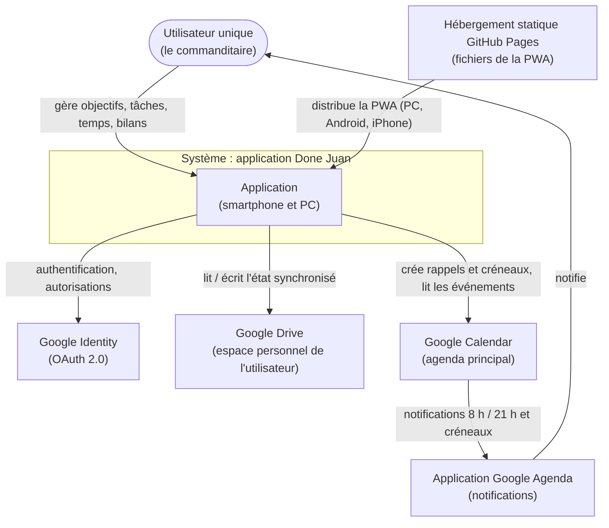
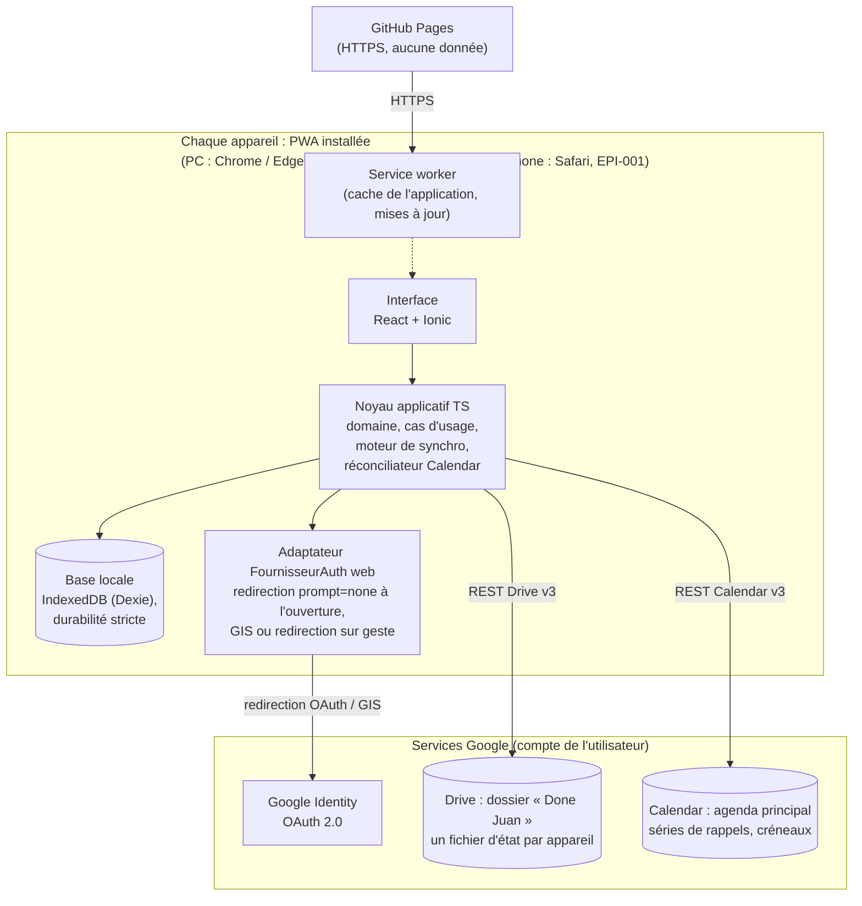
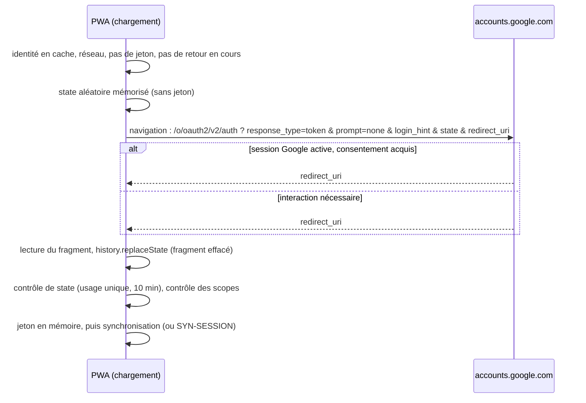
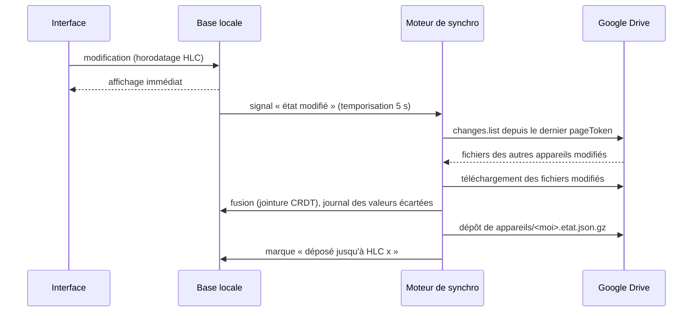
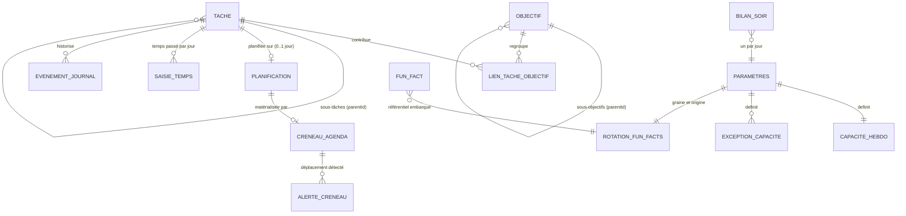

# Dossier d'architecture technique (DAT)

> **Version 0.11.3 (brouillon), 2026-10-27.** Auteur : Starck, architecte logiciel.
> Socle d'architecture initial, préparé hors cycle de lot, à la demande du commanditaire.
> **PWA unique sous condition (v0.11, DEC-034, ADR-013).** La cible est désormais **une seule PWA** sur le PC, sur Android (Chrome, application installée) et, pour EPI-001, sur iPhone. Tout ce qui relève de Capacitor, du module natif d'authentification, de SQLite, de l'APK et de sa signature est marqué **« repli si la condition échoue »** : ce n'est plus la cible, mais cela redevient applicable, avec ADR-012, si la mesure M-RED ou M-PERSIST échoue sur Chrome Android. Le §4.1.7 décrit la connexion par redirection.
> **Statut avant E9 (ANT-12)** : le DAT et les ADR-001 à ADR-013 sont au statut **Proposé** (ADR-012 : remplacé sous condition par ADR-013) et le restent jusqu'à E17 (passage à « Accepté » à la clôture du lot qui les met en œuvre). « Proposé » ne signifie pas « provisoire » : ils sont **stables et exploitables par Anthony pour E9**. Les changements attendus avant E17 sont limités : (1) le résultat du test technique v3 (R11, M-RED, M-PERSIST, M-DUR), qui confirme ou non la PWA unique (ADR-013, condition de DEC-034) ; (2) les arbitrages commanditaire en attente (§9) ; (3) des précisions de détail issues de E11 (revue de lancement) et du développement. Tout changement fait l'objet d'une nouvelle version du DAT, datée dans l'historique, et d'un signalement à Anthony.

## Historique

| Version | Date | Auteur | Origine | Nature de la modification |
|---|---|---|---|---|
| 0.1 | 2026-10-20 | Starck | DEM-001, DEM-002, cahier des charges v0.2 et v0.3, LOT-001 (proposé), réponses Q-DEM001-1 à 20 et compléments du commanditaire | Création. Architecture *local-first* sans serveur applicatif. Base de code TypeScript unique (PWA pour le PC, Capacitor pour le smartphone). Synchronisation par Google Drive (état fusionnable par appareil). Intégration Google Calendar par réconciliation déclarative. ADR-001 à ADR-011 proposés. Avis sur LOT-001 dans `avis-dependances-lot1.md`. Décisions DS-01 à DS-20 et réponses aux points de testabilité d'Anthony (§11). |
| 0.2 | 2026-10-20 | Starck | **DEC-011** (commanditaire) : « le fuseau horaire est celui de l'appareil, on enregistre en base les éléments en utc » | ADR-011 révisé : la journée est celle du fuseau de l'appareil (RG-008 maintenue), les instants sont stockés en UTC ; l'option « fuseau de l'agenda » est écartée. Introduction d'un fuseau technique unique pour l'agenda (`Parametres.fuseauAgenda`, valeur selon Q-DEM001-37). Mise à jour de §4.4.1, §6.1, §6.4, §8 (F3 réécrit, ajout de P-T1), §10 (PO-5), §11 (DS-08, DS-11, DS-18, DS-19, PT-02, PT-06, PT-07, PT-08) et ADR-006. |
| 0.3 | 2026-10-20 | Starck | **DEC-012** (commanditaire), qui remplace DEC-011 : « je change d'avis, reste sur un agenda qui est aligné sur le fuseau horaire Français métropolitain » | ADR-011 révisé : fuseau de référence **fixe Europe/Paris** (constante) pour la journée, les rappels et les créneaux ; instants en UTC. Suppression du paramètre de fuseau de l'agenda et de l'enregistrement du fuseau de l'appareil. §8.1 : A-F1, A-F2, A-F4 et A-F5 sans objet ; A-F3 et P-T1 reformulés ; nouveau point A-F6 (affichage en voyage). Ajout de PT-16 (changements d'heure du 25/10/2026 et du 28/03/2027). Mise à jour d'ADR-006, d'ADR-008 et de l'avis sur le lot 1. |
| 0.4 | 2026-10-21 | Starck | E3 de LOT-001 ; RG-043 (réponse « non » à Q-22.3 : données conservées sur l'appareil à la déconnexion) ; cahier des charges v0.4 (RG-043 à RG-054) | Alignement sur RG-043, DEC-013 à DEC-016 : plus aucun effacement à la déconnexion ; action distincte de suppression des données (DEC-015) ; PC hors ligne dès le lot 1 (DEC-013, US-031) ; base locale **cloisonnée par compte** (§4.1.4, §4.1.5, §7.1, DS-07, ADR-004). Ajouts issus de l'analyse d'impact : empreinte SHA-256 des fichiers Drive et `generation` du manifeste (RG-044) ; registre « cycle de vie » unique (état et dates) ; conséquences des suppressions dérivées à la lecture (RG-046, RG-047) ; réparation des hiérarchies (RG-048) ; incohérences dérivées (RG-049) ; chargement non bloquant de Google Identity Services. Nouveaux risques R11 à R14. Test technique préalable R1/R2 : `test-technique-R1-R2.md`. |
| 0.5 | 2026-10-21 | Starck | E7 de LOT-001 ; DEC-018 (V-01 à V-23) : RG-044 b et extension aux fichiers modifiés à la main, RG-047 à RG-050, RG-054 à RG-056 établies ; nouvelles RG-057 et RG-058 ; V-13 (dossier « Done Juan », DEC-017) | Dossier du Drive et nom du système : « Done Juan » (remplace « Objectifs et Tâches »). Retrait des mentions « proposée » des règles établies. §4.2 : règle de compatibilité des versions (RG-058) précisée, consultation seule sans écriture Drive ni effacement local, contrôle de `generation` effectué seulement après compatibilité de schéma, empreinte du manifeste. §4.1.5 bis : rappel après 24 h hors ligne (RG-057), calcul local. Aucun nouvel ADR ; ADR-003 inchangé dans sa décision. |
| 0.6 | 2026-10-21 | Starck | E7 de LOT-001, tour 1 : ANT-8, ANT-12, BEN-5c, PEP-9, ANT-4, ANT-11, PEP-11 | **Modèles de vue** : nouvelle couche `presentation/modeles-de-vue` (§2.4), requêtes de présentation pures testables sans React (ANT-8). **« Retirer l'accès »** : pas de bouton dans l'application au lot 1, la révocation passe par la gestion du compte Google (§4.1.5, BEN-5c). Statut du DAT et des ADR avant E9 explicité (ANT-12). Objet-valeur `Duree` et estimation calculée à 0 (§2.4, §6.2, PEP-9). Banc de test : en-tête `Date` simulé et `appareilId` fixe (§3.3, ANT-4, ANT-11). Bandeau RG-057 : calcul depuis la plus ancienne modification en attente, en hypothèse en attente de Q-ERG-16 (alternative a : dernier contact Drive) ; Q-ERG-17 ouverte (§4.1.5 bis). Revérification de l'alignement sur RG-043 (PEP-11) : aucun écart. Aucun nouvel ADR ; décisions des ADR inchangées. |
| 0.7 | 2026-10-21 | Starck | E7 de LOT-001, tour 2 : points ANT-17 à ANT-20 de `conventions.md` v0.2 §17.2 | **ANT-17** : `fuseauAppareil()` ajouté au port `Horloge`, réservé à la mention « heure de Paris » (RG-054) (§2.4). **ANT-18** : ports transverses complémentaires et placement confirmés (§2.4). **ANT-19** : un appareil conserve les champs inconnus de même `schemaVersion` à la réécriture de son fichier (§4.2). **ANT-20** : scénarios `@ihm` exécutés par cucumber-js piloté par Playwright, profil `ihm` ; ADR-009 précisé (§2.4, §3.3). RG-057 reste une hypothèse en attente de Q-ERG-16 ; Q-ERG-17 ouverte. |
| 0.8 | 2026-10-21 | Starck | **DEC-019 à DEC-024** (réponses à `etude-sans-cloud-ou-gratuit.md`) ; **DEC-025** (RG-057, Q-ERG-17, Q-ERG-18, Q-REF-1, Q-REF-2, Q-LOT-1) | **Distribution Android (DEC-021, remplace DEC-005)** : installation directe de l'APK, sans Google Play ; nouvel **ADR-012** (signature, conservation de la clé, `versionCode`, publication sur l'hébergement statique, installation par fichier ou par ADB, mise à jour par écrasement, vérification des développeurs Android en 2027) ; C4 niveau 1 (§2.2), pile (§3.2), clients OAuth Android liés à la clé de publication (§4.1.2), conséquence sur RG-058 (§4.2), environnements, intégration continue et mises à jour (§7.4), nouveau §7.5, arbitrage A2 (§9), risques R8, R16, R17 (§10), DS-17. **Hébergement PC (DEC-006 maintenue, DEC-023)** : GitHub Pages si le dépôt est public, Cloudflare Pages tant qu'il est privé (§7.5) ; PO-7 tranché (GitHub). **DEC-025** : RG-057, calcul depuis la plus ancienne modification en attente, n'est plus une hypothèse ; un seul bandeau `BAN-ACCES-GOOGLE` complété de la mention en cas d'accès perdu (Q-ERG-17) ; bandeau fermé réaffiché à la prochaine ouverture (Q-ERG-18) (§4.1.5 bis). RG-048 : annulation **itérative** des déplacements, du plus ancien au plus récent, jusqu'à une hiérarchie valide ; terminaison et convergence démontrées (§4.2, Q-REF-1). Q-REF-2 : déjà conforme (§4.2). Q-LOT-1 : sans impact. ADR-001 : renvoi vers ADR-012. Aucune autre décision d'ADR modifiée. |
| 0.9 | 2026-10-21 | Starck | E8 de LOT-001 : réponses aux demandes de précision d'Anthony (`explicitation-LOT-001.md`) : Q-US-017-1, 2, 4, 5, 10, 12 ; Q-US-031-1 ; Q-US-022-3 ; Q-US-018-3 ; avis sur Q-US-001-2, Q-US-018-1, Q-US-017-3 ; avis sur l'ordre de réalisation (A.2) | **Valeurs écartées (Q-US-017-1)** : le critère « valeur locale pas encore déposée » est remplacé par le critère de RG-036 (« écriture gagnante faite sans connaissance de la valeur perdue »), mis en œuvre par un **contexte causal par champ** (§4.2.1, §6.1, DS-11) ; la proposition « HLC de la valeur remplacée » est écartée, car elle signale à tort une valeur remplacée en connaissance de cause par une chaîne de modifications. Le gagnant reste celui de l'HLC le plus grand. **RG-044 et fichiers par appareil (Q-US-017-2)** : altération détectée et traitée fichier par fichier, `ERR-012` affiché par le seul propriétaire du fichier (ou par tous si le manifeste est atteint), `generation` portée aussi par chaque fichier d'appareil, manifeste monotone à plusieurs écrivains, dossier en double, ordre des contrôles (§4.2.2). **Choix concurrents (Q-US-017-3)** : avis technique, « repartir de zéro » l'emporte (§4.2.2). **Horloges (Q-US-017-4, Q-US-017-5)** : portée exacte de la garantie de CA-13 ; ancrage sur l'horloge monotone d'Android ; détection des sauts d'horloge ; `ALR-001` affiché par le seul appareil déréglé (§6.4) ; limite résiduelle soumise au commanditaire (A8, §9). **Modifications en attente (Q-US-018-1)** : index local des écritures en attente, décompte par élément, instant de la plus ancienne (§4.1.5 bis, §6.1, DS-11). **PC, session expirée ou accès retiré (Q-US-031-1)** : hypothèse de conception jusqu'au test technique R2 et R11 (§4.1.6 bis). **Historique (Q-US-001-2)** : valeurs structurées, conséquences écrites journalisées, conséquences dérivées non journalisées (§6.1). Consultation seule et actions de compte (Q-US-022-3) ; « Mettre à jour » sur PC et version de schéma retirée du message (Q-US-017-10) ; tentatives poursuivies après `SYN-ACTION` (Q-US-017-12, §4.3) ; scénarios « système » du smartphone (Q-US-018-3, §3.3) ; nouvel arbitrage A8 et points ouverts PO-9, PO-10. ADR-003, ADR-004 et ADR-011 précisés (décisions complétées, statut Proposé). |
| 0.10 | 2026-10-21 | Starck | Suite de E8 de LOT-001 : alignement sur le guide d'ergonomie §6.6.1 et US-018 S05c ; **DEC-030** (commanditaire, « Reco ») : CA-13 limité, Q-US-017-3 a), Q-US-001-1 a) ; protocole du test technique (Q-US-031-1) | **§4.1.5 bis** : un élément créé puis supprimé hors ligne avant tout dépôt de sa création **n'est plus compté** (marqueur `creationNonDeposee`, purge de ses entrées d'index à la suppression) ; la suppression d'un élément déjà déposé compte pour un. **A8 tranché** : option (a), formulation acceptée (§6.4, §9, PO-9 clos, R4). **Q-US-017-3 a)** : « Repartir de zéro » l'emporte toujours sur « Restaurer », règle arrêtée ; une restauration ne crée pas de génération (§4.2.2). **Q-US-001-1 a)** : le rattachement d'une tâche et le placement d'un sous-objectif écartés par la suppression de l'objectif sont signalés comme valeurs non retenues ; le §4.2.1 ne le permettait pas tel quel (ces écritures sont des informations de l'enfant) et est **étendu** : le contexte de la pierre tombale couvre aussi les écritures de rattachement et de placement pointant vers l'élément supprimé. Aucun changement de format Drive (schéma 1). Test technique : 3 points de protocole ajoutés (§3.5). Aucun ADR modifié dans sa décision. |
| 0.10.1 | 2026-10-21 | Starck | Contrôle final d'Anthony sur LOT-001 (itération 2/2, `explicitation-LOT-001.md`, section « Contrôle final ») : É-2 et É-4 | **§4.1.5 bis (É-4)** : à la suppression d'un élément, les entrées de ses descendants (à tout niveau) qui portent `creationNonDeposee` et que la suppression rend supprimés par dérivation sont purgées, même si l'élément supprimé est déjà déposé. Le décompte appliqué est celui du guide d'ergonomie §6.6.1 (cas : sous-tâche créée hors ligne sous un objectif déjà déposé, puis objectif supprimé hors ligne : décompte 1). **§4.2.1 (É-2)** : la reformulation du rattachement utilise le modèle du §6.1, c'est-à-dire l'entité `LienTacheObjectif` (relation n-n), et non un champ `objectifId` de la tâche. Aucun changement de format Drive, aucune décision d'ADR modifiée. |
| 0.10.2 | 2026-10-22 | Starck | E9 de LOT-001 : **ANT-25** (`conventions.md` v0.3 §17.2, `ST-socle-ecriture.md` §6.7) | **§6.1 et DS-08** : l'identifiant d'une entrée de `EvenementJournal` écrite par un cas d'usage prend la forme `<UUID v7 de l'opération>:<rang>` (rang décimal, à partir de 0, unique dans l'opération), au lieu d'un UUID par entrée. Unicité globale, fusion par union et dédoublonnage inchangés ; `cause` désigne une entrée de la même opération. Les entrées des réparations RG-048 gardent l'identifiant déterministe `hash(élément, HLC du déplacement annulé)`, dont l'encodage ne contient pas le caractère `:`. Ordre d'un historique : HLC croissant, puis `id` en comparaison ordinale. Correctif sans effet sur le format publié (aucun schéma 1 encore publié). |
| 0.11 | 2026-10-22 | Starck | **DEC-034** (ETU-002, « prendre les recos de Stark » : Q-PWA-1 a à Q-PWA-5) ; **DEC-035** (M1-14, essai de partage) | **PWA unique sur tous les appareils, sous condition de mesure** : nouvel **ADR-013** (Proposé), qui **remplace ADR-012 sous condition** ; notes de portée dans ADR-001, ADR-004 et ADR-010. Capacitor, module natif d'authentification, SQLite, notifications locales, arrière-plan, APK et chaîne de signature : marqués **« repli si la condition échoue »** (§2.2, §2.3, §2.4, §3.2, §4.1.2, §4.2, §5, §6.4, §7.1, §7.4, §7.5, §9 A2, DS-02, DS-06, DS-07, DS-09, DS-15, DS-17). **Nouveau §4.1.7** : connexion par **redirection pleine page** (`prompt=none`) à l'ouverture, une tentative par ouverture, `state`, effacement du fragment, URI de redirection déclarée, geste en cours de session. §4.1.6 et §4.1.6 bis étendus au téléphone (Q-PWA-2) ; IndexedDB en **durabilité stricte** (US-018 CA-5) ; persistance exigée pour la PWA installée ; ancrage monotone par `performance.now()` sur tous les appareils (limite A8 étendue au téléphone). Q-38 b et arrière-plan abandonnés (Q-PWA-3, §5, F2, F6). Risques : R1, R2, R13, R16, R17 sans objet sauf repli ; R3, R15 étendus ; nouveaux **R18** (flux implicite OAuth) et **R19** (politiques navigateur) ; PO-11 (condition de DEC-034), PO-12 (EPI-001, R-P1/R-P2). Test technique v3 : volet web, M-RED, M-PERSIST, M-DUR, volet optionnel R-P1/R-P2 ; **condition d'E9 d'US-022 et d'US-017 : R11 et M-RED**. Les modifications de RG-017, ENF-01, ENF-04, ENF-07, US-018 CA-4 et Q-38 b relèvent de Pepper (en cours). |
| 0.11.1 | 2026-10-22 | Starck | Conventions v0.4 d'Anthony : **ANT-26** (adresse de recette sur GitHub Pages), **ANT-27** (nom de variable) | **Nouveau §7.4 bis** : la recette est servie depuis une **origine distincte** de la production (organisation GitHub gratuite, `https://<organisation-recette>.github.io`), car un sous-chemin `/taskapp/recette/` entrerait dans la portée du service worker de production et partagerait le stockage de l'origine ; en attendant l'organisation, recette sur un dépôt frère `taskapp-recette` (portée disjointe, stockage préfixé par environnement), avec ses limites ; noms de stockage préfixés par environnement dans tous les cas ; décision à confirmer par le commanditaire (création de l'organisation). Lignes « Recette » de §7.4 et §7.5 alignées. **DS-04** : variable `VITE_GOOGLE_WEB_CLIENT_ID` (au lieu de `VITE_GOOGLE_CLIENT_ID_WEB`), comme le PoC, le guide et §7.5 (ANT-27). Aucun ADR modifié dans sa décision. |
| 0.11.2 | 2026-10-25 | Starck | Retour du commanditaire du 2026-10-25 (guide v3, b.4.9 : « Publier l'application » grisé, image de marque incomplète) | **§4.1.3** : la publication en production exige une **image de marque complète** (page d'accueil, règles de confidentialité, domaine autorisé), même sans aucun scope sensible ; elle ne déclenche pas de vérification de la marque tant qu'aucun logo n'est fourni, mais l'écran de Google affiche alors le domaine au lieu du nom. Pages servies avec la PWA sur l'origine GitHub Pages (`poc-specification.md` §16 pour le test ; même principe en production). **R11** (§10) reformulé : risque de refus du domaine `*.github.io` comme domaine autorisé ; question conditionnelle Q-R11-1 (protocole v3.1 §3.1 ter). Note datée dans ADR-005. Aucune décision d'ADR modifiée. |
| 0.11.3 | 2026-10-27 | Starck | E9 d'US-022, 017, 018, 031 (Anthony) : réponses à Q-ST022-STA-1 à 3, Q-ST017-STA-1 et 2, Q-ST018-STA-1, Q-ST031-STA-1 et 2 | **§4.1.4 (Q-ST022-STA-3, correction)** : l'`appareilId` est rangé **dans l'espace du compte** et naît avec lui ; « Supprimer les données de cet appareil » donne donc un **nouvel** `appareilId` à la reconnexion, l'ancien fichier étant celui d'un appareil inactif (fusionné, archivé après 90 jours). Raison : la règle « un appareil connaît toujours ses propres écritures » (§4.2.1) et le « fichier attendu » (§4.2.2) supposent la continuité de l'état local. **§4.1.6 (Q-ST031-STA-1 et 2)** : port `VerrouOnglets`, verrou « meneur » et verrou « cycle » par environnement et par espace ; seul un onglet dont l'accès est valide est meneur. **§4.1.7 (Q-ST022-STA-1 et 2)** : `state` dans la base technique IndexedDB, écriture confirmée avant la navigation, reprise d'écran sans contenu métier ; repli de GIS sur une **redirection interactive** (et non `prompt=none`), une seule par geste. **§6.4 (Q-ST017-STA-2, correction)** : médiane des 5 dernières mesures ; un écart **en avance** de l'horloge murale sur `performance.now()` est présumé être une mise en veille et n'est pas corrigé ; seul un recul est corrigé. Aucune décision d'ADR modifiée. |

## Sommaire
1. Contexte et exigences structurantes
2. Vue d'ensemble (C4 niveaux 1 et 2)
3. Choix technologiques
4. Intégration Google (OAuth, Drive, Calendar)
5. Traitements planifiés sans serveur
6. Modèle de données de haut niveau
7. Sécurité, données personnelles, observabilité, déploiement, environnements
8. Exigences fonctionnelles techniquement sensibles (signalements à Pepper)
9. Arbitrages commanditaire
10. Risques et points ouverts
11. Décisions pour la spécification technique (DS-01 à DS-20) et points de testabilité
12. Index des ADR

---

## 1. Contexte et exigences structurantes

### 1.1 Contexte
Application personnelle de gestion d'objectifs et de tâches, avec un **utilisateur unique** (RG-018). Elle fonctionne sur un **smartphone**, usage prioritaire, et sur un **PC** dès la première version (RG-017, ENF-01). Elle est **inutilisable sans compte Google** (RG-019). Les données sont conservées dans l'**espace de stockage personnel** de l'utilisateur, a priori son Google Drive (RG-020, Q-DEM001-3 b). Conserver les données ailleurs est **exclu** (CdC §4.3). L'agenda Google **principal** reçoit :
- les rappels de 8 h et de 21 h (RG-012 à RG-014) ;
- les créneaux des tâches planifiées (RG-034).

L'application lit aussi cet agenda, pour deux usages :
- calculer la capacité disponible (RG-033) ;
- détecter les créneaux déplacés (RG-037).

### 1.2 Exigences structurantes

| Id | Exigence | Source | Conséquence d'architecture |
|---|---|---|---|
| EX-01 | Smartphone et PC dès la v1 ; smartphone prioritaire | RG-017, ENF-01 | Base de code unique, interface mobile d'abord et adaptative (ADR-001) |
| EX-02 | Données dans l'espace personnel de l'utilisateur, aucune donnée chez l'éditeur | RG-020, CdC §4.3 | Pas de base de données côté serveur. Google Drive sert de support de synchronisation (ADR-002, ADR-003). |
| EX-03 | Modification visible sur l'autre appareil en moins d'une heure | RG-017, ENF-02 (interprétation : Q-DEM001-21) | Envoi immédiat après chaque modification. Interrogation périodique au premier plan, synchronisation à l'ouverture (§4.3). |
| EX-04 | Hors ligne d'abord sur smartphone, en consultation et en saisie | RG-021, ENF-04 | Base locale faisant foi pour l'interface ; synchronisation asynchrone (ADR-003, ADR-010) |
| EX-05 | En cas de conflit, la modification la plus récente l'emporte, sans perte silencieuse | RG-036, ENF-06, Q-DEM001-23 | Fusion par champ, horodatée par horloge hybride (HLC) ; journal des valeurs écartées (ADR-003, ADR-011) |
| EX-06 | Rappels quotidiens à 8 h et 21 h, même si aucun appareil n'est allumé | RG-012, RG-013 | Rappels portés par Google Calendar (séries récurrentes), contenu précalculé (ADR-006, ADR-007) |
| EX-07 | Créneaux dans l'agenda principal ; déplacement détecté, puis notification et proposition le soir | RG-034, RG-037 | Synchronisation incrémentale de l'agenda (*sync token*), identifiants d'événements déterministes (ADR-006) |
| EX-08 | Perte de l'accès Google : événements conservés, aucune perte de données | RG-035, ENF-06 | Aucune suppression d'événement à la déconnexion. La perte d'accès est traitée comme une coupure de réseau (§4.1.5). |
| EX-09 | Accès minimal au compte Google | ENF-05 | Scopes non sensibles quand c'est possible, autorisation incrémentale par fonctionnalité (ADR-004, ADR-005) |
| EX-10 | Fun fact du matin : chacun affiché aussi souvent que les autres | DEM-002 | Permutation déterministe par cycle de 100 jours (ADR-008) |
| EX-11 | Historique pour la vélocité et l'évolution du backlog (12 semaines) | RG-010, RG-015, RG-016 | Journal métier en ajout seul, dès le lot 1 (§6) |

### 1.3 Exigences non fonctionnelles techniques (proposées)

| Id | Exigence | Cible |
|---|---|---|
| ENF-T-01 | Démarrage à froid hors ligne sur un smartphone milieu de gamme | < 2 s jusqu'à l'affichage de la liste des tâches |
| ENF-T-02 | Temps de réponse d'une action locale (création, saisie) | < 100 ms, réseau indifférent |
| ENF-T-03 | Délai de propagation entre appareils actifs et connectés | ≤ 5 min (cible), ≤ 60 min (exigence EX-03) |
| ENF-T-04 | Synchronisation à l'ouverture ou au retour du réseau | Lancée immédiatement ; aboutie en < 10 s pour 5 Mo de données |
| ENF-T-05 | Volumétrie de dimensionnement | 5 000 tâches, 20 000 saisies de temps, 50 000 entrées de journal (≈ 5 ans), soit un état < 5 Mo non compressé |
| ENF-T-06 | Disponibilité | Application pleinement utilisable sans réseau. Les fonctions Google dépendent de la disponibilité de Google. |
| ENF-T-07 | Perte de données | Zéro perte silencieuse. Une modification locale n'est supprimée de l'appareil qu'après son dépôt confirmé dans Drive. |

---

## 2. Vue d'ensemble

### 2.1 Principe directeur : *local-first*, sans serveur applicatif
Chaque appareil porte **l'application complète** : interface, règles métier, base locale, moteur de synchronisation et client Google. Il n'existe **aucun serveur** développé ou exploité par le projet. Le seul hébergement est celui de fichiers statiques : la PWA pour le PC. Le choix est justifié dans ADR-002.
- **Google Drive** est le support d'échange entre les appareils et la copie de référence durable.
- **Google Calendar** est le canal de notification qui fonctionne même quand aucun appareil n'est allumé.

### 2.2 C4 niveau 1 : contexte



*Repli si la condition de DEC-034 échoue (ADR-012)* : l'hébergement distribue aussi l'APK Android signé, installé par l'utilisateur (fichier ou ADB).

### 2.3 C4 niveau 2 : conteneurs

**Cible (v0.11, ADR-013)** : la même PWA sur tous les appareils.



**Repli si la condition de DEC-034 échoue** (ADR-001 option 2, ADR-012) : sur Android, l'application Capacitor des versions 0.1 à 0.10.2, avec base SQLite, module natif d'authentification (Credential Manager, AuthorizationClient), et, dans des lots ultérieurs, notifications locales et tâche d'arrière-plan ; la PWA ci-dessus reste celle du PC et de l'iPhone.

### 2.4 Découpage logique du noyau (architecture hexagonale, ADR-010)

| Couche | Contenu | Dépendances autorisées |
|---|---|---|
| `domaine` | Entités, valeurs (durée par pas de 30 min, date de journée), règles RG : priorisation, planification, reste à faire, vélocité, backlog, rotation des fun facts | Aucune (TypeScript pur, sans entrée-sortie) |
| `application` | Cas d'usage (créer une tâche, saisir du temps, proposer un planning…), **ports** : `DepotLocal`, `TransportSynchro`, `PasserelleAgenda`, `FournisseurAuth`, `Horloge`, `Notifieur`, `Planificateur` | `domaine` |
| `synchro` | Moteur CRDT (fusion par champ, horloge HLC), cycle de synchronisation, journal des valeurs écartées | `domaine`, ports |
| `infrastructure` | Adaptateurs : IndexedDB (Dexie), Drive REST, Calendar REST, authentification web (redirection et GIS) ; *repli (ADR-012)* : SQLite, authentification native, notifications locales | `application` (implémente les ports) |
| `presentation/modeles-de-vue` | **Modèles de vue** (ANT-8) : fonctions pures qui transforment le résultat des cas d'usage et des requêtes en structures prêtes à afficher (listes triées et regroupées, libellés, codes d'état de l'indicateur et des bandeaux, compteurs « 3/3 en cours », états vides, activation des actions) | `application` (requêtes, types de résultat) et ports `Horloge` (heure et fuseau de référence) et `DepotLocal` en lecture seule, **par injection**. Aucune dépendance à React, Ionic, au DOM ni à une entrée-sortie |
| `presentation/ui` | Écrans React et Ionic : composants « bêtes » qui affichent un modèle de vue et déclenchent des cas d'usage. Aucune règle métier ni mise en forme calculée | `presentation/modeles-de-vue`, `application` (cas d'usage) |

**Alignement avec les conventions d'Anthony** (`conventions.md` §3) : le code est découpé d'abord par **contexte métier** (`objectifs-taches`, `planification`, `rappels`, `synchronisation`, `compte`, `commun`…), puis par couche à l'intérieur de chaque contexte (`domaine`, `application`, `infrastructure`, `presentation`). Les couches ci-dessus s'y projettent ainsi :
- `synchro` correspond au contexte `synchronisation` ;
- `presentation/ui` et `presentation/modeles-de-vue` correspondent aux dossiers `presentation` ;
- les adaptateurs Google partagés vont dans `infrastructure-google`.

**Modèles de vue (ANT-8).** Ils appartiennent à la couche `presentation`, mais sous-couche **indépendante du framework**. Ils sont à l'écran ce que les cas d'usage sont au domaine : on les teste en Vitest et en Cucumber sans React ni navigateur. Règles :
- un modèle de vue est une **requête de présentation pure** : `(données de lecture, Horloge) → structure d'affichage`. Il ne modifie rien et n'appelle jamais directement Drive, Calendar ou le stockage ;
- il lit via les **requêtes de la couche `application`**, qui s'appuient sur `DepotLocal` (lecture) ; il utilise `Horloge` pour « aujourd'hui », la journée Europe/Paris et le calcul des bandeaux (RG-057). Les autres ports (`TransportSynchro`, `PasserelleAgenda`, `FournisseurAuth`, `Notifieur`, `Planificateur`) ne lui sont pas accessibles ; l'état de synchronisation et de connexion lui parvient sous forme de **données** exposées par `application` ;
- il produit les **codes d'état stables** et les libellés du catalogue (ANT-7), que les scénarios `@ihm` et les tests Vitest vérifient sans rendu ;
- le composant React ne fait que lier ce modèle à des éléments d'écran. Les tests Playwright se limitent au câblage et à l'accessibilité.
Cette couche répond à la demande d'Anthony : les scénarios Cucumber vérifient ce que l'écran affiche en s'exécutant sur la couche `application` et les modèles de vue, avec les simulateurs de §3.3.

**Précisions de la v0.7 (ANT-17, ANT-18).**
- **`Horloge.fuseauAppareil()` (ANT-17)** : accepté. Il renvoie le fuseau du système de l'appareil et **ne sert qu'à la mention « heure de Paris »** (RG-054), via son modèle de vue : la mention s'affiche si ce fuseau diffère de `FUSEAU_REFERENCE`. Il n'intervient dans aucun calcul métier (DEC-012). L'`Horloge` simulée permet de le fixer dans les tests.
- **Ports transverses (ANT-18)** : `GenerateurIdentifiants`, `SourceAleatoire`, `JournalTechnique` et `EtatReseau` complètent la liste, avec `CoffreJetons`. Ils sont transverses, sans effet sur l'architecture, et leurs adaptateurs en mémoire servent au banc de test. Les modèles de vue peuvent lire `EtatReseau` par la couche `application` (donnée, pas port direct).
- **Placement (ANT-18)** : `DepotLocal` et `TransportSynchro` sont définis dans le contexte `synchronisation` (couche `application`) et implémentés dans `infrastructure`. Les autres contextes y accèdent par les cas d'usage et requêtes, non par les ports. `Planificateur` ne sert qu'à armer les traitements locaux (rattrapage des rappels, évaluation du bandeau), conformément à ADR-007 ; il n'est pas une file d'ordres Calendar.
- **Scénarios `@ihm` (ANT-20)** : voir §3.3.

Les noms de ports du DAT prévalent. Il existe un port supplémentaire, `CoffreJetons`, défini par Anthony et dont la mise en œuvre est décrite par DS-06.

---

## 3. Choix technologiques

Section de référence pour Anthony (`conventions.md`). Les versions sont celles des branches stables en cours au démarrage du lot 1 ; Anthony les fige dans `package.json`.

### 3.1 Plateforme : options étudiées (détail dans ADR-001)

| Option | Avantages | Inconvénients | Verdict |
|---|---|---|---|
| **A. PWA seule (smartphone et PC)** | Un seul livrable, aucun store, coût nul, mises à jour automatiques ; l'iPhone d'EPI-001 couvert | Pas de notification locale programmée ni d'arrière-plan (abandonnés, Q-PWA-3). Jeton d'accès d'une heure sans renouvellement silencieux : passage par Google à l'ouverture (accepté, Q-PWA-2). | **Retenue pour tous les appareils sous condition de mesure (v0.11, DEC-034, ADR-013)** ; v0.1 à v0.10.2 : retenue pour le PC seulement |
| B. Code web unique : PWA (PC) et Capacitor (smartphone) | Un seul code TypeScript et React. Sur smartphone : modules natifs (connexion Google native, notifications locales, arrière-plan, SQLite). Écosystème éprouvé. | Une application mobile à construire, signer et distribuer (installation directe, ADR-012) | Recommandée jusqu'à v0.10.2 ; **repli si la condition de DEC-034 échoue** |
| C. Flutter (mobile, bureau, web) | Une base de code, bonnes performances, bon hors ligne | Dart moins répandu. Outillage Cucumber en Gherkin français peu mature. Cible web moins solide. | Rejetée |
| D. React Native et Expo (avec react-native-web pour le PC) | Natif, une base de code | Rendu web secondaire pour le PC, double paradigme. Gain faible par rapport à B pour une application de formulaires et de listes. | Écartée (alternative crédible) |
| E. Natif pur (Kotlin ou Swift) et web séparé | Intégration système maximale | Deux ou trois bases de code : disproportionné pour un utilisateur unique | Rejetée |
| F. Application de bureau (Tauri ou Electron) pour le PC | Jeton de longue durée dans le trousseau du système | Un livrable et une chaîne de signature supplémentaires | Option d'évolution si la PWA est jugée insuffisante sur PC (§4.1) |

### 3.2 Pile retenue

| Domaine | Choix | Justification | Alternatives |
|---|---|---|---|
| Langage | **TypeScript** en mode `strict` | Un langage pour tout le code, typage fort, écosystème Cucumber et tests | — |
| Exécution et paquets | Node.js LTS, **pnpm** | Standard, reproductible (fichier de verrouillage) | npm |
| Interface | **React** et **Ionic React** | Ionic fournit des composants mobiles accessibles, adaptatifs sur PC et intégrés à Capacitor | MUI, shadcn/ui |
| Construction | **Vite** et **vite-plugin-pwa** (Workbox) | Rapide, PWA et service worker inclus | — |
| Coque mobile | *Repli si la condition de DEC-034 échoue* : Capacitor (Android) | Réutilise le code web, accès aux modules natifs | Expo (ADR-001) |
| Base locale (tous appareils) | **IndexedDB via Dexie**, transactions d'écriture en **durabilité stricte** (`chromeTransactionDurability: 'strict'`), écriture confirmée à `complete` (v0.11, ADR-013) | Standard, transactionnel, testable avec `fake-indexeddb` ; persistance demandée par `navigator.storage.persist()` | — |
| Base locale (mobile natif) | *Repli si la condition échoue* : SQLite (`@capacitor-community/sqlite`) | Durable dans la coque native | IndexedDB de la WebView |
| Gestion d'état de l'interface | **Zustand** | Léger, sans code répétitif | Redux Toolkit |
| Dates et fuseaux | **date-fns** et **@date-fns/tz** | Fuseaux explicites, fonctions pures | Luxon, Temporal (prothèse) |
| Validation des fichiers Drive et migrations | **Zod** | Schémas versionnés, validation à la lecture | — |
| Appels Google | **REST direct** (`fetch`) derrière les ports, sans la bibliothèque `gapi` | Léger, maîtrisé, simulable dans les tests | `googleapis` (Node uniquement) |
| Authentification (tous appareils) | **Redirection OAuth pleine page** (`response_type=token`, `prompt=none`) à l'ouverture, et **Google Identity Services**, modèle « jeton », ou redirection interactive sur geste (§4.1.7, ADR-013) | Pas de secret ni de serveur ; pas de geste à l'ouverture ; autorisation incrémentale | Flux avec code et serveur (rejeté, ADR-002) |
| Authentification (Android natif) | *Repli si la condition échoue* : module Capacitor sur Credential Manager et AuthorizationClient | Jetons gérés par le système, renouvellement silencieux | — |
| Notifications locales (mobile) | **Abandonnées** (Q-PWA-3) ; *repli* : `@capacitor/local-notifications` | — | — |
| Arrière-plan (mobile, lot ultérieur) | **Abandonné** (Q-PWA-3) ; *repli* : `@capacitor/background-runner` | — | — |
| Graphiques (lot ultérieur) | Chart.js | Léger, accessible | Recharts |
| Tests unitaires | **Vitest**, **@testing-library/react**, `fake-indexeddb` | Rapide, natif Vite, compatible TypeScript | Jest |
| Tests métiers | **@cucumber/cucumber** (cucumber-js), `# language: fr` | Gherkin français natif, *step definitions* en TypeScript | — |
| Tests de bout en bout | **Playwright** (et `@axe-core/playwright` pour l'accessibilité) | Parcours UI sur la PWA, mode hors ligne simulable | Cypress |
| Simulation HTTP | **MSW** | Rejoue les réponses Google dans les tests d'adaptateurs | nock |
| Qualité | ESLint (typescript-eslint, configuration *strict*), Prettier, `tsc --noEmit`, Semgrep (sécurité), audit des dépendances | Lint et analyse statique « au vert » (E12) | — |
| Intégration continue | **GitHub Actions** (dépôt GitHub, PO-7 tranché ; gratuit sans limite de minutes une fois le dépôt public, DEC-023) | Construction et déploiement de la PWA ; *repli* : construction et signature de l'APK (ADR-012) | GitHub Actions sur dépôt privé (quota gratuit de minutes) |
| Distribution (tous appareils) | **PWA sur GitHub Pages**, installée depuis le navigateur, mise à jour par le service worker (ADR-013) | Gratuit, sans magasin, sans installation manuelle | *Repli si la condition échoue* : APK signé installé directement (DEC-021, ADR-012) |

### 3.3 Outillage de tests : organisation (ADR-009)
- **Unitaires (Vitest)** : `domaine`, `synchro` et cas d'usage, avec des adaptateurs en mémoire. Couverture minimale proposée : 90 % des lignes pour `domaine` et `synchro`, 80 % pour l'ensemble. Anthony fixe les seuils définitifs.
- **Cucumber (Gherkin français)** :
  - les fichiers `.feature` sont dans `tests/features/` (Pepper) ;
  - les *step definitions* sont en TypeScript (emplacement fixé par Anthony, par exemple `tests/steps/`).

  Les scénarios s'exécutent sur la couche `application`, avec des **simulateurs en mémoire** de Drive, de Calendar, de l'horloge et du réseau. Un scénario peut ainsi instancier **deux appareils** qui partagent le même faux Drive, ce qui permet de tester en Gherkin la synchronisation, les conflits, le hors ligne et la perte d'accès Google. Ces scénarios sont déterministes et sans réseau, donc exécutables en intégration continue. Les tags `@US-xxx`, `@RG-xxx` et `@LOT-xxx` servent au filtrage.
- **Banc de test déterministe** (ANT-4, ANT-11) :
  - l'en-tête HTTP `Date` renvoyé par le faux Google est **simulé** et piloté par le scénario (valeur, écart de plusieurs minutes, ou absence). La correction de dérive de §6.4 et le seuil de l'horloge déréglée sont ainsi testables sans attente réelle ;
  - l'`Horloge` simulée est la seule source de temps ; elle permet d'obtenir des **horodatages HLC strictement égaux** sur deux appareils, pour vérifier le départage par `appareilId` ;
  - chaque appareil simulé reçoit un **`appareilId` fixe** déclaré dans le scénario (par exemple « A » et « B »), jamais un UUID aléatoire. Le générateur d'UUID est un port injectable, et seul le banc de test le fige.
- **Scénarios `@ihm` (ANT-20)** : lèvent l'ambiguïté entre ADR-009 et §2.4. Ils sont exécutés par **cucumber-js piloté par Playwright** (profil `ihm`), sur la PWA réelle avec un faux Google injecté ; ils vérifient ce qui est réellement affiché (interface réelle, accessibilité comprise). Tous les autres scénarios restent sur la couche `application` avec les modèles de vue, sans rendu. Playwright reste donc limité à ce petit sous-ensemble (tag `@ihm`) et aux parcours de bout en bout ; les modèles de vue (§2.4) n'en dispensent pas, ils portent la logique, `@ihm` vérifie le câblage visible. ADR-009 est précisé dans ce sens.
- **Adaptateurs Google** : tests de contrat avec MSW, sur des réponses enregistrées conformes à la documentation, y compris les erreurs 401, 403, 404, 409, 410, 429 et 5xx.
- **Bout en bout (Playwright)** : quelques parcours sur la PWA, avec un faux Google injecté. Ils couvrent le démarrage, le hors ligne et l'accessibilité.
- **Recette sur appareil réel** : un compte Google de recette dédié (§7.4).
- **Scénarios « système » du smartphone (v0.9, Q-US-018-3)** : arrêt brutal, extinction et redémarrage, coupure du réseau pendant la saisie (US-018 S09, S13). Ils sont exécutés au niveau des cas d'usage, avec un `DepotLocal` persistant simulé : un arrêt brutal y est l'abandon de l'instance sans fermeture propre, suivi d'une nouvelle instance sur le même stockage. Une écriture non validée (transaction non terminée) doit être absente, et une écriture validée présente. La vérification est complétée en recette technique (E14, Starck) par un arrêt forcé réel sur l'appareil : **v0.11**, arrêt forcé de Chrome (« Applications > Chrome > Forcer l'arrêt ») puis redémarrage du téléphone, avec la PWA installée (mesure M-DUR du test technique v3) ; *repli* : `adb shell am force-stop` sur l'APK. Une variante `@recette` de S09 est recommandée.

---

## 4. Intégration Google

### 4.1 OAuth 2.0, scopes et jetons (ADR-004, ADR-005)

#### 4.1.1 Scopes minimaux, demandés au fil des fonctionnalités (autorisation incrémentale)

| Scope | Classification Google | Usage | Demandé à partir de |
|---|---|---|---|
| `openid`, `email` | Non sensible | Identifier le compte (claim `sub`), vérifier que les deux appareils utilisent le même compte | Lot 1 |
| `https://www.googleapis.com/auth/drive.file` | **Non sensible** | Créer et lire uniquement les fichiers créés par l'application, dans un dossier visible de l'utilisateur | Lot 1 |
| `https://www.googleapis.com/auth/calendar.events` (ou `calendar.events.owned`, plus étroit, si sa classification est identique ; à vérifier lors de la mise au point technique) | **Sensible** | Créer et modifier les rappels et les créneaux dans l'agenda principal ; lire les événements (capacité, créneaux déplacés) | Premier lot comportant une fonction d'agenda |

Scopes **exclus** :
- `drive` et `drive.readonly`, **restreints** : ils imposent un audit de sécurité payant ;
- `calendar`, accès complet aux agendas, non nécessaire.

**Option `drive.appdata`** : dossier caché, propre à l'application, également non sensible. L'utilisateur ne voit pas ses données et ne peut que les supprimer en bloc. Pour respecter « mes données dans mon espace », nous recommandons le dossier **visible** (`drive.file`) : l'utilisateur voit et télécharge ses fichiers. C'est l'arbitrage A6.

#### 4.1.2 Obtention et stockage des jetons

| Appareil | Mécanisme | Stockage | Renouvellement |
|---|---|---|---|
| **Tous appareils (v0.11, ADR-013)** : PWA sur PC, Chrome Android, Safari iPhone | **Redirection OAuth pleine page** `prompt=none` à l'ouverture ; Google Identity Services (modèle « jeton ») ou redirection interactive sur geste (§4.1.7) | Jeton d'accès (1 h) **en mémoire uniquement**, reçu dans le fragment de l'URL de retour, effacé aussitôt | À chaque ouverture sans jeton en mémoire : une redirection silencieuse (1 à 2 s). En cours de session, après expiration : un geste. Si la session Google a expiré : saisie chez Google. |
| *Repli* : Android (Capacitor) | Credential Manager pour l'identité, AuthorizationClient (Google Play services) pour les scopes | Jetons gérés par Google Play services. L'application ne conserve que le jeton d'accès **en mémoire**. | Silencieux tant que l'autorisation est valide (y compris en arrière-plan, à confirmer lors de la mise au point technique) |
| iOS (si A1) | SDK GoogleSignIn | Jeton de rafraîchissement conservé par le SDK dans le **trousseau** iOS | Silencieux |
| PC (PWA), jusqu'à v0.10.2 | Google Identity Services, modèle « jeton » | Jeton d'accès (1 h) **en mémoire uniquement**, jamais dans `localStorage` ni dans IndexedDB | Nouvelle demande au premier usage suivant l'expiration, ou après un rechargement de la page (le jeton en mémoire est alors perdu). **Hypothèse de conception (v0.9, à vérifier par le test technique R2 et R11)** : cette demande passe par une fenêtre Google et doit être déclenchée par un geste de l'utilisateur (« Reprendre la synchronisation ») ; si la session Google du navigateur est active et le consentement acquis, la fenêtre se ferme d'elle-même, sans saisie. Voir §4.1.6 bis. |

Principes :
- l'application n'utilise **aucun secret client** : tous ses clients OAuth sont publics ;
- notre code ne manipule **aucun jeton de rafraîchissement** ;
- les clients OAuth sont restreints aux origines JavaScript autorisées et aux **URI de redirection autorisés** (v0.11 : `https://mathieublandin-create.github.io/taskapp/` pour le PoC et la production sur GitHub Pages, adresse de recette, `http://localhost:5173/` en développement) ; *repli* : nom de paquet et empreinte SHA-1 sur Android ;
- *repli* : **sur Android, l'empreinte déclarée est celle de la clé de publication du projet** (ADR-012), et non celle d'une clé gérée par Google Play. L'authentification par Google Play services fonctionne à l'identique pour une application installée directement : elle dépend du composant système, pas du magasin.

**Limite connue sur tous les appareils (v0.11 ; auparavant « sur PC »)** : sans serveur, une PWA ne peut pas renouveler son jeton en arrière-plan ; elle le renouvelle à l'ouverture par une redirection silencieuse (§4.1.7) et, en cours de session, au geste. Accepté sur le téléphone par DEC-034 (Q-PWA-2). Les données restent consultables et modifiables localement ; la synchronisation reprend au premier geste de l'utilisateur. Si ce comportement gêne à l'usage, deux évolutions sont possibles :
- (a) une application de bureau Tauri, avec un client OAuth « bureau » (PKCE) et un jeton conservé dans le trousseau du système ;
- (b) une petite fonction sans état qui échange et renouvelle le jeton (voir A4).

#### 4.1.3 Statut de publication et vérification par Google
Ce choix est un arbitrage du commanditaire (A5), détaillé dans ADR-005.
- **Lot 1** (`openid`, `email`, `drive.file`) : tous les scopes sont non sensibles. L'application est publiée « en production » sans vérification et sans écran d'avertissement, à condition de ne pas afficher de logo, ce qui imposerait une vérification de la marque.
- **Prérequis de publication (v0.11.2, constat du 2026-10-25)** : la console n'autorise la publication qu'avec une **image de marque complète** : page d'accueil, page de règles de confidentialité et domaine autorisé (le « domaine privé de premier niveau » de l'origine, soit `mathieublandin-create.github.io`, car `github.io` figure dans la Public Suffix List). Les deux pages sont des fichiers statiques servis avec la PWA, hors de la portée de repli du service worker. Sans vérification de la marque (facultative avec ces scopes, 2 à 3 jours ouvrés), l'écran de Google affiche le domaine au lieu du nom « Done Juan » : accepté. Si Google refuse le domaine `github.io` ou exige une preuve de propriété : Q-R11-1 (vérification Search Console de l'adresse github.io, puis domaine personnalisé), protocole v3.1 §3.1 ter.
- **À partir de l'agenda** (`calendar.events`, scope sensible), trois options :

| Option | Effet | Coût et délai |
|---|---|---|
| **Production, non vérifiée (recommandée)** | Écran « Google n'a pas validé cette application » à chaque consentement, contourné par « Paramètres avancés ». Plafond de 100 nouveaux utilisateurs sur la durée de vie du projet, sans effet pour un utilisateur unique. Les jetons n'expirent pas au bout de 7 jours. | Gratuit, immédiat |
| Mode « Test » | Pas de vérification, mais les autorisations **expirent au bout de 7 jours** : reconnexion chaque semaine, synchronisation d'arrière-plan cassée | Gratuit, mais inutilisable au quotidien |
| Vérification Google des scopes sensibles | Plus d'écran d'avertissement | Gratuit, mais il faut un domaine vérifié, une page d'accueil, une politique de confidentialité et une vidéo de démonstration. Délai de quelques jours à plusieurs semaines. Domaine : environ 10 à 15 € par an. |
| Compte Google Workspace : application « interne » | Ni vérification ni avertissement | Seulement si le compte du commanditaire est un compte Workspace |

#### 4.1.4 Identité et appareils
- Le compte est identifié par la claim `sub`. **La base locale est cloisonnée par compte** : un espace de stockage (base IndexedDB ; *repli* : fichier SQLite) par `sub`, nommé d'après une empreinte de ce `sub`. Un autre compte qui se connecte sur l'appareil ouvre son propre espace et ne voit jamais les données du précédent (RG-018, US-022 CA-9). Il n'y a jamais de mélange entre comptes.
- **DEC-016** : les données du compte précédent sont **conservées à part** sur l'appareil, invisibles pour l'autre compte. C'est le comportement natif du cloisonnement. Chaque espace de stockage a sa propre synchronisation, et seul l'espace du compte connecté est synchronisé.
- Chaque installation reçoit un `appareilId` (UUID) au premier lancement. **Précision v0.11.3 (Q-ST022-STA-3)** : l'`appareilId` est rangé **dans l'espace de stockage du compte** et naît avec lui (un par couple installation et compte). Il disparaît avec l'espace : après « Supprimer les données de cet appareil », la reconnexion crée un espace neuf avec un **nouvel** `appareilId`. L'ancien fichier `appareils/<ancien id>.etat.json.gz` est alors celui d'un appareil inactif : il est fusionné comme les autres, puis archivé après 90 jours (§4.2). Raison : garder l'ancien identifiant avec un état local vide violerait deux hypothèses de la synchronisation. La règle « un appareil connaît toujours ses propres écritures antérieures » (§4.2.1) deviendrait fausse, et une valeur pourrait être écartée sans signalement. Le « fichier attendu » (§4.2.2) serait réécrit depuis un état vide avant d'avoir été relu, ce qui ferait perdre du Drive le dernier dépôt de l'appareil si un autre appareil ne l'a pas encore lu. Le journal technique, qui n'est pas cloisonné par compte, peut porter un identifiant d'installation distinct, jamais écrit dans le Drive.

#### 4.1.5 Perte d'accès (RG-035, Q-DEM001-22)
- Une erreur `401` persistante, `invalid_grant` ou une révocation fait passer l'application à l'état « accès Google perdu ».
- L'application reste utilisable comme hors ligne (recommandation Q-22.2 c). Les modifications s'accumulent localement, puis sont déposées dans Drive après la reconnexion.
- L'application **ne supprime jamais** d'événement Google à la suite d'une déconnexion ou d'une révocation.
- **Déconnexion volontaire (RG-043)** : l'application **n'efface pas** les données locales, y compris les modifications non encore déposées.
  - Elle tente un dernier dépôt si le réseau et le jeton le permettent. Sinon, elle indique le nombre de modifications en attente.
  - Elle efface ensuite la session : jeton en mémoire, identifiant de compte actif et, sur Android, l'état d'identification du Credential Manager.
  - Les données ne sont plus affichées jusqu'à la reconnexion. À la reconnexion avec le même compte, l'espace local est rouvert et les modifications en attente sont déposées.
- **« Supprimer les données de cet appareil » (DEC-015)** : action distincte de la déconnexion. Elle porte sur l'espace du compte connecté et se déroule ainsi (garde-fou établi : V-09, RG-055) :
  - dépôt des modifications en attente ;
  - si le dépôt est impossible, confirmation qui indique le nombre de modifications perdues ;
  - suppression de l'espace de stockage du compte sur l'appareil.
- **« Retirer l'accès » (BEN-5c)** : **aucune US du lot 1 ne la prévoit, donc il n'y a pas de bouton dans l'application.** L'utilisateur qui veut retirer l'accès passe par la gestion de son compte Google (« Sécurité > Applications tierces »). L'application constate ensuite la révocation à la prochaine requête (`invalid_grant` ou `401`) et applique le parcours « accès Google perdu » ci-dessus, sans rien effacer. L'appel au point de révocation Google par l'application n'est pas dans le périmètre du lot 1 ; s'il était souhaité plus tard, il faudrait une US.

#### 4.1.5 bis Rappel après 24 h hors ligne (RG-057, US-018 et US-031 ; DEC-025)
- **Seuil (DEC-025, Q-ERG-16)** : calcul **local** et identique sur les deux plateformes. Le bandeau est affiché si la **plus ancienne modification en attente** date de plus de 24 h : c'est l'âge des données présentes seulement sur l'appareil qui compte. L'instant de cette modification est lu dans l'**index local des écritures en attente** (ci-dessous) ; il est remis à zéro par un dépôt confirmé. Il n'est pas synchronisé et ne change pas le format Drive. Le calcul est porté par un modèle de vue (§2.4).
- **Index local des écritures en attente (v0.9, Q-US-018-1)** : table locale, non synchronisée, tenue dans la **même transaction** que chaque écriture d'un cas d'usage (DS-07). Une entrée par information modifiée localement et non déposée : clé (type d'élément, identifiant, champ) ; `premiereEcriture` (instant UTC corrigé de la **première** écriture locale non déposée de cette information, **conservé** si l'information est modifiée de nouveau avant le dépôt) ; `derniereHlc` (HLC de la dernière écriture). Un dépôt confirmé jusqu'à l'HLC x retire les entrées dont `derniereHlc` ≤ x ; une écriture faite pendant le dépôt reste donc en attente. Seules les écritures **de l'appareil lui-même** y figurent : une valeur reçue d'un autre appareil n'est jamais « en attente ». Cet index n'est pas une file d'opérations (DS-11) : il ne sert qu'à l'affichage.
  - **Décompte affiché** (`SYN-HORS-LIGNE`, `SYN-ATTENTE`, `BAN-RAPPEL-24H`, variante `24H`, `CNF-DECONNEXION`, `CNF-SUPPR-DONNEES-PERTE`, feuille) : **recommandation technique**, le nombre d'**éléments distincts** (objectifs et tâches) qui ont au moins une entrée, c'est-à-dire le nombre d'éléments qui portent ou porteraient `MEN-ATTENTE`. Une suppression d'un élément déjà déposé compte pour un (ligne « Supprimée ») tant qu'elle n'est pas déposée. **Un élément créé puis supprimé hors ligne, avant tout dépôt de sa création, ne compte pas** (v0.10 ; guide d'ergonomie §6.6.1, US-018 S05c) : il n'y a rien à envoyer à l'utilisateur. Mise en œuvre : l'index marque l'entrée de création (`creationNonDeposee`, levée par le dépôt confirmé jusqu'à l'HLC de la création). À la suppression d'un élément E, dans la même transaction, deux purges s'appliquent. (i) Si E porte `creationNonDeposee`, **toutes les entrées de E sont retirées de l'index**, et la suppression de E n'en crée aucune. (ii) Pour chaque descendant D de E, à tout niveau (sous-objectifs et sous-tâches), qui porte `creationNonDeposee` et que la suppression de E rend supprimé par dérivation, **toutes les entrées de D sont retirées de l'index**, que E porte ou non ce marqueur ; la suppression par dérivation de D n'en crée aucune. Si E est déjà déposé, il reste compté (ligne « Supprimée ») : seules les créations en attente de ses descendants sont purgées. Exemple : sous-tâche créée hors ligne sous un objectif déjà déposé, puis objectif supprimé hors ligne : décompte = 1 (l'objectif), la sous-tâche n'est pas comptée. La pierre tombale reste dans l'état local et sera déposée avec le fichier de l'appareil (état complet) : elle est invisible dans le décompte, la feuille et l'instant « plus ancienne modification ». Si le dépôt de la création a été confirmé avant la suppression (marqueur levé), la suppression est une modification en attente ordinaire. Un décompte par opération de l'utilisateur est possible (compteur par entrée), mais il n'est ni vérifiable à l'écran ni stable (deux renommages comptent pour deux alors qu'une seule valeur est envoyée) : il n'est pas recommandé. La décision appartient à Pepper et Steeve.
  - **Plus ancienne modification en attente** (RG-057) : le minimum de `premiereEcriture` sur tout l'index, quel que soit l'élément.
- **Accès Google perdu (DEC-025, Q-ERG-17)** : **un seul bandeau**, `BAN-ACCES-GOOGLE`, complété de la mention des 24 h quand le seuil est dépassé. Le modèle de vue produit un seul code de bandeau, avec un indicateur « mention 24 h » ; il n'affiche jamais deux bandeaux pour la même cause.
- **Bandeau fermé (DEC-025, Q-ERG-18)** : l'utilisateur peut fermer le bandeau ; il réapparaît à la **prochaine ouverture** de l'application si la condition est toujours remplie. L'état « fermé » est **local et en mémoire**, propre à la session : ni persisté, ni synchronisé. Interprétation technique retenue, à confirmer par Pepper et Steeve sans arbitrage : « ouverture » signifie un lancement de l'application sur le smartphone, ou un nouveau chargement de la PWA sur le PC. Le simple retour au premier plan ne réaffiche pas le bandeau.
- **Évaluation** : à l'ouverture, au retour au premier plan et chaque minute tant que l'application est ouverte. Pas de notification système ni de tâche de fond (DEC-007). Le bandeau ne bloque rien et ne limite pas l'usage hors ligne (RG-021).
- **Disparition** : après un dépôt confirmé par Drive. Le calcul dépend de l'horloge de l'appareil, sans conséquence grave si elle est déréglée (information non bloquante).

#### 4.1.6 Hors ligne de la PWA : PC (DEC-013, US-031) et, en v0.11, smartphone (US-018)
- **Démarrage sans réseau** : le service worker (Workbox) met en cache l'ensemble de l'application, en mode « précache ». L'application s'ouvre sans réseau une fois installée ou visitée.
- **Google Identity Services** : le script `accounts.google.com/gsi/client` est chargé **à la demande et de façon non bloquante**. Il ne se charge pas hors ligne. L'application démarre sans lui, à partir de l'identité mise en cache, et le charge au retour du réseau (R12).
- **Session expirée (F14)** : l'application reste utilisable, puisque les saisies vont dans IndexedDB. Elle affiche « reconnexion nécessaire pour synchroniser » ; le nombre de modifications en attente est visible. Le dépôt reprend après le geste de reconnexion. Distinction avec l'accès retiré : §4.1.6 bis.
- **Éviction du stockage par le navigateur** :
  - au premier lancement, l'application demande `navigator.storage.persist()`. Chrome et Edge l'accordent en général à une PWA installée. L'état obtenu est affiché dans l'écran « État de la synchronisation » ;
  - tant que le stockage n'est pas persistant, le navigateur peut évincer les données de l'origine en cas de manque d'espace ;
  - l'utilisateur peut aussi les effacer lui-même (« Effacer les données de navigation », désinstallation de la PWA).

  Dans ces cas, seules les **modifications non déposées** sont perdues ; tout le reste est dans le Drive et rechargé à la reconnexion. Parades : dépôt 5 s après chaque modification ; indicateur permanent des modifications en attente ; avertissement si le stockage n'est pas persistant (R15).
- **Plusieurs onglets** :
  - un seul `appareilId` par profil de navigateur et par compte (§4.1.4) ;
  - un verrou `navigator.locks` garantit qu'un seul onglet exécute la synchronisation et écrit le fichier de l'appareil dans le Drive. **Précision v0.11.3 (Q-ST031-STA-1 et 2)** :
    - port interne `VerrouOnglets` du contexte `synchronisation`, avec deux verrous nommés d'après l'espace (`donejuan-<env>-<empreinte du sub>:synchronisation-meneur` et `…:synchronisation-cycle`). Le verrou « meneur » est tenu tant que l'onglet est meneur. Le verrou « cycle » entoure chaque cycle, de la lecture du Drive à la mise à jour du marqueur « déposé jusqu'à » : un ancien meneur qui finit son cycle ne chevauche jamais le premier cycle du nouveau ;
    - seul un onglet dont l'accès Google est **valide** se porte candidat ; un meneur qui perd son accès (jeton échu, accès perdu, déconnexion) arrête son cycle et rend la main. Chaque onglet a son propre jeton en mémoire : un onglet sans jeton ne doit pas empêcher le dépôt par un autre qui en a un. Si aucun onglet n'a d'accès valide, personne ne synchronise, et les écritures restent dans IndexedDB ;
    - limite acceptée : un meneur en arrière-plan voit ses minuteries ralenties par le navigateur (une par minute environ), et un onglet abandonné par le système libère ses verrous ;
  - l'HLC est avancée dans la transaction IndexedDB ;
  - l'affichage est actualisé d'un onglet à l'autre par observation de la base.
- Navigateurs cibles : Chrome et Edge pour ordinateur ; **v0.11** : Chrome pour Android (PWA installée) ; Safari iOS 17 et plus pour le contributeur d'EPI-001 (hors v1, DEC-001). Firefox n'est pas ciblé.
- **Smartphone (v0.11, ADR-013)** : les dispositions ci-dessus s'appliquent à l'identique à la PWA installée sur Chrome Android. Précisions :
  - le hors ligne (RG-021, US-018) n'est garanti que pour la **PWA installée** : c'est elle qui obtient la persistance (condition de DEC-034, mesure M-PERSIST) ; un onglet ordinaire peut être évincé ;
  - **durabilité** : chaque transaction d'écriture d'un cas d'usage est ouverte en `durability: 'strict'` et n'est confirmée qu'à son événement `complete`. Une écriture confirmée survit à un arrêt forcé et à une extinction (US-018 CA-5 ; mesure M-DUR) ;
  - la désinstallation de la PWA ou « Effacer les données du site » peuvent supprimer la base : seules les modifications non déposées sont exposées (R15).

#### 4.1.6 bis Session expirée ou accès retiré (v0.9, Q-US-031-1 ; v0.11 : tous les appareils)
**Portée (v0.11, ADR-013)** : ce qui suit, écrit pour le PC, s'applique à **tous les appareils**. Deux ajouts : un retour de redirection `prompt=none` en erreur d'interaction (`interaction_required`, `login_required`, `consent_required`, `account_selection_required`) produit **« Session à reprendre »** (`SYN-SESSION`, sans bandeau) ; un retour en erreur de configuration (`redirect_uri_mismatch`, `invalid_request`, `invalid_client`, `origin_mismatch`) produit aussi `SYN-SESSION`, est consigné au journal technique et constitue une anomalie.

**Constat.** Sur le PC, le jeton d'accès est en mémoire et dure 1 h ; il n'y a pas de jeton de rafraîchissement (§4.1.2). Après l'expiration du jeton, ou après un rechargement de la page, l'application n'a plus aucun moyen d'interroger Google **sans geste de l'utilisateur**. Or une autorisation retirée et une session expirée produisent, vues de l'application, le même symptôme : pas de jeton, ou un `401` sur un jeton périmé. Elles ne se distinguent qu'au moment de la nouvelle demande de jeton. Le comportement exact de Google Identity Services (fenêtre qui se ferme seule, codes d'erreur renvoyés après un retrait d'accès) **ne peut être établi que par le test technique R2 et R11** ; la conception retient d'ici là l'hypothèse suivante, qui ne dépend pas de ce résultat pour les états affichés.

**Hypothèse de conception (adaptateur `FournisseurAuth` web) :**

| Situation constatée par l'application | État produit | Affichage (catalogue) |
|---|---|---|
| Pas de jeton (page rechargée), ou `401` sur un jeton dont l'échéance est atteinte ou proche (moins de 60 s, mesurée avec l'horloge monotone de la page) | **Session à reprendre** | `SYN-SESSION`, `ERR-015` dans la feuille ; **aucun bandeau** (sauf `BAN-RAPPEL-24H` selon Q-US-031-2) |
| `401` sur un jeton **non échu** (au moins 60 s avant son échéance) | **Accès perdu** : un jeton valide refusé signifie un retrait de l'autorisation | `BAN-ACCES-GOOGLE`, `ERR-010`, `SYN-ACTION` |
| Geste « Reprendre la synchronisation » ou « Se reconnecter » : jeton obtenu avec tous les scopes demandés | Synchronisation reprise | état courant (`SYN-OK`, `SYN-ATTENTE`…) |
| Geste : refus de consentement (`access_denied`) ou scopes partiellement accordés (`hasGrantedAllScopes` faux) | **Accès perdu** | `BAN-ACCES-GOOGLE`, `ERR-010` |
| Geste : fenêtre fermée par l'utilisateur ou bloquée (`popup_closed`, `popup_failed_to_open`), réseau absent | État inchangé | `SYN-SESSION` maintenu ; message de la feuille selon le catalogue |

Conséquences :
- (a) **Distinction** : l'application ne qualifie jamais un retrait d'accès sans preuve. Elle affiche `SYN-SESSION` tant qu'elle ne sait pas, puis `BAN-ACCES-GOOGLE` dès qu'une preuve apparaît : un jeton encore valide refusé, ou un refus au moment de la reconnexion. Si l'utilisateur, à la reconnexion, accorde de nouveau l'accès qu'il avait retiré, la synchronisation reprend simplement, sans bandeau : RG-035 est respectée (l'application a indiqué la situation et proposé de se reconnecter).
- (b) **Avant tout geste** : `SYN-SESSION` (proposition d'Anthony retenue).
- (c) **« Accès expiré » sur le PC** (RG-035, US-022 CA-7, US-031 CA-9) : il correspond à la session ou au jeton expiré, donc à `SYN-SESSION`, **sans bandeau**. « Accès retiré » correspond à `BAN-ACCES-GOOGLE` une fois constaté selon le tableau. Pour le banc de test, l'étape « l'accès au compte Google "X" a été retiré sur le PC » place l'adaptateur simulé dans l'état « accès perdu constaté » (sens a) de Q-US-022-1).
- **Points à vérifier par le test technique R2 et R11** (ajoutés au protocole, §3.5 de `test-technique-R1-R2.md`, v0.10) : (1) la demande de jeton après expiration exige-t-elle un geste, et la fenêtre se ferme-t-elle seule quand la session est active ? (2) après un retrait de l'accès dans « Sécurité > Applications tierces », un jeton non échu est-il refusé par Drive (`401`), et dans quel délai ? (3) quelle réponse renvoie la demande de jeton après ce retrait : écran de consentement de nouveau, ou erreur ? Si (2) est infirmé, la deuxième ligne du tableau disparaît et le retrait n'est constaté qu'à la reconnexion ; les états affichés restent ceux du tableau.

#### 4.1.7 Connexion par redirection à l'ouverture (v0.11, ADR-013, DEC-034)

**Objet.** Sans jeton de rafraîchissement, obtenir un jeton **sans geste** à l'ouverture de l'application, sur tous les appareils. Une navigation de premier niveau n'exige pas de geste de l'utilisateur, contrairement à une fenêtre surgissante ; c'est aussi la seule méthode fiable dans une application de l'écran d'accueil d'iOS.



**Règles** :
- **Déclencheur** : ouverture de l'application (lancement ou rechargement, DEC-026), si une identité est en cache (sinon : écran de connexion), si le réseau est disponible, si aucun jeton valide n'est en mémoire et si la page ne revient pas elle-même de Google. Jamais pendant une saisie : la redirection précède le premier affichage interactif, derrière un **écran d'attente** (Steeve).
- **Une seule tentative automatique par ouverture.** Un retour en erreur ne relance rien : l'application s'ouvre sur les données locales avec `SYN-SESSION`. Aucune boucle possible.
- **Paramètres** : `client_id` ; `redirect_uri` = origine + chemin de base de la PWA (`…/taskapp/`), déclaré **à l'identique** dans le client OAuth Web ; `response_type=token` ; scopes du moment (autorisation incrémentale, ADR-005) ; `include_granted_scopes=true` ; `prompt=none` ; `login_hint` = adresse en cache (évite le choix de compte) ; `state`.
- **Sécurité** : `state` d'au moins 128 bits (`crypto.getRandomValues`), à usage unique, valable 10 min, mémorisé sans jeton ; retour rejeté si `state` absent, inconnu ou expiré ; fragment **lu et effacé avant tout autre traitement** (premier module exécuté, avant le rendu et avant toute requête) ; `Referrer-Policy: no-referrer` par balise `meta` ; aucune ressource tierce ; CSP du §7.1 étendue à la navigation vers `accounts.google.com` ; jeton jamais journalisé, jamais persisté. La règle « aucun jeton dans une URL » (`conventions.md` §9) admet cette seule exception (à reporter par Anthony).
- **En cours de session** : à l'expiration du jeton, aucune redirection automatique (elle rechargerait la page). « Reprendre la synchronisation » déclenche, sur geste, la fenêtre Google Identity Services (PC, Chrome Android : mesure favorable, avec `login_hint` aucun choix de compte n'est demandé) ou une redirection interactive (iPhone, ou à défaut). Les modifications sont dans IndexedDB et survivent au rechargement.
- **Repli de GIS sur la redirection (v0.11.3, Q-ST022-STA-2)** : sur un geste, si GIS échoue pour une cause **technique**, l'application passe par une **redirection interactive** : `prompt` absent, `login_hint` présent. Elle revient sans écran si la session Google est active et le consentement acquis ; sinon, elle laisse l'utilisateur se connecter. Une redirection `prompt=none` ne convient pas ici : en cas d'erreur d'interaction, elle laisserait l'utilisateur sans aucun moyen de se reconnecter, puisque la fenêtre GIS échoue elle aussi.
  - Causes qui déclenchent le repli : script GIS indisponible alors que le réseau l'est, `popup_failed_to_open`, type d'erreur inconnu.
  - Causes qui ne le déclenchent jamais : `popup_closed` (l'utilisateur renonce, état inchangé) et `access_denied` (accès perdu, §4.1.6 bis).
  - **Une seule redirection par geste**, sans enchaînement. Au retour, `access_denied` donne « accès perdu » ; une autre erreur donne `SYN-SESSION`. Sur `web-ios`, la redirection interactive est employée d'emblée, sans tenter GIS.
- **Support du `state` (v0.11.3, Q-ST022-STA-1)** : la base technique IndexedDB (`donejuan-<env>-technique`) est retenue de préférence à `sessionStorage`, dont la survie au retour de Google n'est pas établie hors de la PWA installée. Conditions :
  - l'écriture du contexte (`state`, échéance, mode, reprise) est **confirmée à `complete`**, en durabilité stricte, **avant** la navigation vers Google ;
  - la lecture est toujours destructive, et une base indisponible empêche toute redirection (l'application s'ouvre sans jeton) ;
  - la « reprise » d'écran ne contient **aucun contenu métier**, ni saisie en cours, ni titre : seulement une route et des identifiants, car cette base n'est pas cloisonnée par compte. Une saisie en cours est enregistrée dans l'espace du compte, ou abandonnée avec l'accord de l'utilisateur, avant un geste qui recharge la page.
- **Première connexion** : redirection interactive (ou fenêtre GIS sur PC), consentement aux scopes du lot.
- **Service worker** : la navigation de retour (fragment non transmis au réseau) est servie par le précache (`navigateFallback`), y compris hors ligne : le retour fonctionne même si GitHub Pages est lent.
- **Coût d'usage** : une redirection d'environ 1 à 2 s à chaque ouverture à froid sans jeton en mémoire, même moins d'une heure après la précédente. Si la mesure ou l'usage montrent une gêne, l'option « jeton persistant chiffré » (ADR-013, option 4) peut être réexaminée.
- **Mesure** : M-RED du test technique v3 (condition de DEC-034, et condition d'E9 d'US-022 et d'US-017 avec R11).

### 4.2 Google Drive : stockage et format (ADR-003)

**Arborescence** dans le dossier visible `Done Juan/` (nom validé : V-13, DEC-018) :
```
Done Juan/
  manifeste.json                 # version de schéma, generation, dernière restauration (plusieurs écrivains, contenu monotone : §4.2.2)
  appareils/
    <appareilId>.etat.json.gz    # état complet fusionnable, écrit par CET appareil uniquement
  LISEZ-MOI.txt                  # explique à l'utilisateur de ne pas modifier ces fichiers
```

- **Un seul écrivain par fichier** : chaque appareil n'écrit que son propre fichier. Il n'y a donc **aucun conflit d'écriture dans Drive**, et l'absence de verrou optimiste fiable dans Drive v3 devient sans conséquence.
- **Contenu** : l'état complet connu de l'appareil. Il s'agit d'un **CRDT à base d'état**, une table « (type, id, champ) → (valeur, horodatage HLC, appareil, contexte causal) » (contexte : §4.2.1), complétée par un journal métier en ajout seul et par les pierres tombales des suppressions.
- **Champs inconnus (ANT-19, RG-058)** : à la réécriture de son fichier, un appareil **conserve** les champs inconnus de même `schemaVersion` reçus d'une version applicative plus récente (aucune perte, ENF-06). Ils sont gardés tels quels, avec leur HLC, et fusionnés par champ comme les autres. Les schémas validés par Zod les laissent passer (pas de suppression des clés inconnues). Un `schemaVersion` plus récent reste en lecture seule (DS-10).
- **Fusion** : chaque appareil lit les fichiers des autres et en fait la **jointure**. Pour chaque champ, la valeur ayant l'horodatage HLC le plus grand l'emporte ; les égalités sont départagées par l'`appareilId`. Le journal est fusionné par union. La fusion est commutative, associative et idempotente : l'ordre et la répétition des synchronisations ne changent pas le résultat.
- **Granularité** : le champ, conformément à la recommandation Q-23 a. Si le commanditaire choisit l'option b, élément par élément, on ajuste le regroupement des champs sans changer de mécanisme.
- **Valeurs écartées (ENF-06, Q-23.2, RG-036)** : une valeur perdue à la fusion est consignée dans un journal « valeurs écartées » **si et seulement si l'écriture gagnante a été faite sans connaissance d'elle** (modifications concurrentes). Que la valeur perdue soit locale ou distante, déposée ou non, n'entre pas dans le critère. Ce journal est synchronisé et affiché à l'utilisateur. Critère et mise en œuvre : §4.2.1 (v0.9, Q-US-017-1 ; remplace le critère « valeur locale pas encore déposée » des versions 0.1 à 0.8).
- **Suppression concurrente d'une modification** : un élément supprimé reste supprimé, même si l'un de ses champs a été modifié plus tard sur l'autre appareil. La modification écartée est consignée comme valeur écartée si la suppression a été faite sans connaissance d'elle (§4.2.1). L'utilisateur est ainsi informé, mais l'élément n'est jamais ressuscité implicitement.
- **Invariants inter-champs après fusion** : une fusion champ par champ peut produire un état que chaque appareil, isolément, aurait refusé. Exemples :
  - une tâche déclarée terminée sur un appareil, alors qu'une de ses sous-tâches est rouverte sur l'autre (Q-25.6) ;
  - deux déplacements croisés qui créent un cycle, ou un deuxième niveau de sous-objectifs (Q-24).

  Après chaque fusion, une **passe de réparation déterministe** du domaine s'exécute :
  - les cycles et les profondeurs illégales sont corrigés en annulant les déplacements en cause **un par un, du plus ancien au plus récent, jusqu'à obtenir une hiérarchie valide** (RG-048, DEC-025). Chaque déplacement annulé est consigné comme valeur écartée ;
  - les incohérences d'état ne sont pas corrigées automatiquement : elles sont **signalées** à l'utilisateur, par exemple « tâche terminée avec une sous-tâche à faire ».

  Les règles exactes de réparation sont fixées par RG-047 à RG-049 (établies, V-03 à V-05, DEC-018).
- **Choix de mise en œuvre (E3 de LOT-001)** :
  - **suppressions** (RG-046, RG-047) : leurs conséquences sont **dérivées à la lecture**, sans écriture en cascade :
    - un lien vers un objectif supprimé est ignoré ;
    - un sous-objectif dont le parent est supprimé devient principal ;
    - une sous-tâche dont la tâche parente est supprimée est considérée comme supprimée et signalée.

    La convergence est garantie sans écriture de réparation ;
  - **hiérarchies** (RG-048 ; Q-REF-1 tranchée par DEC-025) : la réparation est écrite et **itérative**.
    - **Candidats** : les éléments dont la valeur gagnante de `parentId` provient d'un **déplacement**, et qui participent à une violation (cycle ou deuxième niveau). Une valeur issue d'une **création** n'est jamais candidate : une création n'est jamais annulée.
    - **Boucle** : tant que la hiérarchie est invalide, l'application annule le candidat dont le déplacement est le **plus ancien** (HLC du déplacement, puis `appareilId`, puis identifiant de l'élément), puis réévalue la hiérarchie. Annuler, c'est rétablir la valeur **précédente** de `parentId` lue dans le journal métier (RG-050 ; l'entrée d'un changement de parent porte le HLC de l'écriture et son origine), avec son **origine** (création ou déplacement) et le **HLC de cette origine**. L'écriture de réparation porte ces métadonnées d'origine : une valeur rétablie qui provient elle-même d'un déplacement reste candidate, avec son propre HLC.
    - **Terminaison** : chaque annulation fait reculer la valeur d'un élément d'au moins un cran dans son propre historique, qui est fini. Au pire, toutes les valeurs reviennent à leur création. Or un ensemble de valeurs de création est toujours valide : chaque création a été validée localement, et un parent ne peut devenir sous-élément que par un déplacement, qui est candidat. La boucle s'arrête donc toujours sur une hiérarchie valide.
    - **Convergence** : le calcul ne dépend que de l'état fusionné et du journal, fusionné par union. Les deux appareils annulent les mêmes déplacements, dans le même ordre, et écrivent les mêmes valeurs ; l'écart d'horodatage entre leurs écritures de réparation est sans effet, puisque les valeurs sont identiques.
    - **Signalement** : chaque déplacement annulé produit une entrée « Modifications non retenues » (RG-056), avec un identifiant déterministe (élément, HLC du déplacement annulé). Une chaîne de N déplacements annulés produit N entrées, signalées une seule fois même si les deux appareils les constatent (RG-056 c).
    - Le mécanisme précédent (« le plus ancien est annulé ») en est le cas particulier N = 1 : la conception est conservée, seule la boucle est explicitée. Un cas de test à prévoir pour Anthony : une chaîne de trois déplacements croisés qui exige deux annulations.
  - **incohérences d'état** (RG-049) : elles sont **dérivées**, et signalées tant qu'elles existent ;
  - **état d'une tâche** : l'état et ses dates (`etat`, `dateFin`, `dateAbandon`, `abandonParCascade`) forment **un seul registre**, fusionné comme une seule information. Une tâche abandonnée ne peut ainsi jamais porter de date de fin ;
  - **objectifs d'une sous-tâche** : ceux de la tâche parente, dérivés à la lecture.
- **Taille** : moins de 5 Mo non compressé à 5 ans d'usage (ENF-T-05), soit environ 0,5 à 1 Mo compressé. Le fichier est réécrit en entier à chaque dépôt, ce qui est acceptable. Le journal pourra être partitionné par année si nécessaire.
- **Versions de schéma** : chaque fichier porte un `schemaVersion`.
  - Un appareil lit les schémas antérieurs et les migre (Zod).
  - Un appareil qui rencontre un schéma **plus récent** que le sien passe en **consultation seule** et invite l'utilisateur à mettre l'application à jour. C'est utile car la PWA se met à jour avant l'application mobile, dont la mise à jour est manuelle (ADR-012).
  - **RG-058 (V-06 option 2)** : le `schemaVersion` est **le seul critère** de blocage. Deux versions de l'application qui partagent le même schéma coexistent, saisie comprise. Conséquences d'implémentation :
    - une évolution compatible du modèle (champ optionnel ignoré par les anciennes versions) n'incrémente pas `schemaVersion` ; une évolution incompatible l'incrémente et est annoncée au commanditaire, car elle bloque la saisie des appareils non mis à jour ;
    - en consultation seule, l'appareil n'écrit rien dans le Drive, ne fusionne pas les fichiers plus récents et n'efface rien en local. Ses modifications en attente restent dans la base locale (ENF-06) et sont déposées après la mise à jour ; l'interface masque les actions de saisie ;
    - le contrôle de `generation` (RG-044 b) n'est effectué qu'une fois la compatibilité de schéma établie : un appareil en consultation seule n'efface jamais ses données locales ;
    - le message affiché est celui du catalogue (`BAN-CONSULTATION-SEULE`), qui fait foi : il **n'indique pas** la version de schéma (v0.9, Q-US-017-10 b). Les versions de schéma attendue et rencontrée figurent dans l'écran « État de la synchronisation » et dans l'export du diagnostic (§7.3) ;
    - **actions de compte en consultation seule (v0.9, Q-US-022-3)** : « Supprimer les données de cet appareil » considère le dépôt comme impossible et passe directement à la confirmation de perte (`CNF-SUPPR-DONNEES-PERTE`, avec le nombre de modifications en attente) ; « Se déconnecter » ne tente aucun dépôt (les modifications restent sur l'appareil, RG-043). Aucune de ces actions n'écrit dans le Drive ;
    - **« Mettre à jour » sur le PC (v0.9, Q-US-017-10 a)** : l'application demande au service worker de vérifier la présence d'une nouvelle version (`registration.update()`), active la version en attente (`skipWaiting`), puis recharge la page. Les modifications en attente sont dans IndexedDB et survivent au rechargement ; elles sont déposées par la nouvelle version. Si aucune version plus récente n'est publiée, l'application le dit et reste en consultation seule ;
    - **Q-REF-2 (DEC-025)** : « aucune écriture dans le Drive en consultation seule » est confirmé ; c'est le comportement décrit ci-dessus, sans changement ;
    - **v0.11 (ADR-013)** : avec la PWA unique, tous les appareils se mettent à jour par le service worker ; le cas de consultation seule devient exceptionnel, et « Mettre à jour » suit le parcours du PC ci-dessus sur tous les appareils ;
    - *repli*, **distribution directe de l'APK (DEC-021, ADR-012)** : le smartphone est mis à jour à la main et peut donc rester plus longtemps en retard sur la PWA. La règle RG-058 ne change pas. Deux mesures en limitent l'effet : une évolution incompatible du schéma est publiée **en même temps** pour la PWA et l'APK, et annoncée dans les notes de version ; sur Android, l'action « Mettre à jour » ouvre la page de téléchargement de l'APK (§7.5).
- **Empreinte** : chaque fichier porte une empreinte SHA-256 de son contenu.
  - Un fichier dont l'empreinte ne correspond pas a été modifié hors de l'application. Il est traité comme **illisible** (RG-044) et n'est jamais fusionné.
  - Ce mécanisme couvre aussi les modifications manuelles qui laissent le fichier lisible (extension de RG-044, établie : V-02). Le manifeste porte lui aussi une empreinte de son contenu, de sorte qu'un `generation` ou un `schemaVersion` modifié à la main est détecté.
  - L'empreinte détecte une modification involontaire ou manuelle, elle ne constitue pas une protection contre un attaquant (qui détiendrait le compte Google). Restaurer une ancienne révision par l'historique de Drive produit un fichier valide, fusionné normalement.
- **Génération des données (RG-044 b, établie : V-01)** : `manifeste.json` porte un identifiant `generation`, **recopié dans chaque fichier d'appareil** (v0.9, §4.2.2).
  - « Repartir de zéro » crée une nouvelle génération, ordonnée (§4.2.2).
  - Un appareil qui détient une génération différente signale ses modifications non déposées comme valeurs écartées, efface ses données locales du compte, puis relit le Drive.
  - Une erreur transitoire (`5xx`, `429`, réseau) n'est jamais interprétée comme une absence de données.
  - Les valeurs écartées par ce changement de génération (modifications non déposées de l'appareil) sont réinscrites dans la liste « Modifications non retenues » **après** l'effacement local, afin de survivre à celui-ci (RG-044 b, RG-056).
- **Sauvegarde** : Drive conserve l'historique des révisions de chaque fichier. Chaque appareil possède en outre une copie complète. Si les fichiers sont supprimés ou modifiés hors de l'application (Q-22.4), l'appareil le détecte (fichier absent ou invalide), avertit l'utilisateur et propose de **réécrire son état local**. C'est faisable sans coût particulier. Granularité fichier par fichier : §4.2.2.
- **Appareils obsolètes** : le fichier d'un appareil inactif depuis plus de 90 jours, par exemple une ancienne installation, est fusionné puis archivé. Les pierres tombales sont conservées en v1, car leur volume est négligeable.

#### 4.2.1 Valeurs écartées : critère et mise en œuvre (v0.9, Q-US-017-1)

**Critère** (RG-036 et glossaire « Valeur écartée » : « une valeur remplacée plus tard, en connaissance de cause, n'est pas une valeur écartée »). Pour une information (type, id, champ), soit W l'écriture gagnante (HLC le plus grand, puis `appareilId`). Toute autre écriture L de cette information, présente dans l'état local ou dans un fichier lu, est **écartée** si et seulement si **W a été écrite sans connaissance de L**. « Avec connaissance » signifie que l'appareil qui a écrit W avait déjà intégré L, ou une écriture qui remplaçait elle-même L en connaissance de cause. Le fait que L soit locale ou distante, déposée ou non, n'intervient pas : c'est ce qui manquait au critère des versions 0.1 à 0.8, qui ne voyait pas le cas de S10 (valeur du PC déposée, battue par une valeur plus récente du smartphone saisie hors ligne).

**Mise en œuvre : contexte causal par écriture.** Chaque écriture d'une information porte, en plus de (valeur, HLC, `appareilId`), un **contexte** : pour chaque appareil, l'HLC de la plus récente écriture de cette information, faite par cet appareil, que l'auteur connaissait.
- À l'écriture de W sur la valeur courante P : `W.contexte = max(P.contexte, {P.appareilId: P.hlc})`, appareil par appareil. Une création a un contexte vide.
- `connue(W, L)` ⟺ `L.appareilId = W.appareilId` (un appareil connaît toujours ses propres écritures antérieures) ou `W.contexte[L.appareilId] ≥ L.hlc`.
- **Proposition « HLC de la valeur remplacée » d'Anthony : écartée.** Elle signale à tort une valeur remplacée en connaissance de cause par une chaîne. Exemple : le PC renomme « Plan » en « A », les appareils échangent ; puis le smartphone renomme « A » en « B », puis « B » en « C », avant l'échange suivant. La valeur remplacée par « C » est « B », pas « A » : « A » serait signalée, à tort. Avec le contexte, « C » connaît « A » (`contexte[PC] = HLC de A`), et rien n'est signalé.
- **Suppression** (RG-047) : la pierre tombale D porte un contexte au niveau de l'élément, le maximum, appareil par appareil, des contextes et des écritures de tous les champs de l'élément connus au moment de la suppression. Une écriture L d'un champ de l'élément est « écartée par la suppression » si `non connue(D, L)`. La suppression l'emporte toujours, même si L est plus récente (RG-047).
- **Rattachement et placement sous un élément supprimé (v0.10, DEC-030, Q-US-001-1 a ; précisé en v0.10.1)** : le rattachement d'une tâche à un objectif et le placement d'un sous-objectif sont des informations **de l'élément enfant**, pas de l'élément supprimé. Le rattachement est une écriture de l'entité `LienTacheObjectif` (§6.1), identifiée par (tâche, objectif), dont le champ est `actif` ; le placement est une écriture du champ `parentId` de l'objectif enfant. Telle que rédigée ci-dessus, la règle ne les voyait donc pas. Extension : à la suppression d'un élément E, la pierre tombale D porte aussi, dans son contexte, pour chaque appareil, l'HLC de la plus récente écriture **pointant vers E** connue de l'auteur de D, c'est-à-dire une écriture de `LienTacheObjectif` dont `objectifId` vaut E, ou une écriture de `parentId` égale à E. Cette lecture porte sur les liens et les enfants de E présents localement, sans coût notable. Une telle écriture R est alors « écartée par la suppression » si `non connue(D, R)`, selon la règle commune. Résultat : un rattachement ou un placement fait avant la suppression, en connaissance de celle-ci, n'est jamais signalé ; un rattachement ou un placement fait sur l'autre appareil pendant que E était supprimé, ou sans connaissance de la suppression, est signalé comme **valeur non retenue** (entité : la tâche, champ : le lien `LienTacheObjectif` (tâche, E) ; ou entité : le sous-objectif, champ : `parentId` ; valeur retenue : « objectif supprimé », la conséquence dérivée sur l'enfant étant celle de RG-047, non journalisée, §6.1). Identifiant et dédoublonnage : ceux des autres valeurs écartées. Le mécanisme du §4.2.1 le permet donc, avec cette seule extension du contexte de D ; le schéma 1 n'est pas touché (rien n'est publié). Le critère ne dépend pas de l'ordre de réception : la détection a lieu sur tout appareil qui voit à la fois R et D. Scénarios concernés : US-001 S20, US-023 S19.
- **Registre d'état** (`etat`, dates, `abandonParCascade`) : une seule information, même règle (US-003 S17).
- **Déplacements annulés** (RG-048) : mécanisme propre (§4.2, « hiérarchies »), inchangé.
- **Changement de génération** (RG-044 b) : toutes les écritures en attente de l'appareil (index du §4.1.5 bis) sont signalées, inchangé.

**Détection et signalement unique.** La détection a lieu à chaque fusion, sur tout appareil qui voit à la fois L et W, dans son état ou dans les fichiers lus. Au moins un appareil voit toujours les deux : celui dont la valeur courante perd, ou celui qui lit le fichier contenant la valeur perdante. Chaque entrée `ValeurEcartee` a un **identifiant déterministe** `hash(type, id, champ, L.appareilId, L.hlc)`. Si deux appareils constatent le même écart, ils produisent le même identifiant, et l'union le dédoublonne (RG-056 c). Si les deux appareils ont vu des gagnants différents (W remplacée ensuite par W'), l'entrée retenue pour cet identifiant est celle dont le gagnant a l'HLC **le plus petit** (le premier remplaçant) : le choix est déterministe et ne dépend pas de l'ordre des échanges. L'état « lu » (« Compris », RG-056 b) est une information distincte de l'entrée, fusionnée par HLC.

**Vérification sur les scénarios cités** :
- US-017 S10, US-018 S07, US-031 S10 : « B » a pour contexte la création de « Plan », et ne connaît donc pas « A » : « A » est écartée et signalée sur les deux appareils (une entrée).
- S11 : `contexte["B"]` contient l'HLC de « A » : rien n'est signalé.
- S12b : égalité d'HLC, écritures concurrentes : une entrée sur chacun des deux appareils, la même.
- US-003 S17 : registre d'état, « terminée » écartée.
- US-001 S19 : la pierre tombale ne connaît pas le changement de délai fait hors ligne : il est écarté par la suppression.

**Propriétés.** Le choix du gagnant est inchangé (HLC le plus grand), donc la fusion reste commutative, associative et idempotente. La détection est une fonction déterministe de l'ensemble des écritures vues ; les entrées sont fusionnées par union et par minimum. Comme l'HLC respecte la causalité, une écriture faite en connaissance d'une autre a toujours un HLC plus grand : **une modification faite en connaissance de cause l'emporte toujours, quel que soit l'état des horloges** (voir §6.4).

**Coût.** Le contexte est omis quand il est vide (création, écriture sur sa propre valeur sans valeur d'un autre appareil). Il a en pratique une ou deux entrées (smartphone, PC). Les `appareilId` sont représentés par un index entier, via une table d'appareils en tête du fichier. Surcoût estimé : environ 10 % de l'état ; ENF-T-05 est respectée. Le contexte fait partie du schéma 1 du format Drive : il n'y a aucune migration, puisque rien n'est encore publié.

#### 4.2.2 RG-044 avec un fichier par appareil et un manifeste (v0.9, Q-US-017-2 ; avis Q-US-017-3)

**Altération d'un fichier** : fichier attendu absent, illisible (décompression, JSON, validation Zod) ou d'empreinte non conforme (modification à la main). Une erreur transitoire (`5xx`, `429`, réseau) n'est jamais une altération (S23). Un appareil « attend » son propre fichier dès son premier dépôt confirmé (il en mémorise le `fileId`), et le manifeste dès qu'il l'a lu ou écrit une fois.

**Ordre des contrôles à chaque cycle** :
1. dossier et manifeste (présence, lisibilité, empreinte) ;
2. compatibilité de schéma (RG-058) : en cas de schéma plus récent, consultation seule, et aucun des contrôles suivants n'est effectué ;
3. génération effective (ci-dessous), comparée à celle de l'appareil : en cas de génération plus récente, RG-044 b s'applique ;
4. fichier de l'appareil lui-même ;
5. fichiers des autres appareils : seuls les fichiers valides de la génération effective sont fusionnés.

**(a) Qui affiche `ERR-012`** :

| Altération constatée | Appareils qui affichent `ERR-012` | Comportement des autres appareils |
|---|---|---|
| Manifeste absent, illisible ou modifié, seul ou avec d'autres fichiers (« les données de l'application ont été supprimées / rendues illisibles », S18 à S22) | **Tout appareil** qui le constate | Tant qu'il affiche `ERR-012`, un appareil n'écrit rien dans le Drive (S18, S19, S22) |
| Fichier de l'appareil X seul, manifeste intact | **X seulement**, à sa prochaine synchronisation | Les autres **ignorent** ce fichier (il n'est jamais fusionné : S33) et continuent de déposer leur **propre** fichier, sans toucher à celui de X. L'écran « État de la synchronisation » indique « fichier de l'appareil X ignoré ». Rien n'est perdu : chaque fichier contient l'état complet connu de son appareil, et X garde sa copie locale. |
| Fichier d'un autre appareil absent | **Aucun** | **(c) confirmé** : ce cas est indiscernable d'un appareil jamais vu ou archivé (90 jours). Son propriétaire le constatera lui-même. |

Justification : seul le propriétaire d'un fichier peut le réécrire (un seul écrivain par fichier). Proposer « Restaurer » sur un autre appareil serait trompeur, car ce choix ne réparerait pas le fichier altéré. *Point d'interprétation pour Pepper* : « rien n'est réécrit dans le Drive » (RG-044) est lu comme « aucune donnée altérée n'est réécrite, et l'appareil qui pose la question n'écrit rien ». Un autre appareil continue donc de déposer son propre fichier, distinct du fichier altéré. Si Pepper lit la règle autrement, la question remonte au commanditaire.

**Conséquence pour les étapes Gherkin** (à préciser par Pepper) : « les données de l'application ont été <supprimées | rendues illisibles> » désigne le manifeste et tous les fichiers d'appareil. « Un fichier de données de l'application a été modifié à la main » (S32) et « le délai … a été changé à la main » (S33) désignent le **fichier du smartphone**, qui est l'appareil qui affiche `ERR-012` dans ces scénarios. Si c'était le fichier du PC, le smartphone n'afficherait rien.

**(b) « Restaurer » sur l'appareil A** : A réécrit **son propre fichier**, à partir de sa copie locale complète, et le **manifeste**. La génération est inchangée (la génération effective connue de A), et le champ `restauration` prend la valeur (HLC, A). A n'écrit jamais le fichier d'un autre appareil : le fichier altéré de B reste ignoré jusqu'à ce que B le réécrive. À sa prochaine synchronisation, B examine son propre fichier :
- s'il est absent ou altéré, que le manifeste est valide, de même génération, et que `restauration.hlc` est postérieur au dernier dépôt confirmé de B, alors B réécrit son fichier **sans poser la question** (« le choix fait sur un appareil vaut pour les deux », RG-044). Un `ERR-012` resté en attente sur B (« Décider plus tard ») disparaît ;
- sinon, l'altération est postérieure à la restauration : c'est un nouvel incident, et B affiche `ERR-012`.

Un « Restaurer » choisi sans réseau (Q-US-017-11 b) est exécuté au retour du réseau, **après** les contrôles 1 à 3. Si une génération plus récente est apparue entre-temps, la restauration mémorisée est abandonnée et RG-044 b s'applique.

**« Repartir de zéro » sur A** (après confirmation) : A écrit le manifeste avec une **nouvelle génération** `G = (HLC, A)` et son propre fichier, vide, marqué G. Les fichiers d'une autre génération ne sont plus jamais fusionnés. B constate la génération plus récente : il signale ses écritures en attente, efface ses données locales, relit le Drive et dépose son fichier dans la génération G, sans poser de question (S21).

**(d) Manifeste à plusieurs écrivains** (première connexion, restauration, repartir de zéro) :
- **Contenu monotone** : `schemaVersion`, `generation`, `restauration`. Les générations sont totalement ordonnées : la valeur constante `initiale` précède toute génération `(HLC, appareilId)`. Comme la première connexion écrit `initiale`, deux premières connexions simultanées écrivent le même contenu.
- **Lire, fusionner, écrire** : l'écrivain relit le manifeste juste avant d'écrire, puis écrit, champ par champ, le maximum de ce qu'il a lu et de ce qu'il apporte. Après l'écriture, il relit une fois le manifeste, et le réécrit s'il y trouve une valeur inférieure. Une écriture concurrente perdue ne peut donc faire reculer le contenu que temporairement.
- **Génération effective** : le maximum de la génération du ou des manifestes et de celles des fichiers d'appareil valides. **Chaque fichier d'appareil porte sa génération** : la perte d'une écriture du manifeste ne fait jamais perdre un « repartir de zéro ».
- **Doublons** : Drive accepte deux fichiers de même nom, ce qui peut arriver avec deux créations simultanées. Les lecteurs prennent le maximum sur tous les manifestes. Le manifeste canonique est le plus ancien (`createdTime`, puis `fileId`), et un appareil supprime le doublon qu'il a lui-même créé. La même règle vaut pour un dossier « Done Juan » créé en double : le dossier canonique est le plus ancien ; l'appareil qui a écrit dans l'autre dossier redépose son fichier dans le dossier canonique, puis supprime le dossier qu'il a créé s'il est vide.
- **Première connexion ou altération ?** Un appareil sans fichier attendu (aucun dépôt confirmé), devant un dossier sans manifeste ni fichier d'appareil, crée le manifeste : c'est une première connexion. Un appareil qui attendait le manifeste et ne le trouve pas affiche `ERR-012`.

**Choix concurrents (Q-US-017-3 ; DEC-030, commanditaire : « Reco » ; v0.10)** : **règle arrêtée.** « Repartir de zéro » l'emporte toujours sur « Restaurer », quel que soit l'ordre. **Une restauration ne crée pas de nouvelle génération** (elle ne fait qu'inscrire `restauration`, §4.2.2 b) : c'est ce qui rend la règle valable sans mécanisme supplémentaire. Justification d'origine : le PC choisit « Restaurer » et le smartphone « Repartir de zéro », avant tout échange. Avec le mécanisme ci-dessus, **« repartir de zéro » l'emporte toujours (option a)**, quel que soit l'ordre : une restauration ne change pas la génération, alors que « repartir de zéro » en crée une plus récente que toute autre. C'est l'option recommandée :
- elle ne demande aucun mécanisme supplémentaire et converge sans dépendre des horloges ;
- elle respecte un choix destructeur que l'utilisateur a explicitement confirmé ;
- les modifications en attente du PC sont signalées (RG-044 b), donc aucune perte n'est silencieuse.

Les autres options sont moins bonnes. L'option b (le choix le plus récent) obligerait à faire de la restauration une génération et pourrait annuler un effacement confirmé une seconde plus tôt ; elle dépend en outre des horloges. L'option c (le premier choix déposé) n'est pas déterminable de façon fiable dans Drive, faute de verrou ; en pratique, elle revient à b. **La question restée en attente** (« Décider plus tard ») **disparaît d'elle-même** dans les deux cas : restauration faite ailleurs (règle b ci-dessus) ou nouvelle génération (RG-044 b).

### 4.3 Cycle de synchronisation des données



Déclencheurs :
- démarrage et retour au premier plan : synchronisation **immédiate** (recommandation Q-21.2) ;
- modification locale : après une temporisation de 5 s ;
- retour du réseau ou du jeton ;
- au premier plan : toutes les **2 minutes** ;
- ~~en arrière-plan sur Android (lot ultérieur)~~ : **abandonné** (v0.11, Q-PWA-3) ; *repli* : toutes les 30 à 60 minutes, via WorkManager ;
- sur demande (« Synchroniser maintenant »).

**Échec persistant du cycle (v0.9, Q-US-017-12 b)** : un échec transitoire (réseau, `5xx`, `429`) est retenté avec attente exponentielle et gigue, jusqu'à un palier de 5 min (§4.4.5). L'interface passe à `SYN-ACTION` après 3 tentatives infructueuses, mais **les tentatives continuent** au palier de 5 min, ainsi qu'à chaque déclencheur ci-dessus (retour du réseau, premier plan, « Synchroniser maintenant »). Le premier succès rétablit l'état normal. Les échecs non transitoires suivent leur propre parcours, sans tentative automatique supplémentaire : `401` (§4.1.5, §4.1.6 bis), Drive plein (S29, nouvelle tentative au déclencheur suivant), altération (§4.2.2). Le code `ERR-` affiché relève de Steeve (Q-US-017-12 a).

**Respect du délai d'une heure** : il est garanti dès que l'appareil destinataire est au premier plan ou qu'il s'ouvre. Il ne peut pas l'être quand cet appareil est éteint, ce qui serait vrai de toute architecture (voir §8, F1).

### 4.4 Google Calendar (ADR-006)

#### 4.4.1 Événements gérés par l'application

| Type | Forme | Identifiant | Marquage |
|---|---|---|---|
| Rappel du matin | **Série récurrente quotidienne** à 8 h, heure de Paris (`timeZone: Europe/Paris`, ADR-011, DEC-012), courte (15 min). Transparente : elle n'occupe pas l'agenda. Notification « fenêtre » à 0 min. Le contenu du jour est porté par une **modification d'occurrence**. | Déterministe : `hash(type, version de série)`, en base32hex | `extendedProperties.private` : `{app: "objectifs-taches", type: "rappel-matin"}` |
| Rappel du soir | Idem, à 21 h | Idem | `type: "rappel-soir"` |
| Créneau de tâche | Événement simple, opaque (occupé), à l'horaire suggéré | Déterministe : `hash(tacheId, n° de génération du créneau)` | `{type: "creneau", tacheId}` |

Justifications :
- **Série récurrente** : les rappels se déclenchent **même si aucun appareil n'a été ouvert depuis des jours** (EX-06). Les occurrences sans contenu calculé affichent un texte générique qui invite à ouvrir l'application. Pour changer d'heure (RG-012, « modifiable »), on clôt la série en cours (`UNTIL`) et on en crée une nouvelle ; les occurrences passées sont préservées.
- **Identifiants déterministes** : la création est **idempotente** même si deux appareils l'exécutent en même temps. Un code `409` signifie que l'événement existe déjà : l'application le relit et le met à jour. Les nouvelles tentatives sont donc sans risque.
- **Marquage privé** : les événements de l'application sont distingués des événements de l'utilisateur. Ils sont exclus du calcul de capacité (recommandation Q-34.3).

#### 4.4.2 Réconciliation déclarative (et non file d'ordres)
Chaque appareil calcule, à partir de l'état fusionné, l'**état souhaité** des événements de l'application sur un horizon glissant (J à J+7). Il le compare à l'**état observé** dans l'agenda, puis applique les écarts : création, mise à jour ou clôture de série.
- Deux appareils qui réconcilient convergent vers le même résultat, car le calcul est déterministe.
- Un appareil resté longtemps hors ligne rattrape tout en une passe.
- Une occurrence de rappel dont l'heure est **passée** n'est jamais modifiée (RG-012 ; recommandation Q-40.2).

#### 4.4.3 Détection d'un créneau déplacé ou supprimé (RG-037, Q-DEM001-33)
- Chaque appareil fait une **synchronisation incrémentale** de l'agenda principal : `events.list` avec `syncToken`.
  - Le `syncToken` est conservé localement, par appareil.
  - Une réponse `410 Gone` déclenche une resynchronisation complète sur l'horizon.
  - Le paramètre `syncToken` est incompatible avec le filtre `privateExtendedProperty` : le filtrage se fait donc côté client.
- **Distinguer les modifications de l'application de celles de l'utilisateur (anti-boucle, PT-05)** : à chaque écriture, l'application inscrit **dans l'événement lui-même** la position qu'elle a écrite :
  - propriété `extendedProperties.private.posApp`, qui contient le début et la fin écrits ;
  - propriété `generation`.

  L'interface de Google Calendar ne modifie pas ces propriétés privées. Le diagnostic se fait alors événement par événement, sans dépendre de l'état synchronisé :
  - si `start`/`end` sont égaux à `posApp`, la modification vient de l'application : aucune alerte, même si l'écriture vient de l'autre appareil et que l'état correspondant n'est pas encore reçu ;
  - si `start`/`end` diffèrent de `posApp`, c'est **l'utilisateur** qui a déplacé le créneau. L'application crée une `AlerteCreneau` (synchronisée, donc visible sur les deux appareils), avec un identifiant déterministe `(eventId, posApp, position observée)`, ce qui évite les doublons entre appareils. Elle **n'écrase pas** le déplacement.

  L'état synchronisé conserve aussi la dernière position écrite (`CreneauAgenda`), pour l'affichage et la proposition du soir.
  - Un statut `cancelled` signifie que l'utilisateur a supprimé le créneau. L'application crée la même alerte et ne recrée pas le créneau.
- **Proposition de replanification** : elle est calculée à l'heure du rappel du soir et présentée à l'ouverture suivante (Q-33.1 a). Elle n'est appliquée qu'après validation (RG-037).
- **Notifications push de Calendar** (`events.watch`) : **non retenues**. Elles exigent un point de terminaison HTTPS public, donc un serveur (ADR-002).

#### 4.4.4 Lecture des événements pour la capacité (RG-033)
- L'application interroge `events.list` sur la fenêtre de planification, avec `singleEvents=true`.
- Elle ne retient que les **intervalles occupés** : événements avec horaire, opaques, non refusés, à l'exclusion des événements de l'application (recommandation Q-34.2 a).
- **Minimisation** : les titres, descriptions et participants des événements de l'utilisateur ne sont **jamais** écrits dans Drive ni dans les journaux. Seuls les intervalles sont conservés, en cache local.

#### 4.4.5 Quotas et reprise sur erreur
- **Volumétrie attendue** : quelques dizaines à quelques centaines d'appels par jour, très loin des quotas de Calendar et de Drive (par projet et par utilisateur et par minute).
- **Reprise** :
  - erreurs `429`, `403 rateLimitExceeded` / `userRateLimitExceeded` et `5xx` : nouvelle tentative avec attente exponentielle et gigue (1 s, 2 s, 4 s… jusqu'à 5 min) ;
  - `401` : un renouvellement de jeton, puis passage à l'état « accès perdu » ;
  - `404` sur un événement : considéré comme supprimé ;
  - `409` : relecture puis mise à jour ;
  - `412` : relecture puis nouvelle réconciliation.
- **Idempotence** : grâce aux identifiants déterministes et à la réconciliation, toute opération peut être rejouée sans doublon.
- **Coupure en cours de passe** : la passe reprend à la synchronisation suivante, sans état intermédiaire à restaurer.

---

## 5. Traitements planifiés sans serveur (ADR-007)

Principe : **aucun traitement ne dépend d'un horaire d'exécution côté application**. Chaque traitement « planifié » est :
- soit **délégué à Google Calendar**, qui se déclenche seul ;
- soit **une fonction déterministe et idempotente de l'état et de la date**, recalculée par le premier appareil actif, que l'on appelle « rattrapage ».

| Traitement | Qui ? | Quand ? | Si aucun appareil n'est ouvert |
|---|---|---|---|
| Notification 8 h et 21 h | **Google Calendar** (série récurrente) | À l'heure exacte | Elle se déclenche quand même. Le contenu est celui calculé lors de la dernière réconciliation, sinon un texte générique. |
| Contenu du rappel du matin de J (tâches du jour et fun fact) | Tout appareil, lors de la réconciliation | À chaque synchronisation avant 8 h le jour J ; précalculé jusqu'à J+7 | Le contenu précalculé inclut la **projection** du report automatique : une tâche non terminée la veille figure le lendemain. Il reste juste si rien n'a changé. |
| Contenu du rappel du soir de J (temps passé, reste à faire, 2 questions de bilan) | Tout appareil | À chaque saisie de temps avant 21 h | L'occurrence affiche les questions et invite à saisir le temps (recommandation Q-40.1 a) |
| Report automatique des tâches non terminées (RG-032) | Premier appareil actif du jour | Au démarrage ou à la première synchronisation après minuit | Le report est **appliqué à la première ouverture** : la tâche est replanifiée et le créneau déplacé dans l'agenda. Entre-temps, le rappel du matin le reflète déjà par projection. |
| Détection des créneaux déplacés (RG-037) | Tout appareil actif (v0.11 : plus d'arrière-plan, Q-PWA-3) | À chaque synchronisation | Détection différée à la prochaine ouverture |
| Proposition de replanification du soir (RG-037) | Tout appareil | Calculée à l'heure du rappel du soir, présentée à l'ouverture suivante | Présentée à l'ouverture suivante |
| Instantanés hebdomadaires (backlog, vélocité) | **Aucun** : ils sont recalculés à partir du journal métier | — | Sans objet |
| ~~Notification de secours de l'application en cas de perte de l'accès à l'agenda (Q-38 b)~~ | **Abandonnée (v0.11, DEC-034, Q-PWA-3)** : impossible en PWA sans serveur émetteur. *Repli* : notifications locales programmées à l'avance sur l'APK | — | Les rappels restent portés par Google Calendar |

**Idempotence entre appareils** : si deux appareils exécutent le même rattrapage, ils écrivent les mêmes valeurs. La fusion par champ les rend équivalentes, et les identifiants d'événements déterministes empêchent les doublons.

**Alternative écartée** : un serveur planifié, sous forme de fonction cron sans serveur, qui détiendrait un jeton de rafraîchissement. Il apporterait la détection en temps réel, l'application du report à minuit sans appareil actif et l'envoi de notifications push. En contrepartie, il faudrait conserver les jetons et traiter des données chez l'éditeur, ce qui va contre l'exclusion du CdC §4.3, sans compter le coût, l'exploitation et la sécurité. Le gain fonctionnel est faible : RG-012 interdit déjà de mettre à jour le rappel après son heure, et RG-037 prévoit une proposition le soir. Voir l'arbitrage A4.

---

## 6. Modèle de données de haut niveau

### 6.1 Entités



| Entité | Attributs principaux | Clé de fusion et règle | RG |
|---|---|---|---|
| `Objectif` | id, titre, description, délai?, importance, parentId?, ordreManuel?, créé le, supprimé (pierre tombale) | Par champ, la plus récente l'emporte | RG-001, 002, 022, 030 |
| `Tache` | id, titre, description, délai, **estimationInitiale** (minutes, multiple de 30), resteAFaireCorrigé? et date de correction, état (`A_FAIRE`, `TERMINEE`, `ABANDONNEE`), date de fin?, parentId?, ordreManuel? | Par champ | RG-003, 009, 023, 026 à 029 |
| `LienTacheObjectif` | id = (tacheId, objectifId), actif | Par lien : ensemble « dernier écrit gagnant », ce qui couvre la relation **n-n** | RG-001 |
| `Planification` | tacheId, jour, horaire suggéré (début, durée), origine (`PROPOSITION`, `MANUEL`, `REPORT`, `REPLANIF`) | Par champ (une seule journée à la fois, RG-006) | RG-006, 031, 032, 034 |
| `CreneauAgenda` | tacheId, eventId, génération, dernière position écrite (jour, début, fin), état observé | Par champ | RG-034, 037 |
| `AlerteCreneau` | id, eventId, tacheId, ancienne et nouvelle position, type (`DEPLACE`, `SUPPRIME`), statut (`A_TRAITER`, `PROPOSEE`, `VALIDEE`, `IGNOREE`) | Par champ | RG-037 |
| `SaisieTemps` | id = (tacheId, jour), durée | Par clé : le total du jour remplace la saisie précédente (recommandation Q-31.4 a) | RG-008 |
| `CapaciteHebdo` | durée par jour de la semaine ; plages de travail (si Q-32 a) | Par champ | RG-011 |
| `ExceptionCapacite` | id = date, durée | Par clé | RG-011 |
| `Parametres` | heure du rappel du matin (08:00), heure du rappel du soir (21:00), version des séries de rappels. Le fuseau n'est pas un paramètre : c'est la constante Europe/Paris (DEC-012). | Par champ | RG-012, 013 |
| `EvenementJournal` | id (`<UUID v7 de l'opération>:<rang>`, v0.10.2 ; identifiant déterministe pour les réparations RG-048), horodatage HLC, **instant UTC, jour calculé dans Europe/Paris** (DEC-012), type (liste fermée ci-dessous, v0.9), élément (objectif ou tâche), `avant` et `apres` structurés, `cause` | **Ajout seul, fusion par union** | RG-010, 015, 016 |
| `BilanSoir` | id = date, ce qui s'est bien passé, ce que j'aurais fait autrement | Par champ | DEM-002 |
| `RotationFunFacts` | graine (générée une fois), date d'origine, version du référentiel | Par champ (en pratique, écrit une seule fois) | DEM-002 |
| `FunFact` | id (1 à 100), texte, domaine, source | **Référentiel embarqué** dans l'application (fichier JSON versionné), non synchronisé | DEM-002 |
| `ValeurEcartee` | id déterministe `hash(type, id, champ, appareil et HLC de la valeur écartée)`, entité, champ, valeur écartée, valeur retenue (ou suppression, annulation, données effacées), appareils, date ; « lu » (« Compris ») porté à part | Union par identifiant ; pour un même identifiant, l'entrée dont le gagnant a l'HLC le plus petit (§4.2.1) ; « lu » : par HLC | ENF-06, RG-036, RG-056 |
| `Appareil` | appareilId, libellé, plateforme, dernier dépôt | Par champ | — |

**Métadonnées de chaque écriture d'information** (v0.9) : valeur, HLC, `appareilId`, **contexte causal** (§4.2.1, omis s'il est vide). Pierre tombale : HLC, `appareilId`, contexte au niveau de l'élément.

**Historique RG-050 : format de `EvenementJournal` (v0.9, avis sur Q-US-001-2)** :
- **Valeurs structurées, jamais rendues** : chaque entrée porte `type` (liste fermée), `element` (type et id), `avant` et `apres` sous forme d'objets typés `{champ: valeur}`, limités aux champs historisés, ainsi que `hlc`, l'instant UTC, le jour à Paris et `cause`. Le **rendu** textuel des scénarios (« délai 2026-12-15 », « parent Publier le guide »…) relève des *step definitions* et, au lot qui l'affichera, d'un modèle de vue. Il **n'engage pas le format Drive**. Pour l'architecture, Q-US-001-2 a) n'est donc bloquante que pour E10, pas pour E9.
- **Liste fermée des types (b)** : `CREATION`, `MODIFICATION_DELAI`, `MODIFICATION_ESTIMATION`, `RATTACHEMENT`, `DETACHEMENT`, `CHANGEMENT_PARENT`, `FIN`, `REOUVERTURE`, `ABANDON`, `REPRISE`, `SUPPRESSION`, complétée aux lots suivants (`PLANIFICATION`, `RAF_CORRIGE`…). Un type inconnu de même `schemaVersion` est conservé tel quel (ANT-19). Les noms du §6.1 de la v0.8 (`TACHE_CREEE`, `TERMINEE`…) sont remplacés par cette liste, qui s'applique aux objectifs comme aux tâches.
- **Conséquences indirectes (c), principe technique** : **toute conséquence écrite dans l'état produit une entrée**, avec `cause` égale à l'identifiant de l'entrée qui l'a déclenchée. C'est le cas de l'abandon en cascade (une entrée `ABANDON` par sous-tâche, puisque `abandonParCascade` est écrit), de la réouverture de la tâche parente (US-003 CA-9, ou ajout d'une sous-tâche à une tâche terminée), de l'estimation recopiée à la suppression de la dernière sous-tâche et des déplacements annulés par RG-048. Une **conséquence dérivée à la lecture** (§4.2, RG-046 et RG-047 : détachement d'une tâche d'un objectif supprimé, sous-objectif devenu principal, sous-tâche d'une tâche supprimée) **ne produit pas d'entrée**. Le calcul de la vélocité et du backlog rejoue le journal avec les mêmes fonctions de dérivation, ce qui le rend déterministe. Raison : une conséquence dérivée apparaît aussi à la fusion, sur les deux appareils, sans écriture ; la journaliser créerait des doublons ou des divergences. Pepper reste maître de ce que les scénarios vérifient ; si elle souhaite voir ces conséquences comme des entrées, elles devront être écrites, avec un identifiant déterministe.
- **Identifiant d'une entrée écrite par un cas d'usage (v0.10.2, ANT-25)** : `<UUID v7 de l'opération>:<rang>`. L'opération est l'appel unique au service d'écriture qui applique une décision ; son UUID v7 est tiré une fois par le port `GenerateurIdentifiants`. Le rang est l'entier décimal (0, 1, 2…, sans zéros de tête) de l'entrée dans cette décision. L'identifiant est globalement unique (UUID v7 unique, rang unique dans l'opération), calculable par le domaine sans tirage, donc déterministe dans les tests, et il permet à une décision d'enregistrer l'identifiant de sa propre entrée (par exemple `abandonParCascade`) avant l'écriture. `cause` désigne une entrée de la même opération. L'identifiant est **opaque** : aucun traitement ne doit en extraire l'opération, le rang ou l'horodatage du UUID.
- **Entrées produites par la fusion** (réparation RG-048) : identifiant **déterministe** `hash(élément, HLC du déplacement annulé)`, pour que les deux appareils produisent la même entrée et que l'union la dédoublonne. Son encodage (base32hex) ne contient pas le caractère `:`, ce qui exclut toute collision avec la forme précédente.
- **Ordre d'un historique** : HLC croissant, puis `id` en comparaison ordinale de chaînes (unités de code, sans `localeCompare`). Le second critère ne sert qu'en cas d'égalité d'HLC, qui ne se produit pas entre deux entrées écrites par des cas d'usage (au plus une entrée par modification, et un HLC distinct par modification).
- **(d)** : l'intitulé et la description ne sont pas historisés (RG-050 ne les cite pas) ; aucun obstacle technique à les ajouter plus tard, comme nouveaux champs optionnels sans changement de `schemaVersion`.

**Données locales non synchronisées** :
- **index des écritures en attente** (§4.1.5 bis) ;
- `syncToken` de l'agenda et `pageToken` de Drive ;
- cache des intervalles occupés ;
- file des appels Google en reprise ;
- journaux techniques ;
- marqueur « déposé jusqu'à ».

### 6.2 Données dérivées (calculées, jamais stockées)
- **Atteinte d'un objectif** (RG-025, Q-26) : calculée à partir des tâches, des sous-objectifs et des liens.
- **Reste à faire** (RG-009) : estimation initiale moins temps passé, ou valeur corrigée moins le temps passé depuis la correction (recommandation Q-31.1 a).
- **Estimation d'une tâche parente** : somme des estimations de ses sous-tâches (recommandation Q-25.3 a).
- **Objet-valeur `Duree` et estimation calculée à 0 (PEP-9)** : `Duree` est un nombre entier de minutes, multiple de 30. Deux constructions : `Duree.saisie(n)`, utilisée pour toute valeur entrée par l'utilisateur, refuse 0 et applique le minimum de 30 min ; `Duree.calculee(n)`, utilisée pour les totaux dérivés (parente sans sous-tâche estimée, reste à faire épuisé), **accepte 0**. Une estimation calculée à 0 n'est donc pas une erreur, et elle n'est jamais stockée. La règle d'affichage et de planification d'une tâche à 0 relève de Pepper (BEN-10) ; le domaine ne la présume pas.
- **Ordre de priorité proposé** (RG-005) et **planning proposé** (RG-031).
- **Vélocité hebdomadaire** (RG-010) : calculée à partir des événements `FIN` et `REOUVERTURE` du journal et des estimations initiales.
- **Évolution du backlog sur 12 semaines** (RG-015) : rejouée à partir du journal (planifications, restes à faire, états) à la fin de chaque semaine.
- **Fun fact du jour** (ADR-008).

**Conséquence pour le lot 1** : le journal doit être alimenté **dès la première tâche créée**. Sinon, l'historique de vélocité et de backlog des premières semaines est perdu de façon irréversible.

### 6.3 Rotation équitable des fun facts (DEM-002, ADR-008)
- Soit `n` le nombre de jours entre la date d'origine et J, `k = n div 100` le numéro de cycle et `i = n mod 100` le rang dans le cycle. Le fun fact de J est `permutation(graine, k)[i]`, où la permutation est un mélange de Fisher-Yates initialisé par `(graine, k)`.
- Ce mode de calcul :
  - est **aléatoire** pour l'utilisateur ;
  - est **strictement équitable** : chaque fun fact est affiché une fois par cycle de 100 jours, et l'écart entre deux fun facts ne dépasse jamais un affichage ;
  - est **sans état partagé à mettre à jour** : les deux appareils, et le rappel précalculé, trouvent le même fun fact pour le même jour sans se coordonner.
- Pour éviter qu'un même fun fact apparaisse deux jours de suite à la jonction de deux cycles, le premier élément du nouveau cycle est échangé avec un autre s'il est identique au dernier élément du cycle précédent.
- Un changement du référentiel, par ajout ou remplacement de faits, ouvre un nouveau cycle.

### 6.4 Temps et horloges (ADR-011)
- **Horloge hybride logique (HLC)** pour départager les modifications : `max(heure physique corrigée, dernier HLC + 1)`, augmentée d'un compteur et de l'`appareilId`. La « plus récente » au sens de RG-036 est celle dont l'HLC est le plus grand. Il approxime l'heure murale tout en respectant la causalité.
- **Correction de la dérive d'horloge** : à chaque échange avec Google, l'appareil mesure l'écart entre son horloge et l'en-tête HTTP `Date` des réponses de Google. Il applique cet écart, lissé, à son « heure physique corrigée ». **Lissage (v0.11.3, Q-ST017-STA-2)** : chaque mesure est prise au milieu de l'aller-retour, et seules comptent les mesures dont l'aller-retour dure moins de 3 s. L'écart retenu est la **médiane** des 5 dernières mesures, plutôt que leur moyenne, pour résister à une réponse retardée. L'en-tête `Date` étant à la seconde, la précision visée reste d'environ une seconde. Après un saut corrigé (ci-dessous), les mesures conservées sont décalées du saut. Hors ligne, il utilise le dernier écart connu. Deux appareils dont les horloges diffèrent de plusieurs minutes horodatent ainsi sur une base commune, à environ une seconde près.
- **Avertissement `ALR-001` (v0.9, Q-US-017-5 ; remplace « une valeur reçue datée de plus de 24 h dans le futur déclenche un avertissement »)** : `ALR-001` s'affiche **seulement sur l'appareil dont l'horloge diffère de plus de 24 h** (strictement) de l'en-tête `Date` de Google, mesuré lors d'un échange. L'autre appareil n'affiche rien. Une valeur reçue datée de plus de 24 h dans le futur est consignée dans le journal technique (§7.3), sans message à l'utilisateur. La règle HLC de réception reste inchangée (l'HLC local avance au-delà de la valeur reçue), car elle garantit la causalité (§4.2.1).
- **Portée de la garantie « la modification réellement la plus récente l'emporte » (CA-13 ; v0.9, Q-US-017-4)** :
  1. **Modifications faites en connaissance l'une de l'autre** : la plus récente l'emporte **toujours, quelles que soient les horloges**, car l'HLC respecte la causalité (§4.2.1).
  2. **Modifications concurrentes, horloge décalée d'un écart constant**, quelle qu'en soit l'ampleur (minutes ou jours) : l'écart est mesuré au dernier échange avec Google et reste valable hors ligne. La garantie est **tenue**, y compris au-delà de 24 h. Les deux appareils horodatent sur la base de l'heure de Google, à environ une seconde près.
  3. **Horloge modifiée pendant que l'appareil est hors ligne** (réglage manuel, pile de l'horloge du PC, heure d'un téléphone remise à zéro) : l'écart mesuré n'est plus valable. Parades retenues :
     - **Smartphone (v0.11, ADR-013)** : même mécanisme que le PC ci-dessous (`performance.now()` et détection des sauts) ; la limite résiduelle du point 4 s'applique donc aussi au téléphone pour une heure changée application fermée (déjà acceptée pour le PC, DEC-030) ;
     - *repli*, **Android natif** : l'heure corrigée est calculée à partir de l'**horloge monotone du système** (`SystemClock.elapsedRealtime`, qui avance aussi en veille et ignore les changements d'heure), ancrée sur l'heure de Google au dernier échange : `heure corrigée = heureGoogle₀ + (monotone − monotone₀)`. L'ancre est persistée avec l'identifiant de démarrage du système, et reste valable tant que le téléphone **n'a pas redémarré**. Une petite extension native est nécessaire, à prévoir dans ST-US-018 ;
     - **PC** (v0.11 : tous les appareils) : pendant que la page est ouverte, un **saut** de l'horloge murale est détecté en comparant sa progression à celle de `performance.now()`. L'écart corrigé est alors ajusté du saut, exactement ;
     - **Précision v0.11.3 (Q-ST017-STA-2)** : seuil de détection de 2 s, contrôle à chaque minute et à chaque retour au premier plan.
       - **Seul un recul** de l'horloge murale par rapport à `performance.now()` est corrigé.
       - Un écart **en avance** n'est jamais corrigé. Selon le système, `performance.now()` peut s'arrêter pendant la mise en veille (notamment sur Android), si bien qu'une veille d'une heure ressemblerait à une avance d'une heure de l'horloge murale ; la « corriger » reculerait l'heure corrigée d'une heure. Cet écart est seulement consigné dans le journal technique.
       - Conséquence : une avance manuelle de l'heure, page ouverte, n'est rattrapée qu'au prochain échange avec Google. Le cas rejoint la limite du point 4, sans perte silencieuse (`ALR-001` au-delà de 24 h, valeurs non retenues signalées) ;
     - **les deux** : l'HLC ne recule jamais (dernier HLC persisté), et un recul de l'horloge murale à l'ouverture est consigné dans le journal technique.
  4. **Limite résiduelle, impossible à lever sans source d'heure fiable hors ligne** : l'horloge est modifiée pendant que l'application est fermée (PC) ou suivie d'un redémarrage (smartphone), alors que l'appareil reste hors ligne. Les modifications faites ensuite, et jusqu'au retour du réseau, peuvent être mal départagées face à une modification **concurrente** de la même information sur l'autre appareil. Même dans ce cas, **rien n'est perdu silencieusement** : la valeur écartée figure dans « Modifications non retenues » (RG-036, RG-056). Au retour du réseau, l'écart est de nouveau mesuré, et les modifications suivantes sont correctement horodatées.
  Le point 4 limite la phrase « quel que soit l'écart, la modification réellement la plus récente l'emporte » de CA-13, qui a été validée. **Sa reformulation (option a de A8) est acceptée par le commanditaire (DEC-030, « Reco ») : A8 est tranché (§9).** La conception retient les points 1 à 4 ; CA-13 limité est celui des points 1 à 3 avec la limite résiduelle du point 4.
  Tests : les points 1 à 3 sont testables au banc (`Horloge` simulée : horloge murale et horloge monotone distinctes, redémarrage simulé). Un scénario avec un écart constant **supérieur à 24 h** (point 2) est recommandé à Pepper.
- **Instants en UTC** : tous les instants sont stockés en UTC (ISO 8601 avec `Z`). Les dates civiles choisies par l'utilisateur (délai, jour planifié, jour d'une saisie, date d'exception) restent des `AAAA-MM-JJ`, sans conversion (voir P-T1).
- **Fuseau de référence fixe : Europe/Paris (DEC-012)** :
  - il s'agit de la constante `FUSEAU_REFERENCE`, exposée par le port `Horloge` ;
  - la journée, « aujourd'hui », les semaines ISO, les rappels de 8 h et 21 h et les horaires des créneaux sont tous calculés dans ce fuseau, quel que soit l'appareil ;
  - le jour d'une action est calculé à partir de l'instant UTC, puis persisté ;
  - le fuseau système de l'appareil n'intervient dans aucun calcul métier.
- Options écartées : le fuseau de l'appareil (DEC-011, remplacée par DEC-012) et le fuseau de l'agenda Google (ADR-011, options).

---

## 7. Sécurité, données personnelles, observabilité, déploiement, environnements

### 7.1 Sécurité
- **Surface d'attaque** : il n'y a aucun serveur. Les seuls flux sortants vont vers les API Google, en HTTPS.
- **Jetons** :
  - aucun secret ni jeton de rafraîchissement dans notre code ;
  - jetons d'accès conservés en mémoire ;
  - aucun jeton dans les journaux ;
  - clients OAuth restreints (origines et URI de redirection autorisés sur le web ; *repli* : paquet et SHA-1 sur Android) ;
  - **redirection OAuth (v0.11)** : `state` à usage unique, fragment effacé avant tout traitement, `no-referrer`, jeton jamais persisté (§4.1.7). Le flux implicite est exposé à une fuite du jeton par l'historique ou le référent : ces mesures la neutralisent ; la durée de vie d'une heure et le scope `drive.file` en bornent l'effet.
- **Web (OWASP)** :
  - CSP stricte, sans `unsafe-inline` ni `unsafe-eval`, avec pour seules origines autorisées `accounts.google.com` et `*.googleapis.com` ;
  - aucune bibliothèque tierce chargée depuis un CDN ;
  - aucun `dangerouslySetInnerHTML` ; échappement des contenus écrits dans les descriptions d'événements ;
  - `Trusted Types` si le navigateur le permet.
- **Données au repos** :
  - smartphone (v0.11) : IndexedDB du profil Chrome, propre à l'origine ; *repli* : stockage privé de l'application Android (SQLCipher possible plus tard) ;
  - PC : IndexedDB du profil de navigateur ;
  - **conséquence de RG-043** : après une déconnexion, les données **restent au repos sur l'appareil**. Sur Android, elles restent dans le bac à sable de l'application ; elles sont accessibles à qui dispose du téléphone déverrouillé et peut se reconnecter avec le compte Google enregistré. Sur PC, elles sont lisibles par toute personne qui utilise le même profil de navigateur. C'est une tension avec ENF-05, que le commanditaire a traitée par l'action « Supprimer les données de cet appareil » (DEC-015). Recommandation d'usage : ne pas utiliser l'application sur un PC partagé sans session personnelle du système ;
  - Drive : protégé par le compte Google. Un chiffrement côté client est possible en option (A7), non recommandé en v1.
- **Intégrité des fichiers Drive** : validation par Zod à la lecture. Un fichier invalide est ignoré, l'utilisateur est averti, et ce fichier n'écrase jamais l'état local.
- **Chaîne d'approvisionnement** : dépendances verrouillées, audit en intégration continue (`pnpm audit` ou OSV-Scanner), mises à jour automatisées (Dependabot ou Renovate), Semgrep.
- **Signature** : *repli si la condition échoue* : la clé de signature Android est conservée dans les secrets de l'intégration continue, avec une copie hors ligne chez le commanditaire (DEC-027). Aucune clé n'est créée tant que la PWA unique n'est pas infirmée (Q-PWA-5).

### 7.2 Données personnelles (RGPD)
- **Usage strictement personnel**, par un utilisateur unique. L'éditeur ne traite **aucune** donnée : il n'a ni serveur, ni télémétrie, ni analytique.
- **Données métier** : stockées uniquement sur les appareils et dans le Drive de l'utilisateur, conformément à RG-020.
- **Données d'agenda de tiers**, comme les participants aux réunions : jamais persistées dans Drive. Seuls les intervalles occupés sont conservés en cache local.
- **Règles Google** : l'application respecte la politique « Google API Services User Data Policy », y compris les exigences d'usage limité (*Limited Use*).
- **Politique de confidentialité** : une page courte reste à rédiger. Elle est obligatoire si une vérification Google est engagée (A5) et recommandée dans tous les cas.

### 7.3 Observabilité (sans serveur)
- **Journal technique local** : tampon circulaire de 7 jours, sans contenu métier, sans titre et sans jeton. Il enregistre les cycles de synchronisation, les erreurs Google avec leur code et les durées.
- **Écran « État de la synchronisation »** :
  - dernier dépôt et dernière lecture, par appareil ;
  - modifications en attente ;
  - état de l'accès Google ;
  - dernières erreurs ;
  - valeurs écartées.
- **Export du diagnostic** sur demande de l'utilisateur, sous forme de fichier, pour la recette et l'analyse des anomalies.
- **Aucun outil tiers de suivi d'erreurs** (Sentry par exemple) en v1, car il ferait sortir des données. Son ajout est possible avec l'accord du commanditaire.

### 7.4 Environnements et déploiement

| Environnement | Projet Google Cloud | Clients OAuth | Données | Distribution |
|---|---|---|---|---|
| Développement | `objectifs-taches-dev` | Web (localhost, origine et URI de redirection) ; *repli* : Android en mode debug | Compte Google de test ; dossier Drive `… (dev)` | Local ; simulateurs pour les tests automatisés |
| Recette | `objectifs-taches-dev` (partagé) | Web (origine de recette et URI de redirection, §7.4 bis) ; *repli* : Android `…recette` | Compte Google de recette dédié | **PWA sur une origine de recette distincte** (§7.4 bis, ANT-26), installée sur le PC et sur le téléphone à côté de la production ; *repli* : APK de recette (ADR-012) |
| Production | `objectifs-taches` (distinct) | Web (origine de l'hébergement statique et URI de redirection) ; *repli* : Android (empreinte de la clé de publication) | Compte du commanditaire | **PWA sur GitHub Pages**, installée sur le PC et le téléphone (ADR-013) ; *repli* : APK installé directement (ADR-012) ; pas d'iPhone en v1 (DEC-001), iPhone du contributeur avec EPI-001 |

**Intégration continue (GitHub Actions)** :
- à chaque *pull request* : lint, typage, tests unitaires, Cucumber, construction de la PWA ;
- sur une étiquette de version : déploiement de la PWA ;
- *repli si la condition échoue* : construction de l'APK à chaque *pull request* et, sur étiquette, construction, signature et vérification (`apksigner verify`) de l'APK ; contrôle que le `versionCode` augmente ; publication de l'APK, de `android/derniere-version.json` et de la page de téléchargement sur l'hébergement statique (ADR-012). Les secrets de signature ne sont accessibles qu'à ce flux, déclenché sur une étiquette de la branche principale.

Les versions suivent la numérotation sémantique. La version de l'application est distincte de la version du schéma de données.

**Mises à jour** : la PWA se met à jour par son service worker, avec une invite « nouvelle version », sans rechargement forcé pendant une saisie, **sur tous les appareils** (v0.11). *Repli* : sur Android, la mise à jour est **faite par l'utilisateur** : il installe le nouvel APK par-dessus l'ancien, ce qui conserve les données locales et la connexion (ADR-012). La règle de compatibilité des schémas, et sa conséquence pour une mise à jour manuelle, sont décrites au §4.2.

### 7.4 bis Adresse de recette sur GitHub Pages (v0.11.1, ANT-26)

**Problème.** GitHub Pages sert tous les dépôts d'un même compte sous **une seule origine** (`https://mathieublandin-create.github.io`). Une recette en sous-chemin de la production (`/taskapp/recette/`) :
- entre dans la **portée du service worker de production** (`/taskapp/`), dont le `navigateFallback` servirait la page de production à l'adresse de recette ;
- partage avec la production **tout le stockage de l'origine** (IndexedDB, `localStorage`, persistance, quota). « Effacer les données du site » dans Chrome, ou la désinstallation de la PWA de recette (effet à mesurer, R19), effacerait aussi la base de production du téléphone ;
- est de toute façon impossible avec un seul site Pages par dépôt, sauf à construire les deux versions dans un même artefact.

**Options.**
| Option | Isolation | Coût et mise en œuvre | Verdict |
|---|---|---|---|
| (a) Sous-chemin `/taskapp/recette/` | Aucune (portée et stockage partagés) | — | **Rejetée** |
| (b) Production déplacée en `/taskapp/app/`, recette en `/taskapp/recette/`, un seul artefact qui contient les deux constructions | Portées disjointes ; stockage partagé, isolé par convention de nommage seulement | Workflow qui reconstruit la dernière étiquette et la branche principale à chaque déploiement ; aucune ressource nouvelle | Écartée : isolation faible, déploiement fragile |
| (c) Dépôt frère `mathieublandin-create/taskapp-recette` (`/taskapp-recette/`), dont le workflow construit le dépôt public `taskapp` sans jeton | Portées disjointes (`/taskapp-recette/` n'est pas sous `/taskapp/`) ; stockage de l'origine partagé, isolé par nommage | Un dépôt public de plus, déploiement lancé par le commanditaire ou planifié | **Solution d'attente** acceptable, avec la limite du stockage partagé |
| (d) **Origine distincte** : organisation GitHub gratuite (par exemple `donejuan-recette`) appartenant au commanditaire, dépôt `donejuan-recette.github.io` dont le workflow construit le dépôt public `taskapp` (aucun jeton, aucun secret) | **Complète** : service worker, stockage, persistance et installation séparés par le navigateur | Gratuit ; création de l'organisation par le commanditaire (5 min) ; origine et URI de redirection de recette déclarées dans le client OAuth Web du projet `objectifs-taches-dev` | **Recommandée** |
| (e) Pas d'environnement de recette séparé (recette sur la production avec le compte Google de recette) | Bonne pour les données (cloisonnement par `sub`), nulle pour le code | Aucun | **Rejetée** : la version à recetter serait publiée en production avant la validation E16 |
| (f) Cloudflare Pages pour la recette (`*.pages.dev`) | Complète | Compte Cloudflare ; déploiement par chargement manuel ou jeton d'API (secret) | Alternative à (d) si le commanditaire préfère ne pas créer d'organisation |

**Décision proposée : (d)**, avec (c) en attente si l'organisation n'est pas encore créée au moment de la première recette (E16 de LOT-001). La création de l'organisation est une action du commanditaire sur son hébergement : **question à lui soumettre par Jarvis** (Q-ANT26 : « Créer une organisation GitHub gratuite `donejuan-recette` pour la recette ? Reco : oui »).

**Ce que le code doit garantir quelle que soit l'option (exigences pour l'E9 d'US-031, qui n'est donc pas bloquée)** :
- l'application ne suppose ni l'origine ni le chemin : `VITE_BASE_PATH` et `VITE_APP_ORIGIN` fixent la portée du service worker, le `start_url` et la `scope` du manifeste, et l'URI de redirection (§4.1.7) ;
- **nom de l'environnement** injecté à la construction (`VITE_ENV` : `dev`, `recette`, `production`) et **préfixe de tous les noms de stockage** : bases IndexedDB (`donejuan-<env>-<empreinte du sub>`), clés `localStorage`, caches applicatifs. Les caches Workbox sont déjà distincts par portée ;
- nom et icône de la PWA de recette distincts (« Done Juan (recette) »), pour que les deux installations coexistent sans confusion sur le téléphone ;
- dossier Drive de recette distinct (compte Google de recette, §7.4).

### 7.5 Distribution et hébergement (DEC-006, DEC-023, DEC-034 ; repli DEC-021)

**Distribution de la PWA unique (v0.11, ADR-013)** :
| Sujet | Disposition |
|---|---|
| Adresse | `https://mathieublandin-create.github.io/taskapp/` (production) ; adresse de recette distincte (E16) |
| Mise à disposition | Dépôt rendu public par le commanditaire ; « Settings > Pages » en source **GitHub Actions** ; variables du dépôt `VITE_BASE_PATH=/taskapp/`, `VITE_APP_ORIGIN=https://mathieublandin-create.github.io`, `VITE_GOOGLE_WEB_CLIENT_ID` |
| Installation | PC : icône d'installation de Chrome ou Edge. Android : Chrome, « Installer l'application ». iPhone (EPI-001) : Safari, « Sur l'écran d'accueil » |
| Mise à jour | Automatique, par le service worker ; invite « nouvelle version » ; « Mettre à jour » (RG-058) identique partout |
| Recette (E16) | Le commanditaire installe la PWA de recette depuis son **origine distincte** (§7.4 bis) ; aucune installation de fichier |
| Désinstallation | Peut effacer la base locale : déposer les modifications en attente avant (indicateur à 0) |

**Repli si la condition de DEC-034 échoue : distribution Android (ADR-012)**, en résumé :
| Sujet | Disposition |
|---|---|
| Signature | Une clé de publication par application (production, recette). Elle n'est jamais dans le dépôt (`.gitignore` à poser avant sa création). Elle est conservée dans les secrets chiffrés de GitHub Actions, sous réserve de l'accord du commanditaire (QC-8), avec une **sauvegarde hors ligne chez le commanditaire**. |
| Numérotation | `versionCode` strictement croissant, dérivé de la version sémantique, contrôlé par l'intégration continue |
| Publication | `android/` sur l'hébergement statique : APK, empreinte SHA-256, `derniere-version.json`, procédure d'installation |
| Installation | Par fichier (navigateur du téléphone, « installer des applications inconnues »), ou par câble (`adb install -r`) |
| Mise à jour | Installation par-dessus, avec le même paquet et la même clé : données conservées. Jamais de désinstallation, qui effacerait la base locale. |
| Invitation à mettre à jour (RG-058) | L'action « Mettre à jour » ouvre la page de téléchargement. Aucun téléchargement ni installation par l'application elle-même au lot 1. |
| Vérification des développeurs Android | Appliquée en France en 2027 (date non publiée). Recommandation : compte gratuit « distribution limitée » (20 appareils, sans pièce d'identité), ou ADB, exempté. Choix à faire par le commanditaire avant l'échéance (QC-9). |
| Recette (E16) | Le commanditaire installe l'APK de recette avec le guide fourni ; la version se lit dans les réglages Android. |

**Hébergement de la PWA** (et, en repli, de l'APK) (DEC-006 maintenue) :
- **dépôt public** (DEC-023, passage à faire par le commanditaire) : **GitHub Pages**, gratuit, sans compte supplémentaire, déployé par GitHub Actions ;
- **tant que le dépôt est privé** : GitHub Pages est payant (GitHub Pro) ; utiliser **Cloudflare Pages**, gratuit, avec un compte à créer par le commanditaire ;
- le choix est **figé au moment du test technique R11** (prérequis P5), selon la visibilité du dépôt à cette date. Changer d'hébergeur ensuite change l'**origine** de la PWA : il faut alors déclarer la nouvelle origine dans le client OAuth web, et la base locale du PC (IndexedDB, liée à l'origine) repart du Drive, ce qui fait perdre les seules modifications non déposées. Il est donc préférable de choisir avant la mise en production ;
- **avant le passage en public** : vérifier qu'aucun secret ne figure dans l'historique Git. Un contrôle par noms de fichiers au 2026-10-21 n'en a trouvé aucun. Les identifiants de clients OAuth ne sont pas des secrets.

---

## 8. Exigences fonctionnelles techniquement sensibles (signalements à Pepper, via Jarvis)

Ces points ne modifient pas les livrables de Pepper. Ils sont transmis pour être intégrés aux questions résiduelles ou aux critères d'acceptation.

| Id | Exigence | Difficulté | Alternatives et recommandation |
|---|---|---|---|
| F1 | RG-017 / ENF-02 : visible « dans l'heure » | Si l'appareil destinataire est éteint ou fermé, aucune architecture ne peut afficher la modification. Sur PC, sans geste de l'utilisateur après l'expiration du jeton, la synchronisation attend. | Reformuler ainsi : « une modification faite sur un appareil connecté est visible sur l'autre appareil au plus tard 1 h après, s'il est au premier plan et connecté, et dès son ouverture sinon ». C'est cohérent avec la recommandation Q-21.2. |
| F2 | RG-037 : notification d'un créneau déplacé | Une détection en temps réel sans appareil actif exige les notifications push de Calendar, donc un serveur (A4). | Détection à l'ouverture et à chaque synchronisation au premier plan. Notification dans l'application : bandeau et liste des alertes. (v0.11 : l'arrière-plan Android est abandonné, Q-PWA-3.) |
| F3 | DEC-012 : fuseau de référence fixe Europe/Paris (remplace DEC-011) | Les difficultés liées à des appareils situés dans deux fuseaux différents **disparaissent**. Le report, le bilan, le fun fact, la vélocité et les rappels sont calculés sur le même jour, celui de Paris, sur tous les appareils. Seule conséquence restante : en voyage, la journée et les horaires sont ceux de Paris, et non ceux de l'endroit où se trouve l'utilisateur (A-F6). | RG-008 (« heure locale de l'appareil ») et Q-DEM001-37 sont à aligner sur DEC-012 par Pepper. |
| F4 | RG-012 : contenu du rappel du matin | Le contenu est précalculé par le dernier appareil synchronisé. Une modification faite hors ligne et non synchronisée avant 8 h n'y figure pas. | Accepter ce comportement, cohérent avec « pas de mise à jour après l'heure ». Le préciser dans les critères d'acceptation. |
| F5 | RG-032 : report automatique | Sans appareil actif, le créneau n'est pas déplacé dans l'agenda à minuit. Il l'est à la première ouverture du jour. Le rappel du matin le reflète déjà par projection. | Préciser dans les critères d'acceptation : « appliqué au plus tard à la première ouverture de l'application du jour ». |
| F6 | Q-38 b : notification de secours de l'application | Elle n'est possible que sur l'application mobile native (notifications locales programmées). Elle est impossible en PWA sans serveur de notifications push. | **v0.11 : abandonnée par DEC-034 (Q-PWA-3)**, à acter par Pepper (Q-38 b). |
| F7 | DEM-002, RG-042 : « affiché aussi souvent que les autres » | Faut-il compter ce qui est attribué à un jour, ou ce que l'utilisateur a réellement vu ? Compter les vues exigerait un suivi des lectures, non garanti dans Google Calendar. | Définir l'équité sur les **attributions quotidiennes** : exacte sur chaque cycle de 100 jours (ADR-008). Reste à préciser l'origine et la licence des 100 fun facts, à fournir par le commanditaire ou à rédiger. |
| F8 | DEM-002, RG-039 : réponses aux 2 questions du soir | Un événement Google Calendar ne permet pas de saisir des réponses. | Les questions figurent dans le rappel, avec un lien vers l'écran de bilan de l'application ; la saisie se fait dans l'application. |
| F9 | Q-22.4 : restauration après suppression dans Drive | Faisable : chaque appareil possède une copie complète. | Retenir l'option a recommandée par Pepper. |
| F10 | RG-010, RG-015 : historiques | Les graphiques des lots ultérieurs exigent un journal alimenté **dès le lot 1**. | À porter dans les US du lot 1 comme exigence technique, sans écran associé. |
| F11 | Q-36.2 : horizon de la proposition de planning | Un horizon illimité multiplierait les créneaux dans l'agenda et les écritures. | Nous soutenons la recommandation N = 7 jours, cohérente avec l'horizon de réconciliation. |
| F12 | Q-23.1 a : fusion information par information | Elle est faisable et recommandée, mais elle peut violer des règles qui portent sur plusieurs informations : sous-tâche rouverte sous une tâche terminée, cycle ou profondeur de hiérarchie, suppression d'un côté et modification de l'autre. | Ajouter aux US-017, 023, 024 et 003 les règles de réparation après fusion (§4.2) : la suppression l'emporte, avec signalement ; le déplacement le plus récent l'emporte, avec signalement ; une incohérence d'état est signalée sans être corrigée. |
| F13 | US-017 CA-7 : « sans réseau, l'application indique qu'une connexion est nécessaire » | Dans une architecture *local-first*, la saisie est d'abord enregistrée sur l'appareil. Bloquer l'usage sans réseau demande un développement **supplémentaire**, qu'il faudra retirer au lot suivant. Une coupure en cours de saisie doit de toute façon être gérée sans perte. | Remplacer CA-7 par : « sans réseau, les saisies sont conservées sur l'appareil, signalées comme non synchronisées, puis déposées au retour du réseau ». Voir l'avis S3 dans `avis-dependances-lot1.md`. |
| F14 | Q-21.2 : affichage immédiat à l'ouverture | Il est faisable : l'état local s'affiche immédiatement, puis l'application se synchronise en quelques secondes. Sur la PWA, si la session Google du navigateur a expiré, une reconnexion est nécessaire avant cette synchronisation ; v0.11 : à l'ouverture, un bref passage par Google (§4.1.7), sur tous les appareils. | Retenir la recommandation de Pepper, en précisant l'exception, étendue au téléphone par DEC-034 (Q-PWA-2). |
| P-T1 | « Instants en UTC » (consigne du coordinateur avec DEC-012 ; reprise de DEC-011) | Une **date sans heure** (délai, jour planifié, jour d'une saisie) convertie en UTC changerait de jour : un délai au 21 octobre deviendrait le 20 octobre à 22 h UTC. | Interprétation : instants en UTC ; dates civiles conservées telles quelles (`AAAA-MM-JJ`). Point d'interprétation technique, toujours pertinent, mais de faible enjeu. **Simple confirmation** demandée à Pepper, sans arbitrage du commanditaire nécessaire si elle l'accepte. |

### 8.1 Points métier liés au fuseau horaire (pour Pepper, via Jarvis), mis à jour après DEC-012

| Id | Question | État après DEC-012 | Recommandation de Starck |
|---|---|---|---|
| A-F1 | Journée d'une saisie ou d'une fin de tâche faite depuis un autre fuseau | **Sans objet** : la journée est toujours celle de Paris. | — |
| A-F2 | Report automatique entre deux appareils dans deux fuseaux | **Sans objet** : le report a lieu après minuit à Paris, au plus tard à la première ouverture qui suit, de façon identique sur tous les appareils. | — |
| A-F3 | Date d'une réponse au bilan du soir saisie **après minuit (heure de Paris)** | **Toujours pertinent, sous une forme réduite** : il n'y a plus de question de fuseau. Reste le cas d'une réponse donnée après minuit, à rattacher à la veille ou au jour de la saisie. Rejoint PT-14 (3) d'Anthony. | La date du rappel auquel la réponse répond (portée par le lien, ou proposée à l'écran et modifiable). |
| A-F4 | Fuseau des rappels et des créneaux (Q-DEM001-37) | **Sans objet** : tranché par DEC-012 (Europe/Paris). | — |
| A-F5 | Fun fact affiché dans l'application et fun fact du rappel | **Sans objet** : les deux sont calculés pour le même jour de Paris, donc identiques. | — |
| A-F6 (nouveau) | **Affichage en voyage** : les horaires (créneaux, heures de rappel) et « aujourd'hui » sont ceux de Paris | Question d'ergonomie et de métier, sans impact sur l'architecture | Afficher les heures de Paris, avec la mention « heure de Paris » lorsque le fuseau de l'appareil est différent. À traiter par Steeve et Pepper. |

---

## 9. Arbitrages commanditaire

| Id | Sujet | Options | Recommandation de Starck |
|---|---|---|---|
| **A1** | Système du smartphone | Android ; iPhone | **À préciser par le commanditaire.** Android : aucun coût récurrent. iPhone : Apple Developer Program (99 USD par an), un Mac ou un service de construction macOS dans le cloud, et un arrière-plan beaucoup plus limité. L'architecture couvre les deux ; seul le coût diffère. **Tranché : Android (DEC-001).** v0.11 : avec la PWA unique, l'iPhone du contributeur d'EPI-001 est couvert sans coût (DEC-035, M1-10). |
| **A2** | Distribution de l'application Android | (a) Google Play, piste de test interne (25 USD une fois) ; (b) installation directe de l'APK (gratuite) | **Tranché : (b), DEC-021 (2026-10-21), qui remplace DEC-005 (a).** Mise en œuvre : ADR-012, §7.5. **v0.11 : sans objet si la PWA unique est confirmée (DEC-034, ADR-013) ; DEC-021 à remplacer, sous validation du commanditaire.** |
| **A3** | Hébergement de la PWA (PC) | GitHub Pages, Cloudflare Pages (offres gratuites) ; domaine personnalisé facultatif (environ 10 à 15 € par an) | **Tranché : hébergement statique gratuit, sans domaine (DEC-006).** Code public autorisé (DEC-023) : GitHub Pages si le dépôt est public, Cloudflare Pages tant qu'il est privé (§7.5). |
| **A4** | Serveur applicatif | (a) Aucun serveur (*local-first*) ; (b) une petite fonction sans serveur (environ 0 à 5 € par mois) qui détient un jeton de rafraîchissement, pour la détection en temps réel des créneaux déplacés, le report à minuit et le renouvellement silencieux sur PC | **(a) Aucun serveur.** L'option b conserverait des jetons, donc des données personnelles, chez l'éditeur, ce qui contredit l'exclusion du CdC §4.3. Elle crée aussi un coût et une charge d'exploitation pour un gain faible (§5). |
| **A5** | Statut OAuth et vérification Google (à partir des fonctions d'agenda) | (a) Production non vérifiée : écran d'avertissement au consentement ; (b) vérification Google : domaine, politique de confidentialité, vidéo, quelques jours à quelques semaines ; (c) mode « Test » : reconnexion tous les 7 jours | **(a)**. Option b seulement si l'écran d'avertissement est inacceptable. Si le compte du commanditaire est un compte Google Workspace : application « interne », sans vérification. |
| **A6** | Emplacement des données dans Drive | (a) Dossier **visible** (`drive.file`) ; (b) dossier **caché** de l'application (`drive.appdata`) | **(a)** : l'utilisateur voit et possède ses fichiers, conformément à Q-3 b. Le risque de modification accidentelle est couvert par la détection et la restauration (§4.2). |
| **A7** | Chiffrement des données dans Drive | (a) Aucun chiffrement supplémentaire ; (b) chiffrement côté client par phrase secrète | **(a)** en v1. L'option b protège contre une lecture par Google, mais une phrase secrète perdue signifie des données perdues, et la complexité est réelle. |
| **A8** (v0.9 ; **tranché : (a), DEC-030, v0.10**) | Portée de la garantie de CA-13 (US-017) face à une horloge modifiée hors ligne (§6.4, point 4 ; Q-US-017-4) | (a) Limiter la garantie : elle ne vaut pas pour les modifications faites hors ligne après un changement d'heure de l'appareil effectué application fermée ou suivi d'un redémarrage, jusqu'au retour du réseau ; aucune perte silencieuse ; (b) garantie absolue | **(a)**. L'option b est techniquement impossible sans source d'heure fiable hors ligne ; l'approcher obligerait à bloquer la saisie hors ligne après un redémarrage, ce qui contredit RG-021. Formulation de Starck acceptée par le commanditaire (DEC-030, « Reco »). |

---

## 10. Risques et points ouverts

### 10.1 Risques

| Id | Risque | Probabilité | Impact | Parade |
|---|---|---|---|---|
| R1 (*repli seulement*, v0.11 : sans objet avec un client Web unique) | `drive.file` : les fichiers créés par le client Android ne seraient pas visibles du client web, ou inversement, alors que les deux clients appartiennent au même projet Cloud | Faible | Bloquant pour la synchronisation | **Test technique préalable**, protocole dans [`test-technique-R1-R2.md`](test-technique-R1-R2.md), avant E9. Repli : `drive.appdata` (arbitrage A6 à rouvrir, car DEC-009 retient le dossier visible). |
| R2 (*repli seulement*) | Renouvellement silencieux du jeton sur Android en arrière-plan | Moyenne | Pas de synchronisation d'arrière-plan | Mise au point technique ; repli : synchronisation au premier plan seulement |
| R3 | Friction du renouvellement du jeton sur la PWA (après 1 h ; v0.11 : PC **et téléphone**) | Moyenne | Gêne d'usage | Redirection silencieuse à l'ouverture (§4.1.7) ; synchronisation au geste en cours de session ; mesure M-RED ; évolutions : jeton persistant chiffré (ADR-013, option 4), Tauri ou fonction d'échange de jeton (§4.1.2) |
| R4 | Horloge d'un appareil déréglée, qui fausse la règle « la plus récente » | Faible | Valeur écartée à tort (jamais silencieusement) | HLC causale ; écart mesuré avec Google ; ancrage monotone sur Android et détection des sauts sur PC ; `ALR-001` au-delà de 24 h ; journal des valeurs écartées. Limite résiduelle : horloge modifiée hors ligne, application fermée ou appareil redémarré (§6.4, A8) |
| R5 | Versions d'application différentes entre la PWA et le mobile (schéma) | Moyenne | Lecture impossible | `schemaVersion`, lecture seule et invitation à mettre à jour (§4.2) ; migrations testées |
| R6 | L'utilisateur modifie ou supprime manuellement les fichiers Drive | Faible | Données incohérentes | Validation Zod, fichier ignoré, restauration depuis l'appareil |
| R7 | L'utilisateur modifie une série de rappels directement dans Google Calendar (heure, suppression) | Moyenne | Rappels décalés ou absents | Détection par la synchronisation incrémentale ; alerte et proposition de recréer la série ; l'heure de l'application fait foi |
| R8 | Évolution des règles Google : classification des scopes, facturation des API au-delà d'un seuil quotidien (annoncée pour fin 2026), vérification des développeurs Android | Moyenne | Délais ou coûts imprévus | Veille ; scopes minimaux ; volumétrie très inférieure aux seuils ; arbitrage A5 ; R17 |
| R9 | Taille du lot 1, alourdi par le socle transverse | Élevée | Retard du premier incrément | Voir `avis-dependances-lot1.md` : mise au point technique préalable et découpage |
| R10 | Notifications Google Calendar désactivées ou non installées sur le smartphone | Moyenne | Rappels non perçus | Vérification guidée à la connexion de l'agenda ; notification de secours sur smartphone (Q-38 b) |
| R11 | L'origine de la PWA, sans domaine propre (DEC-006), n'est pas acceptée comme domaine autorisé de l'image de marque (prérequis de la publication, v0.11.2 ; refus signalé pour un domaine `*.github.io`), ou un écran d'avertissement s'affiche malgré des scopes non sensibles | Moyenne | Bloque la publication, donc US-022 CA-8 (PC et téléphone) | Test technique v3.1 (§3.1 bis). Q-R11-1 : vérification Search Console de l'adresse github.io (gratuit), puis domaine personnalisé (environ 10 à 15 € par an, arbitrage du commanditaire). |
| R12 | Le script Google Identity Services ne se charge pas hors ligne sur PC | Certaine si Q-39 b | Démarrage hors ligne bloqué | Chargement du script à la demande et non bloquant ; application utilisable sans lui |
| R13 (*repli seulement*) | Maturité ou performances du module SQLite pour Capacitor | Faible | Retard d'US-018 | Adaptateur derrière `DepotLocal` ; repli sur l'IndexedDB de la WebView Android |
| R14 | Erreur dans la fusion ou la réparation (perte ou divergence) | Moyenne | Bloquant (perte de données) | Tests de propriétés (fast-check), banc Cucumber à deux appareils, recette technique E14 ciblée |
| R15 | Éviction ou effacement par le navigateur de l'IndexedDB (v0.11 : PC **et téléphone**) avant le dépôt de modifications | Faible | Perte des seules modifications non déposées | `storage.persist()`, dépôt 5 s après la modification, indicateur des modifications en attente, avertissement si le stockage n'est pas persistant (§4.1.6) |
| R16 (*repli seulement*) | Perte ou compromission de la clé de signature de l'APK | Faible | Plus de mise à jour possible ; réinstallation qui efface la base locale (modifications non déposées perdues) | Sauvegarde hors ligne chez le commanditaire ; secrets chiffrés ; procédure de changement de clé (ADR-012) ; dépôt de toutes les modifications avant toute désinstallation |
| R17 (*repli seulement*) | Vérification des développeurs Android appliquée en France (2027) : installation directe ralentie (parcours avancé, délai de 24 h) ou bloquée sans enregistrement | Certaine (date inconnue) | Mises à jour du smartphone gênées | Compte gratuit « distribution limitée » ou installation par ADB (ADR-012) ; décision QC-9 du commanditaire avant l'échéance ; veille |
| R18 (v0.11) | Flux OAuth implicite (`response_type=token`) déconseillé par les recommandations OAuth récentes : Google pourrait le restreindre ou modifier le comportement de `prompt=none` | Faible à moyenne | Plus de jeton sans geste à l'ouverture ; retour au geste seul (ADR-013, option 2) | Veille (R8) ; adaptateur isolé derrière `FournisseurAuth` ; repli au geste sans changement des états affichés ; réintroduction d'une coque native possible (ADR-010) |
| R19 (v0.11) | Politiques des navigateurs : persistance refusée, installation de PWA, retour de redirection hors de la fenêtre installée ; pour l'iPhone (EPI-001), revirement d'Apple sur les applications web de l'écran d'accueil | Faible | Hors ligne fragilisé, connexion dégradée | Mesures M-PERSIST, M-RED (mode `standalone`), R-P2 ; avertissement si la persistance est refusée ; veille |

### 10.2 Points ouverts

| Id | Point | Dépend de | Bloque |
|---|---|---|---|
| PO-1 | Système du smartphone | A1 | Choix des modules natifs iOS, coûts |
| PO-2 | Sens du délai d'une heure | Q-DEM001-21, F1 | Critères d'acceptation de US-017 |
| PO-3 | Granularité de la règle « la plus récente l'emporte » | Q-DEM001-23 | Regroupement des champs dans le CRDT |
| PO-4 | ~~Effacement volontaire et changement de compte~~ : **tranché** (DEC-015, DEC-016). Garde-fou validé (V-09, RG-055). | Pepper | US-022 |
| PO-5 | ~~Fuseau de référence~~ : **tranché par DEC-012** (Europe/Paris). Restent A-F3, A-F6 et la confirmation de P-T1. | Pepper, Steeve | Lots « Rappels » et « Suivi du temps » ; aucun impact sur le lot 1 |
| PO-6 | Scope `calendar.events.owned` ou `calendar.events` | Vérification dans la console Google | ADR-005 (lot avec agenda) |
| PO-7 | ~~Hébergeur du dépôt et de l'intégration continue~~ : **tranché**, GitHub et GitHub Actions ; dépôt privé, passage en public autorisé (DEC-023) | Commanditaire | — |
| PO-8 | Contenu des 100 fun facts : rédaction, sources, licence | Pepper et commanditaire | Lot DEM-002 |
| PO-9 (v0.9) | **Clos (v0.10)** : reformulation de CA-13 acceptée, A8 tranché (DEC-030) | commanditaire | Sans objet |
| PO-11 (v0.11) | **Condition de DEC-034** : M-RED et M-PERSIST sur Chrome Android | Test technique v3 (volet web) | E9 d'US-022 et d'US-017 (avec R11) ; confirmation d'ADR-013 ou retour à ADR-012 |
| PO-12 (v0.11) | Partage multicomptes avec `drive.file` (R-P1) et PWA sur iPhone (R-P2), EPI-001 | Volet optionnel R-P1/R-P2 du test v3 | E3 d'EPI-001 seulement |
| PO-10 (v0.9) | Comportement de Google Identity Services : demande de jeton après expiration et après retrait de l'accès (§4.1.6 bis) | Test technique R2 et R11 | Rien : hypothèse de conception retenue ; seule la détection précoce du retrait (`401` sur jeton non échu) en dépend |

---

## 11. Décisions pour la spécification technique (DS-01 à DS-20) et points de testabilité

Réponse aux demandes d'Anthony (`docs/04-specification-technique/conventions.md` §14 et §15). Statut : **Proposé**, stable pour E9 (voir l'en-tête). Les décisions marquées ★ sont nécessaires avant E9 de LOT-001. La correspondance avec les points S1 à S10 de LOT-001 est indiquée dans `avis-dependances-lot1.md`.

| DS | Décision | Référence |
|---|---|---|
| ★ DS-01 Langage | **TypeScript** (dernière version 5.x stable au démarrage du lot, figée dans `package.json`), `strict: true`, `noUncheckedIndexedAccess`, `exactOptionalPropertyTypes`, `noImplicitOverride`. Cible ES2022, modules ESM. **Node.js 24 LTS** pour l'outillage. Navigateurs cibles : Chrome et Edge (deux dernières versions) sur PC ; **v0.11** : Chrome pour Android à jour (Android 10 et plus), PWA installée ; Safari iOS 17 et plus pour le contributeur d'EPI-001 ; *repli* : WebView Android à jour. Conventions idiomatiques : `type` et unions discriminées plutôt que des classes pour les données ; classes admises pour les adaptateurs ; pas d'`enum` TypeScript (unions de littéraux) ; pas de `any`. | §3.2, ADR-001 |
| ★ DS-02 Forme de l'application | **v0.11 (ADR-013, sous condition DEC-034)** : **une seule PWA** sur tous les appareils, une seule composition (`composition/web.ts`). *Repli* (texte antérieur) : **base de code unique** : PWA installable sur PC, application **Capacitor** sur smartphone (Android ; iOS selon A1). 100 % du code métier et de l'interface est partagé. Seuls diffèrent les adaptateurs de plateforme (stockage, authentification, notifications), choisis à l'assemblage (`composition/web.ts`, `composition/capacitor.ts`). | §3.1, ADR-001 |
| ★ DS-03 Serveur | **Aucun composant serveur.** OAuth : mécanismes Google côté client. Rappels : séries Google Calendar. Synchronisation : fichiers Drive par appareil. Seul hébergement : fichiers statiques de la PWA. | §2.1, §5, ADR-002 |
| DS-04 Flux OAuth | **Clients publics uniquement**, sans aucun secret. **v0.11** : un seul client Web, redirection `prompt=none` à l'ouverture et GIS ou redirection interactive sur geste (§4.1.7) ; URI de redirection déclarées par environnement. Antérieurement (et en repli) : Google Identity Services, modèle « jeton », sur le web ; Credential Manager et AuthorizationClient sur Android ; SDK GoogleSignIn (PKCE interne) sur iOS. Les identifiants clients ne sont pas secrets : ils sont injectés à la construction par environnement (variable `VITE_GOOGLE_WEB_CLIENT_ID` ; *repli* : configuration Android par variante de build). Il existe un projet Google Cloud pour le développement et la recette, et un autre pour la production. | §4.1, §7.4, ADR-004 |
| ★ DS-05 Scopes | Lot 1 : `openid`, `email`, `drive.file` (non sensibles). Lot avec agenda : ajout par **autorisation incrémentale** de `calendar.events.owned`, ou à défaut de `calendar.events`. Un scope n'est demandé qu'au premier usage de la fonctionnalité concernée. Le refus d'un scope dégrade la fonctionnalité concernée sans bloquer les autres (erreur `PorteeInsuffisante`). | §4.1.1, ADR-005 |
| DS-06 `CoffreJetons` | Port conservé. Il ne conserve **jamais de jeton de rafraîchissement** produit par notre code. Web (v0.11 : tous les appareils) : jeton d'accès **en mémoire uniquement**, perdu à la fermeture, obtenu à nouveau par redirection à l'ouverture (§4.1.7) ou par Google Identity Services sur geste. Android : jeton d'accès en mémoire, renouvellement délégué à Google Play services. iOS : délégué au SDK GoogleSignIn (trousseau). La règle de `conventions.md` §8, « stockage sécurisé de la plateforme », est donc satisfaite par délégation. | §4.1.2, ADR-004 |
| ★ DS-07 Stockage local | Port `DepotLocal`. Web (v0.11 : tous les appareils) : **IndexedDB via Dexie**, transactions d'écriture en **durabilité stricte**, confirmées à `complete`. *Repli* natif : **SQLite** (`@capacitor-community/sqlite`). Chaque cas d'usage écrit en **une transaction** les champs modifiés avec leur HLC et les entrées du journal métier. Une modification validée localement survit à un arrêt brutal. Pas de chiffrement au repos en v1 : bac à sable Android, profil de navigateur ; SQLCipher est possible plus tard. **Un espace de stockage par compte (`sub`)**. Les données sont **conservées à la déconnexion** (RG-043). Un autre compte qui se connecte ne voit pas ces données, conservées à part (DEC-016). Leur effacement se fait seulement par l'action « Supprimer les données de cet appareil » (DEC-015) ou par « repartir de zéro » (RG-044 b). | §3.2, ADR-010 |
| DS-08 Identifiants | **UUID v7** (RFC 9562 ; horodatage UTC intégré), générés sur l'appareil par le port `GenerateurIdentifiants`. Ils sont globalement uniques et triables par date de création. Exceptions, à clé naturelle ou déterministe : `SaisieTemps` (tacheId, jour), `LienTacheObjectif` (tacheId, objectifId), `ExceptionCapacite` et `BilanSoir` (date), identifiants d'événements Google (`hash` en base32hex), `AlerteCreneau`, `EvenementJournal` (`<UUID v7 de l'opération>:<rang>`, ou `hash` pour les réparations RG-048 ; v0.10.2, ANT-25). | §6.1 |
| DS-09 Traitements planifiés | Délégation à Google Calendar (séries récurrentes) et **rattrapage idempotent** par le premier appareil actif. Aucune exécution à heure fixe côté application (v0.11 : les notifications locales de secours sont abandonnées, Q-PWA-3). | §5, ADR-006, ADR-007 |
| ★ DS-10 Format dans Drive | Un dossier visible ; **un fichier d'état par appareil** (`appareils/<appareilId>.etat.json.gz`, JSON compressé) et un `manifeste.json`. Le fichier porte `schemaVersion` (entier croissant) et `versionApplication`. Lecture des schémas antérieurs par **migrations** pures et testées (Zod). Un schéma plus récent que celui de l'appareil fait passer l'application en **lecture seule** et demande une mise à jour. Pas de fichier unique partagé. | §4.2, ADR-003 |
| ★ DS-11 Synchronisation et conflits | **CRDT à base d'état, par champ.** Métadonnées par champ : (valeur, HLC, appareilId). L'HLC est fondé sur l'heure **UTC** **corrigée de l'écart avec l'en-tête `Date` de Google** ; en cas d'égalité, l'`appareilId` le plus grand (ordre lexicographique) l'emporte. Suppression : **pierre tombale** conservée indéfiniment en v1 ; elle l'emporte sur une modification concurrente, avec signalement. Journal métier : union. Passe de réparation après fusion. Valeurs écartées : journal synchronisé, critère de concurrence par **contexte causal par écriture** (v0.9, §4.2.1). **File d'attente hors ligne** : il n'y a pas de file d'opérations. L'état local et le marqueur « déposé jusqu'à HLC x » suffisent : toute écriture **de l'appareil lui-même** dont l'HLC est supérieur à x est en attente (une valeur reçue d'un autre appareil ne l'est jamais). L'**index local des écritures en attente** (v0.9, §4.1.5 bis) sert seulement à l'affichage (décompte, plus ancienne modification). Le port `Horloge` expose en outre une **horloge monotone** (v0.9, §6.4), simulée au banc. Les écritures Calendar se font par réconciliation, sans file. Pas d'erreur `ConflitDeVersion` sur Drive, puisque chaque fichier n'a qu'un écrivain. Journaux techniques : locaux, dans un tampon circulaire, et exportables (§7.3). | §4.2, §4.3, §7.3, ADR-003, ADR-011 |
| DS-12 Erreurs | **Type résultat** conformément à la recommandation d'Anthony : union discriminée maison `Succes<T> \| Echec<E>`, sans bibliothèque. Les exceptions sont réservées aux erreurs de programmation. Asynchronisme par `async`/`await` et `Promise<Resultat<…>>`, avec annulation par `AbortSignal` pour les appels réseau. | — |
| DS-13 Injection de dépendances et état de l'interface | Injection **manuelle par constructeur**, assemblée dans `composition/`, sans conteneur. État de l'interface : **Zustand**, alimenté par les cas d'usage et par un abonnement aux changements du `DepotLocal`. | §3.2 |
| ★ DS-14 Tests | **Vitest** (unitaires, couverture v8) ; **fast-check** (tests par propriétés : convergence de la fusion, durées, rotation) ; **@cucumber/cucumber** en mode `--strict`, avec `# language: fr`, *step definitions* en TypeScript chargées par `tsx`, et simulateurs en mémoire (banc multi-appareils) ; **MSW** (contrats des adaptateurs Google) ; **Playwright** avec axe (PWA, y compris le hors ligne). Sur smartphone, pas de bout en bout automatisé en v1 : recette manuelle guidée sur appareil réel (v0.11 : la PWA installée sur Chrome Android ; Playwright peut émuler un mobile, sans remplacer l'appareil réel). **Stryker** (mutation, indicateur). Seuils : ceux d'Anthony (§10). | §3.3, ADR-009 |
| ★ DS-15 Arborescence | **Un seul paquet** (pas de monodépôt), géré par pnpm. `src/<contexte>/<couche>/`, `src/infrastructure-google/`, `src/composition/` ; `tests/` selon `conventions.md` §3.2 (tests unitaires **séparés**, en miroir de `src/`). `android/` (et `ios/`) générés par Capacitor à la racine *en repli seulement* (v0.11 : aucun) ; `public/` contient les ressources statiques, dont `fun-facts.fr.json` (lot DEM-002). | §2.4 |
| ★ DS-16 Qualité | Prettier ; ESLint (configuration *flat*, `typescript-eslint` `strict-type-checked`, `eslint-plugin-react-hooks`, `jsx-a11y`) ; `no-restricted-syntax` et `no-restricted-globals` pour interdire `Date.now`, `new Date()` sans argument, `Math.random` et `crypto.randomUUID` hors des adaptateurs ; `tsc --noEmit` ; **dependency-cruiser** pour les règles de couches et de contextes ; **Semgrep** (SAST) ; **gitleaks** (secrets) ; **osv-scanner** et `license-checker` (SCA et licences) ; Husky et lint-staged pour les hooks locaux. | §7.1 |
| DS-17 Intégration continue, environnements, distribution | **GitHub Actions** (PO-7 tranché). Environnements selon §7.4. **v0.11** : distribution de la PWA seule sur GitHub Pages (§7.5, ADR-013). *Repli* : distribution Android par **APK installé directement** (DEC-021, ADR-012) : signature dans l'intégration continue sur étiquette, `versionCode` croissant, publication sur l'hébergement statique. Hébergement : GitHub Pages (dépôt public) ou Cloudflare Pages (dépôt privé), §7.5. | §7.4, §7.5, ADR-012 |
| DS-18 Calendar | Marquage par `extendedProperties.private` ; identifiants déterministes ; réconciliation déclarative ; `posApp` dans l'événement contre les boucles ; lecture incrémentale par `syncToken` (pas de notifications push) ; attente exponentielle avec gigue ; les rappels et les créneaux sont écrits avec `timeZone: "Europe/Paris"` (DEC-012). | §4.4, ADR-006 |
| ★ DS-19 Historisation | **Journal métier en ajout seul**, et non des instantanés. Chaque entrée porte l'instant UTC et le jour calculé dans Europe/Paris (DEC-012). Le journal est alimenté **dès le lot 1** par chaque cas d'usage (liste dans `avis-dependances-lot1.md`, S7). Les courbes démarrent à la première entrée du journal, sans reconstitution antérieure. | §6.1, §6.2 |
| DS-20 Fun facts | Liste **embarquée** (JSON versionné). Rotation par **fonction pure** (graine, date d'origine, J, version de la liste) : aucun état de cycle à partager entre appareils. La graine est tirée une fois par `SourceAleatoire`, puis synchronisée. La permutation utilise un générateur pseudo-aléatoire initialisé par la graine, implémenté dans le domaine. | §6.3, ADR-008 |

### Réponses aux points de testabilité

| PT | Réponse de Starck |
|---|---|
| PT-01 | ADR-008. Un jour sans rappel consomme son fun fact : l'équité porte sur les attributions quotidiennes (F7). Les propriétés listées par Anthony sont toutes vérifiables. |
| PT-02 | Le rappel de 8 h est produit par **Google Calendar** (série récurrente), même si aucun appareil n'est ouvert. Le contenu de J est une fonction pure (état, J, instant T), écrite par modification d'occurrence tant que T est antérieur à l'heure du rappel. Après l'heure, aucune écriture. **Un rappel « manqué » n'existe pas** : l'occurrence existe toujours, avec un contenu générique si aucun appareil ne l'a calculé. L'idempotence est assurée par les identifiants déterministes (série et occurrence). Changement d'heure légal : les séries Google sont créées avec `timeZone: Europe/Paris`, et l'heure murale de 8 h est conservée (voir PT-16). |
| PT-03 | Horodatage de référence : HLC fondé sur l'heure de l'appareil **corrigée de l'écart avec l'heure des serveurs Google**. Départage : `appareilId`. Suppression contre modification : la suppression l'emporte, avec signalement ; pierres tombales conservées indéfiniment en v1. Granularité : le champ (recommandation Q-23 a), réglable. |
| PT-04 | Critères vérifiables avec une horloge contrôlable : (1) synchronisation lancée **au démarrage et au retour au premier plan** ; (2) dépôt **5 s** après une modification locale ; (3) synchronisation **toutes les 2 min** au premier plan (P ≤ 60 min) ; (4) synchronisation **au retour du réseau** ou du jeton. Le délai de bout en bout est mesuré en recette technique (E14). |
| PT-05 | Propriété `posApp` inscrite dans l'événement à chaque écriture de l'application : une écriture de l'application ne produit **jamais** d'alerte, qu'elle vienne de l'un ou l'autre appareil (§4.4.3). Test : `FauxAgendaGoogle.deplacerEvenementCommeUtilisateur()` doit modifier `start`/`end` sans toucher `posApp`. |
| PT-06 | **DEC-012** : la `DateCalendaire` d'une action est calculée dans **Europe/Paris** à partir de l'instant UTC, puis persistée. Le résultat est identique sur tous les appareils. Pour le rappel du soir, le « temps passé dans la journée J » couvre les saisies dont la `DateCalendaire` est J. Tests : appareils simulés dans des fuseaux système différents (`UTC`, `Pacific/Auckland`, `America/New_York`), dont le résultat doit être **identique**. |
| PT-07 | Le report est une fonction pure (état, date de référence). Il est appliqué à la première activité du jour, et son résultat est le même sur les deux appareils (valeurs identiques et créneau d'identifiant déterministe). La date de référence est le jour courant à Paris. Les tests d'ouverture après 1, 3 et 10 jours sont adaptés. |
| PT-08 | DS-19 : journal métier, avec les valeurs successives du reste à faire. Les semaines sont des semaines ISO (du lundi au dimanche) du jour (Europe/Paris) enregistré avec chaque événement. |
| PT-12 | Une erreur `401` déclenche un seul renouvellement silencieux. S'il échoue, ou en cas d'`invalid_grant` ou de révocation, l'erreur devient `AccesGoogleRevoque` : l'application continue de fonctionner comme hors ligne. |
| PT-13 | Garanties : transaction locale par cas d'usage ; dépôt Drive idempotent (réécriture du fichier complet de l'appareil) ; marqueur « déposé jusqu'à » mis à jour seulement **après** la confirmation de Drive. Une interruption à n'importe quelle étape ne fait que rejouer le dépôt. |
| PT-16 (nouveau) | **Changements d'heure à Paris**, à couvrir en tests unitaires et Cucumber avec l'horloge contrôlable :<br>**dimanche 25/10/2026**, retour à l'heure d'hiver (3 h CEST devient 2 h CET ; la plage de 2 h à 2 h 59 existe deux fois ; journée de 25 h) ;<br>**dimanche 28/03/2027**, passage à l'heure d'été (2 h CET devient 3 h CEST ; la plage de 2 h à 2 h 59 n'existe pas ; journée de 23 h).<br>Cas à vérifier :<br>(1) rappel de 8 h à 06:00Z le 24/10/2026 et à 07:00Z le 25/10/2026 ; à 07:00Z le 27/03/2027 et à 06:00Z le 28/03/2027 (même logique pour 21 h) ;<br>(2) jour d'une action faite à 23 h 30 et à 0 h 30 heure de Paris ces jours-là, à partir de l'instant UTC ;<br>(3) un créneau suggéré dans la plage ambiguë ou inexistante (2 h 30) est refusé ou décalé selon une règle déterministe (à préciser en ST) ;<br>(4) le report après minuit et la semaine de vélocité qui contient ces dimanches ;<br>(5) l'HLC n'est pas affecté (UTC). |

---

## 12. Index des ADR

| ADR | Titre | Statut |
|---|---|---|
| [ADR-001](adr/ADR-001-plateforme-base-de-code-unique.md) | Plateforme : base de code TypeScript unique, PWA (PC) et Capacitor (smartphone) | Proposé (note de portée v0.11 : ADR-013) |
| [ADR-002](adr/ADR-002-architecture-local-first-sans-serveur.md) | Architecture *local-first* sans serveur applicatif | Proposé |
| [ADR-003](adr/ADR-003-synchronisation-drive-crdt.md) | Synchronisation par Google Drive : état fusionnable par appareil (CRDT par champ) | Proposé |
| [ADR-004](adr/ADR-004-authentification-google-jetons.md) | Authentification Google et gestion des jetons | Proposé |
| [ADR-005](adr/ADR-005-scopes-et-publication-oauth.md) | Scopes Google minimaux et statut de publication OAuth | Proposé |
| [ADR-006](adr/ADR-006-integration-google-calendar.md) | Intégration Google Calendar : séries de rappels, identifiants déterministes, réconciliation | Proposé |
| [ADR-007](adr/ADR-007-traitements-planifies-sans-serveur.md) | Traitements planifiés sans serveur : délégation à Calendar et rattrapage idempotent | Proposé |
| [ADR-008](adr/ADR-008-rotation-equitable-fun-facts.md) | Rotation équitable des fun facts par permutation déterministe | Proposé |
| [ADR-009](adr/ADR-009-outillage-de-tests.md) | Outillage de tests : Vitest, cucumber-js en français, Playwright, simulateurs Google | Proposé |
| [ADR-010](adr/ADR-010-architecture-hexagonale-stockage-local.md) | Architecture hexagonale et stockage local (IndexedDB et SQLite) | Proposé (note de portée v0.11 : IndexedDB seul) |
| [ADR-011](adr/ADR-011-horloges-et-fuseau-de-reference.md) | Horloges hybrides (HLC), instants en UTC et fuseau de référence fixe Europe/Paris (révisé après DEC-012) | Proposé |
| [ADR-012](adr/ADR-012-distribution-android-apk-direct.md) | Distribution Android par installation directe de l'APK, sans Google Play (DEC-021) | **Remplacé sous condition par ADR-013** |
| [ADR-013](adr/ADR-013-pwa-unique-tous-appareils.md) | PWA unique sur tous les appareils, connexion par redirection à l'ouverture (DEC-034, sous condition de mesure) | Proposé |
