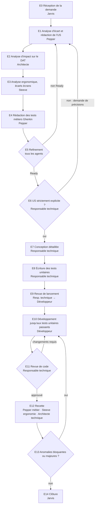

# Workflow de traitement d'une demande

> Version 1 — 2026-10-20. Jarvis lit ce fichier avant toute coordination et l'applique strictement.

## Vue d'ensemble

Toute boucle est soumise à la **règle anti-boucle** (voir plus bas).

## Étapes

### E0 — Réception de la demande (Jarvis)
- Enregistre la demande sous un identifiant `DEM-xxx` dans `docs/suivi-projet.md`.
- La transmet telle quelle à Pepper, sans l'interpréter.

### E1 — Analyse d'écart et rédaction de l'US (Pepper)
- Analyse l'écart entre la demande, le cahier des charges et l'existant (US déjà rédigées, fonctionnalités livrées).
- Met à jour le cahier des charges si la demande le fait évoluer (nouvelles règles de gestion, périmètre).
- Rédige l'US `US-xxx` (statut **En analyse**). Les questions ouvertes remontent au commanditaire via Jarvis.

### E2 — Analyse d'impact architecture (Architecte)
- Renseigne la section « Impacts architecture » de l'US : composants touchés, données, intégration Google Calendar, sécurité, exigences non fonctionnelles.
- Prépare si nécessaire les évolutions du DAT et les ADR, au statut « Proposé » tant que l'US n'est pas Ready.

### E3 — Analyse ergonomique (Steeve)
- Renseigne la section « Impacts ergonomie » de l'US : écrans créés ou modifiés, parcours impactés, nouveaux composants.
- Crée ou met à jour les maquettes `ECR-xxx` correspondantes.

### E4 — Rédaction des tests métiers (Pepper)
- Rédige `tests/features/US-xxx-<titre>.feature` en Gherkin (Cucumber), en français (`# language: fr`).
- Couvre chaque critère d'acceptation, les cas limites et les cas d'erreur. Chaque scénario porte les tags `@US-xxx` et `@RG-xxx`.

### E5 — Refinement (Jarvis, tous les agents)
- Jarvis soumet en parallèle le dossier de l'US (US, impacts, maquettes, fichier `.feature`) à Pepper, Steeve, l'architecte, le responsable technique et le développeur.
- Chaque agent rend un avis **Ready / Non Ready** au regard de la *Definition of Ready*, avec des remarques précises.
- Jarvis consolide les avis dans `docs/ceremonies/refinement-US-xxx.md`. Les remarques sont traitées par l'agent propriétaire du livrable concerné, puis un nouveau tour de refinement a lieu.
- Quand tous les avis sont Ready, l'US passe au statut **Prête**.

### E6 — Contrôle d'explicitation (Responsable technique)
- Vérifie que l'US est **strictement explicite** : aucune interprétation n'est nécessaire pour concevoir et tester.
- Si ce n'est pas le cas : demande de précisions numérotée (`Q-US-xxx-n`) transmise à Pepper via Jarvis, puis nouveau contrôle.

### E7 — Conception détaillée (Responsable technique)
- Rédige `docs/04-specification-technique/ST-US-xxx.md`. Ce document doit suffire au développeur, sans autre interprétation :
  - composants, fichiers à créer ou modifier ;
  - interfaces et signatures ;
  - modèle de données et migrations ;
  - gestion des erreurs ;
  - patterns imposés ;
  - *step definitions* Cucumber à implémenter ;
  - ordre de réalisation ;
  - liste des tests unitaires fournis.
- Met à jour le statut de l'US : **En conception**.

### E8 — Écriture des tests unitaires (Responsable technique)
- Écrit les tests unitaires automatisés qui valident l'évolution. Ils doivent s'exécuter et **échouer** (phase rouge du TDD).
- Ces tests font foi : le développeur ne les modifie pas sans l'accord du responsable technique.

### E9 — Revue de lancement (Responsable technique → Développeur, animée par Jarvis)
- Le responsable technique présente l'US, la conception détaillée et les tests.
- Le développeur reformule le travail à produire et pose ses questions ; le responsable technique y répond.
- Compte rendu dans `docs/ceremonies/lancement-US-xxx.md`. L'US passe au statut **En développement**.

### E10 — Développement (Développeur)
- Implémente l'évolution et les *step definitions* Cucumber.
- Itère jusqu'à ce que tous les tests unitaires de l'évolution soient passants, sans régression, avec le lint et l'analyse statique au vert.
- Peut ajouter des tests complémentaires, mais ne supprime ni n'affaiblit aucun test existant.

### E11 — Revue de code (Responsable technique)
- Contrôle :
  - la maintenabilité ;
  - le respect des normes de développement et de la spécification technique ;
  - le niveau de qualité ;
  - la sécurité (OWASP, gestion des jetons Google, données personnelles) ;
  - la dette introduite.
- Verdict **Approuvé** ou **Changements requis**, avec des remarques `RC-US-xxx-n` localisées (`fichier:ligne`).
- En cas de changements requis : retour en E10, puis nouvelle revue limitée aux remarques ouvertes.

### E12 — Recette (en parallèle)
| Agent | Type de tests | Référentiel |
|---|---|---|
| Pepper | Tests métiers : exécution des scénarios Cucumber, contrôles complémentaires | US, cahier des charges |
| Steeve | Tests d'ergonomie : conformité aux maquettes et au guide d'ergonomie, accessibilité, états vides, chargement, erreur et hors ligne | Guide d'ergonomie, maquettes |
| Architecte | Tests techniques : conformité au DAT, sécurité, performance, robustesse de la synchronisation Google Calendar | DAT, ADR |

Chaque agent produit son PV dans `docs/01-specification-fonctionnelle/recette/PV-US-xxx-<type>.md`.

### E13 — Traitement des anomalies
- Chaque anomalie est tracée dans `docs/anomalies.md` (`ANO-xxx`) par l'agent qui la détecte, avec sa gravité.
- **Bloquante** ou **majeure** : correction obligatoire (retour en E10, puis E11), puis nouveau test du périmètre concerné par l'agent qui l'a détectée.
- **Mineure** ou **cosmétique** : conservée au registre, sans correction dans le cadre de l'US. Sa planification est décidée par le commanditaire.

### E14 — Clôture (Jarvis)
- Vérifie que les livrables sont à jour : cahier des charges, DAT et ADR passés au statut « Accepté », guide d'ergonomie, guide utilisateur (mis à jour par Steeve), registre de dette.
- Passe l'US au statut **Terminée** et adresse un bilan au commanditaire.

## Gravité des anomalies
| Gravité | Définition |
|---|---|
| Bloquante | Fonctionnalité principale inutilisable, perte ou corruption de données (tâches, événements Google), faille de sécurité |
| Majeure | Critère d'acceptation non respecté ou fonctionnalité dégradée sans contournement simple |
| Mineure | Défaut avec contournement simple, sans impact sur les données |
| Cosmétique | Défaut visuel ou rédactionnel sans impact fonctionnel |

La gravité est proposée par l'agent qui détecte l'anomalie. Une contestation de gravité est un échange soumis à la règle anti-boucle.

## Règle anti-boucle et arbitrage
- Un **échange** est un aller-retour entre deux agents sur un même sujet : une question `Q-…`, une remarque de revue `RC-…`, une anomalie `ANO-…` ou une remarque de refinement.
- Jarvis tient un compteur par sujet dans le journal des échanges de `docs/suivi-projet.md`.
- **Au maximum 2 itérations par sujet.** Si le même problème est soulevé une troisième fois, ou si un refinement n'aboutit pas après 2 tours, Jarvis **interrompt la boucle** et demande un arbitrage au commanditaire.
- Pour l'arbitrage, Jarvis rédige une fiche `docs/ceremonies/arbitrage-xxx.md` contenant :
  - le sujet ;
  - l'historique des échanges ;
  - la position de chaque agent ;
  - les options possibles ;
  - sa recommandation.
- La décision du commanditaire est consignée dans la section « Décisions » du suivi. Elle s'impose à tous les agents et ne peut plus être rediscutée.

## Definition of Ready (E5)
- [ ] L'US respecte le gabarit, sans aucune question ouverte.
- [ ] Les règles de gestion sont référencées et le cahier des charges est à jour.
- [ ] Les critères d'acceptation sont testables, cas limites et cas d'erreur compris.
- [ ] Les impacts architecture sont renseignés, et les évolutions du DAT ou les ADR sont proposés si nécessaire.
- [ ] Les impacts ergonomie sont renseignés et les maquettes sont à jour.
- [ ] Le fichier `.feature` couvre tous les critères d'acceptation.
- [ ] L'US est de taille raisonnable ; sinon, elle est découpée.

## Definition of Done (E14)
- [ ] Tous les tests unitaires et Cucumber sont passants, sans régression.
- [ ] La revue de code est approuvée.
- [ ] Les PV de recette (métier, ergonomie, technique) sont favorables et aucune anomalie bloquante ou majeure n'est ouverte.
- [ ] La documentation est à jour (cahier des charges, DAT, guides, spécification technique, registre de dette).

## Statuts d'une US
En analyse → Prête → En conception → En développement → En revue → En recette → Terminée (ou En arbitrage, à toute étape)

## Points de validation du commanditaire
- Réponses aux questions ouvertes de Pepper (E1).
- Arbitrages (règle anti-boucle).
- Planification des anomalies mineures et cosmétiques.
- *À compléter.*
