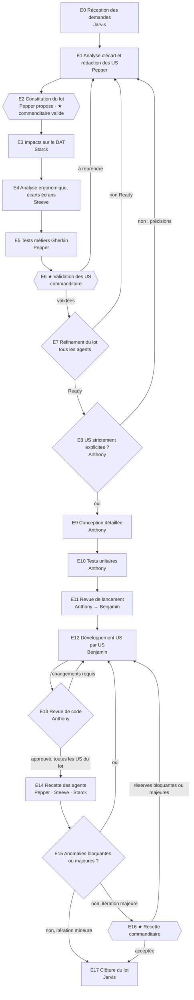

# Workflow de traitement des demandes

> Version 2 — 2026-10-20. Jarvis lit ce fichier avant toute coordination et l'applique strictement.

## Acteurs
| Acteur | Rôle |
|---|---|
| Commanditaire | L'utilisateur : émet les demandes, valide les lots et les US, recette les itérations majeures, arbitre |
| Jarvis | Orchestrateur |
| Pepper | Business analyste |
| Steeve | Expert UX/UI |
| Starck | Architecte logiciel |
| Anthony | Responsable technique |
| Benjamin | Développeur |

## Principe : le travail est organisé en lots
Les US sont regroupées en **lots**, chacun correspondant à une itération. Un lot réunit des US dont le regroupement est pertinent :
- cohérence fonctionnelle (même parcours ou même domaine métier) ;
- dépendances entre US ;
- écrans communs ;
- impacts d'architecture communs ;
- taille maîtrisable.

Chaque lot est qualifié selon sa **typologie** :
- **Itération majeure** : livre un incrément fonctionnel significatif pour l'utilisateur final. Exemples : nouvelle fonctionnalité ou nouveau parcours, évolution de la synchronisation Google Calendar, impact d'architecture structurant. Elle se termine par une **recette du commanditaire**.
- **Itération mineure** : corrections, ajustements, améliorations localisées. Les PV de recette des agents suffisent.

C'est le commanditaire qui valide la typologie de chaque lot.

## Vue d'ensemble

★ = point de validation du commanditaire. Toute boucle entre agents est soumise à la **règle anti-boucle** (voir plus bas).

## Étapes

### E0 — Réception des demandes (Jarvis)
- Enregistre chaque demande sous un identifiant `DEM-xxx` dans `docs/suivi-projet.md`.
- La transmet telle quelle à Pepper, sans l'interpréter.

### E1 — Analyse d'écart et rédaction des US (Pepper)
- Analyse l'écart entre la demande, le cahier des charges et l'existant (US déjà rédigées, fonctionnalités livrées).
- Met à jour le cahier des charges si nécessaire.
- Découpe la demande en une ou plusieurs US `US-xxx` (statut **En analyse**).
- Les questions ouvertes remontent au commanditaire via Jarvis.

### E2 — Constitution du lot (Pepper propose, ★ le commanditaire valide)
- À partir des US en attente, Pepper propose un regroupement dans `docs/lots/LOT-xxx.md` :
  - objectif du lot ;
  - US incluses et justification du regroupement ;
  - dépendances ;
  - typologie proposée (majeure ou mineure).
- Starck est consulté si les dépendances techniques influencent le regroupement.
- Le commanditaire valide la composition et la typologie du lot.
- Plusieurs lots peuvent coexister, mais **un seul lot est en développement (E12–E13) à la fois**.

### E3 — Analyse d'impact architecture (Starck)
- Pour chaque US du lot, renseigne la section « Impacts architecture » : composants touchés, données, intégration Google Calendar, sécurité, exigences non fonctionnelles.
- Fait une synthèse des impacts au niveau du lot dans `LOT-xxx.md`.
- Prépare les évolutions du DAT et les ADR au statut « Proposé ».

### E4 — Analyse ergonomique (Steeve)
- Pour chaque US, renseigne la section « Impacts ergonomie » : écrans créés ou modifiés, parcours impactés, nouveaux composants.
- Veille à la cohérence des écrans à l'échelle du lot.
- Crée ou met à jour les maquettes `ECR-xxx`.

### E5 — Rédaction des tests métiers (Pepper)
- Rédige `tests/features/US-xxx-<titre>.feature` en Gherkin (Cucumber), en français (`# language: fr`).
- Couvre chaque critère d'acceptation, les cas limites et les cas d'erreur.
- Chaque scénario porte les tags `@US-xxx`, `@RG-xxx` et `@LOT-xxx`.

### E6 — ★ Validation des US par le commanditaire
- Jarvis présente au commanditaire une synthèse de chaque US du lot :
  - le besoin ;
  - les règles de gestion ;
  - les critères d'acceptation ;
  - les impacts architecture et ergonomie ;
  - les maquettes ;
  - les scénarios de test.
- Verdict par US :
  - **Validée** : l'US passe au statut **Validée** ;
  - **À reprendre** : retour en E1 avec les remarques du commanditaire, puis mise à jour de E3 à E5 si elles sont impactées, et nouvelle soumission ;
  - **Retirée du lot**.

### E7 — Refinement du lot (Jarvis, tous les agents)
- Jarvis soumet en parallèle le dossier du lot à Pepper, Steeve, Starck, Anthony et Benjamin. Le dossier comprend les US, les impacts, les maquettes et les fichiers `.feature`.
- Chaque agent rend un avis **Ready / Non Ready** par US, au regard de la *Definition of Ready* et de la cohérence entre les US du lot.
- Jarvis consolide les avis dans `docs/ceremonies/refinement-LOT-xxx.md`. Chaque remarque est traitée par l'agent propriétaire du livrable, puis un nouveau tour a lieu.
- Les US Ready passent au statut **Prête**.

### E8 — Contrôle d'explicitation (Anthony)
- Vérifie que chaque US est **strictement explicite** : aucune interprétation n'est nécessaire pour concevoir et tester.
- Sinon, émet des demandes de précisions numérotées `Q-US-xxx-n`, transmises à Pepper via Jarvis.
- Si une précision modifie le périmètre ou une règle de gestion, Pepper le signale et l'US repasse en validation du commanditaire (E6).

### E9 — Conception détaillée (Anthony)
- Rédige `docs/04-specification-technique/ST-US-xxx.md`. Ce document doit suffire à Benjamin, sans interprétation :
  - composants, fichiers à créer ou modifier ;
  - interfaces et signatures ;
  - modèle de données et migrations ;
  - gestion des erreurs ;
  - patterns imposés ;
  - *step definitions* Cucumber à implémenter ;
  - liste des tests unitaires fournis.
- Définit l'**ordre de réalisation des US du lot** dans `LOT-xxx.md`.
- Statut : **En conception**.

### E10 — Écriture des tests unitaires (Anthony)
- Écrit les tests unitaires automatisés qui valident chaque évolution. Ils s'exécutent et **échouent** (phase rouge du TDD).
- Ces tests font foi : Benjamin ne les modifie pas sans l'accord d'Anthony.

### E11 — Revue de lancement du lot (Anthony → Benjamin, animée par Jarvis)
- Anthony présente le lot, l'ordre de réalisation, la conception détaillée et les tests.
- Benjamin reformule le travail à produire et pose ses questions ; Anthony y répond.
- Compte rendu dans `docs/ceremonies/lancement-LOT-xxx.md`. Statut : **En développement**.

### E12 — Développement (Benjamin)
- Traite les US une par une, dans l'ordre défini par Anthony.
- Pour chaque US : implémente l'évolution et les *step definitions*, puis itère jusqu'à ce que tous les tests unitaires de l'évolution soient passants, sans régression, avec le lint et l'analyse statique au vert.
- Peut ajouter des tests, mais ne supprime ni n'affaiblit aucun test existant.

### E13 — Revue de code (Anthony), pour chaque US
- Contrôle :
  - la maintenabilité ;
  - le respect des normes de développement et de la spécification technique ;
  - le niveau de qualité ;
  - la sécurité (OWASP, jetons Google, données personnelles) ;
  - la dette introduite.
- Verdict **Approuvé** ou **Changements requis**, avec des remarques `RC-US-xxx-n` localisées (`fichier:ligne`).
- En cas de changements requis : retour en E12, puis nouvelle revue limitée aux remarques ouvertes.
- Statut une fois approuvée : **En recette**.

### E14 — Recette des agents (en parallèle, une fois toutes les US du lot approuvées)
| Agent | Type de tests | Référentiel |
|---|---|---|
| Pepper | Tests métiers : exécution des scénarios Cucumber du lot, contrôles complémentaires, non-régression | US, cahier des charges |
| Steeve | Tests d'ergonomie : conformité aux maquettes et au guide, accessibilité, états vides, chargement, erreur et hors ligne | Guide d'ergonomie, maquettes |
| Starck | Tests techniques : conformité au DAT, sécurité, performance, robustesse de la synchronisation Google Calendar | DAT, ADR |

Chaque agent produit son PV `docs/01-specification-fonctionnelle/recette/PV-LOT-xxx-<metier|ergonomie|technique>.md`.

### E15 — Traitement des anomalies
- Chaque anomalie est tracée dans `docs/anomalies.md` (`ANO-xxx`) par l'agent qui la détecte, avec sa gravité.
- **Bloquante** ou **majeure** : correction obligatoire (E12 puis E13), puis nouveau test du périmètre concerné par l'agent qui l'a détectée.
- **Mineure** ou **cosmétique** : conservée au registre, sans correction dans le lot. Sa planification est décidée par le commanditaire.

### E16 — ★ Recette du commanditaire (itérations majeures uniquement)
- Pepper prépare `docs/01-specification-fonctionnelle/recette/cahier-recette-LOT-xxx.md`, qui contient :
  - le mode opératoire pour lancer l'application ;
  - les parcours à dérouler pas à pas ;
  - les résultats attendus ;
  - la synthèse des PV des agents ;
  - les anomalies ouvertes.
- Le commanditaire rend un verdict :
  - **Acceptée** ;
  - **Acceptée avec réserves** : les réserves sont tracées en anomalies ;
  - **Refusée**.
- Les réserves bloquantes ou majeures repartent en E12. Le commanditaire refait ensuite la recette du périmètre concerné.

### E17 — Clôture du lot (Jarvis)
- Vérifie que les livrables sont à jour :
  - cahier des charges ;
  - DAT et ADR au statut « Accepté » ;
  - guide d'ergonomie et guide utilisateur (mis à jour par Steeve) ;
  - registre de dette ;
  - registre des anomalies.
- Passe les US du lot au statut **Terminée** et le lot au statut **Clôturé**.
- Adresse un bilan au commanditaire, qui comprend les anomalies mineures en attente de planification.

## Gravité des anomalies
| Gravité | Définition |
|---|---|
| Bloquante | Fonctionnalité principale inutilisable, perte ou corruption de données (tâches, événements Google), faille de sécurité |
| Majeure | Critère d'acceptation non respecté ou fonctionnalité dégradée sans contournement simple |
| Mineure | Défaut avec contournement simple, sans impact sur les données |
| Cosmétique | Défaut visuel ou rédactionnel sans impact fonctionnel |

La gravité est proposée par l'agent qui détecte l'anomalie. Une contestation de gravité est un échange soumis à la règle anti-boucle.

## Règle anti-boucle et arbitrage
- Un **échange** est un aller-retour entre deux agents sur un même sujet : une question `Q-…`, une remarque de revue `RC-…`, une anomalie `ANO-…` ou une remarque de refinement.
- Jarvis tient un compteur par sujet dans le journal des échanges de `docs/suivi-projet.md`.
- **Au maximum 2 itérations par sujet.** Si le même problème est soulevé une troisième fois, ou si un refinement n'aboutit pas après 2 tours, Jarvis **interrompt la boucle** et demande un arbitrage au commanditaire.
- Pour l'arbitrage, Jarvis rédige une fiche `docs/ceremonies/arbitrage-xxx.md` contenant :
  - le sujet ;
  - l'historique des échanges ;
  - la position de chaque agent ;
  - les options possibles ;
  - sa recommandation.
- La décision du commanditaire est consignée dans la section « Décisions » du suivi. Elle s'impose à tous les agents et ne peut plus être rediscutée.

## Definition of Ready (E7)
- [ ] L'US a été validée par le commanditaire (E6) et ne comporte aucune question ouverte.
- [ ] Les règles de gestion sont référencées et le cahier des charges est à jour.
- [ ] Les critères d'acceptation sont testables, cas limites et cas d'erreur compris.
- [ ] Les impacts architecture sont renseignés, et les évolutions du DAT ou les ADR sont proposés si nécessaire.
- [ ] Les impacts ergonomie sont renseignés et les maquettes sont à jour.
- [ ] Le fichier `.feature` couvre tous les critères d'acceptation.
- [ ] L'US est cohérente avec les autres US du lot et de taille raisonnable ; sinon, elle est découpée.

## Definition of Done (E17)
- [ ] Tous les tests unitaires et Cucumber sont passants, sans régression.
- [ ] La revue de code de chaque US est approuvée.
- [ ] Les PV de recette des agents sont favorables et aucune anomalie bloquante ou majeure n'est ouverte.
- [ ] Pour une itération majeure, la recette du commanditaire est acceptée.
- [ ] La documentation est à jour.

## Statuts
- **US** : En analyse → Validée → Prête → En conception → En développement → En revue → En recette → Terminée (ou En arbitrage, à toute étape)
- **Lot** : Proposé → Validé → En préparation (E3–E7) → En réalisation (E8–E13) → En recette (E14–E16) → Clôturé

## Points de validation du commanditaire
| Moment | Objet |
|---|---|
| E1 | Réponses aux questions ouvertes de Pepper |
| E2 | Composition et typologie du lot |
| E6 | Validation de chaque US avant le refinement |
| E16 | Recette des itérations majeures |
| À tout moment | Arbitrages (règle anti-boucle) |
| E17 | Planification des anomalies mineures et cosmétiques |
